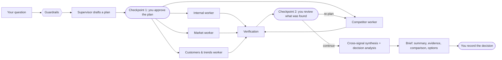

<p align="center">
  
</p>

<h3 align="center">إدراك · Evidence first. Decisions yours.</h3>

<p align="center">
An agentic decision-intelligence platform. Four specialist AI workers research your company, your
competitors, your markets and your customers; verification checks what they found; you approve the
plan, review the evidence and record the decision.
</p>

---

## What it does

Edrak answers business questions such as *"How does our pricing compare with Fawry?"*, *"What does
entering Saudi Arabia look like for us?"* or *"Is there a case for launching an AI support product?"*

| Use case | What you get |
|---|---|
| Competitive intelligence | What competitors offer, charge and announce, compared with you |
| Market entry and expansion | Demand, regulation, local players and sentiment in a market |
| Product launch | Whether the problem exists, how competitors serve it, and whether demand is rising |

Every claim in a brief cites its sources (E-numbers). Gaps are always shown. Options are never ranked:
**Edrak informs decisions; people make them.**

## How a run works



- **Internal worker**: retrieval over your uploaded documents (RAG on ChromaDB).
- **Competitor worker**: finds competitors automatically when none are named, confirms their official
  websites and social accounts, researches them in at most three bounded stages from relevant sources
  only, and compares them with you.
- **Market worker**: news, open data and regulation for your markets.
- **Customers & trends worker**: Google search interest through Apify, social conversation, reviews,
  and posts and replies on your and your competitors' official X, Instagram and Facebook accounts.
- **Verification**: grades every finding's evidence and proposes targeted re-plans.
- **Two human checkpoints**: nothing runs before you approve the plan, and the run pauses after
  verification until you decide to continue, re-plan (with tasks you can edit) or stop. A paused run
  survives a server restart.
- **Guardrails** on questions (prompt injection, harmful or off-topic requests, personal data),
  documents (instruction-like or hidden text is kept out of search), web content and briefs (uncited
  claims, numbers missing from sources, verdict language).
- **Evaluation** after each run: citation coverage, groundedness, evidence quality, source diversity,
  and a model-judged sample of faithfulness and answer relevance.

## Product

Sign in, step-by-step company onboarding, Home, New analysis (chat or guided form), Plan review, Live
run, the four-card Brief (full screen, download as PDF, Word or Markdown), Reports with run
comparison, Monitors (scheduled runs) and Alerts, Watchlist, Evidence explorer, Decision log, Data
sources with an in-app file viewer, Notifications, Ask Edrak, Settings. English and Arabic (RTL).

## The brief: typed numbers, options and an action plan

Every number on the brief comes from a stored, typed metric linked to its evidence. The language model picks components and writes headlines; it never writes or computes a figure.

- **Metric registry** (`backend/src/edrak/metrics/registry.yaml`) lists each metric: definition, unit, owner agent, preferred source types and how it is drawn. **Use-case templates** (`templates.yaml`) choose the KPI strip, the required figures and the section order, so the same data under another use case reads differently.
- **Planner and workers.** Each worker receives a checklist of figures to find. After it reports, code checks the checklist (found, retry once, or gap with a reason: not found, not publicly disclosed, only a third-party source, too little data). A figure that must come from the company itself is not met by a third party's page.
- **After the agents.** Extract (the model points at the exact words, code parses the value) → reconcile (the number must be in its saved source; different values from different sources become a conflict with a range) → derive (deltas computed in code, with their formula) → propose (headlines with `{m:uid}` tokens, no digits) → fill (values from the table, with chart checks and gap cards).
- **Dashboard.** KPI strip, coverage and gaps, signals, lens sections, a card drawer (evidence, verifier note, why this visual, table toggle, version history) and an executive / analyst / PM view that changes order and density only.
- **Options and the action plan.** Decision analysis produces two or three genuinely different options with their own opportunities and risks. Choosing one drafts an editable action plan: workstreams, owners, timeline and dependencies, decision gates, KPIs (baselines read from the stored metrics), a risk register and opportunities. You edit it, then approve it; approving records the decision. Every save is a new version.
- **Chat.** Ask Edrak answers about a brief or one card from a hybrid (keyword + vector) index, reads exact numbers from the metrics table, and labels each answer: from the brief, from the web (unverified), or not covered. A number it cannot find in the table or cited evidence is removed. "Challenge this" sends new text back through extraction and verification and creates a new card version; the old one is kept.

## Technology

| Layer | Tools |
|---|---|
| Frontend | React 19, TypeScript, Vite, React Router, Vitest |
| API | FastAPI, Uvicorn, Server-Sent Events |
| Agents | LangGraph (workers, orchestration, checkpoints), LangChain |
| Model | Ollama Cloud (`gpt-oss:120b`) |
| Data | SQLite (v0.2 schema), ChromaDB, sentence-transformers / ONNX MiniLM embeddings |
| Research sources | Tavily, Serper, Apify (Google Trends, X, Instagram, Facebook, TikTok, YouTube, Reddit, app stores), SocialCrawl, YouTube Data API, GDELT, NewsAPI, open-data APIs |
| Documents | pypdf, python-docx, openpyxl, trafilatura |
| Exports | Playwright (PDF), python-docx (Word), Markdown |
| Security | argon2 password hashing, hashed server-side sessions |
| Tooling | MCP servers for shared tools, pytest, ruff |

## Getting started

Requirements: Python 3.11+, Node 20+.

```bash
# backend
python -m venv .venv && source .venv/bin/activate
pip install -r requirements.txt
playwright install chromium          # for PDF export
cp .env.example .env                 # then fill in the keys below

PYTHONPATH=backend/src uvicorn edrak.main:app --port 8000

# frontend (another terminal)
cd frontend && npm install && npm run dev     # http://localhost:5173
```

The database (`data/edrak.db`) is created on first start. A database from the earlier MVP layout is
migrated automatically; the original is kept as `data/edrak.v1.bak.db`.

### Environment variables

Names only; see `.env.example` for all of them.

| Variable | Used for |
|---|---|
| `OLLAMA_API_KEY` | The language model |
| `TAVILY_API_KEY`, `SERPER_API_KEY` | Web search (competitor and market workers) |
| `APIFY_TOKEN` | Trends and social sources (customers & trends worker) |
| `SOCIALCRAWL_API_KEY`, `YOUTUBE_API_KEY` | Further social sources |
| `NEWS_API_KEY`, `FRED_API_KEY`, ... | Market data sources |
| `EDRAK_DB_PATH` | Optional: another database file |
| `EDRAK_ENV` | `production` turns on secure cookies |

## Development

```bash
pytest                                  # backend tests
.venv/bin/python scripts/run_evals.py   # guardrail evaluation set
cd frontend && npm test && npm run build
```

## Repository

```
backend/src/edrak/
  agents/          the four workers (LangGraph)
  orchestration/   Supervisor graph, planner, routing, review checkpoint
  verification/    evidence grading and control decisions
  CrossSignal/, DecisionAnalysis/   synthesis
  guardrails/      question, document, content and brief guardrails
  evaluation/      per-run and per-document quality scores
  knowledge/       document extraction and indexing
  monitoring/      monitor scheduler, change detection, alerts
  db/              schema.sql (v0.2), repositories, v1 migration
  api/             FastAPI routers, run manager, brief builder
  exports/         PDF, Word and Markdown
frontend/src/      React app
mcp_servers/       shared MCP tool servers
backend/evals/     evaluation cases
```
