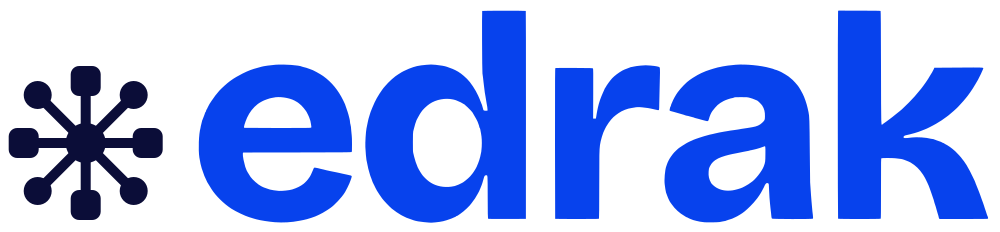
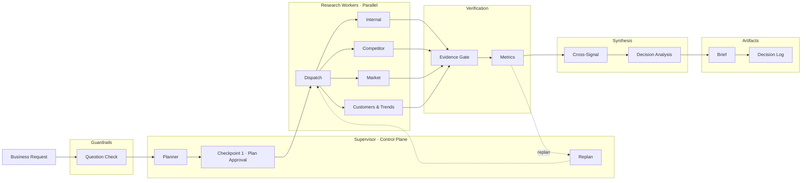
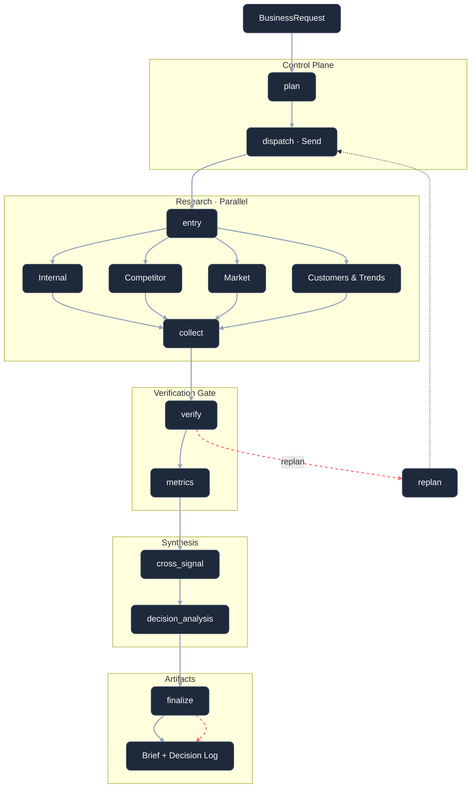

<div align="center">

# EDRAK | ادراك



**Evidence first. Decisions yours.**

An agentic decision-intelligence platform. Four specialist AI workers research your company, your
competitors, your markets and your customers; verification checks what they found; you approve the
plan, review the evidence and record the decision.

<br>


</div>

<!-- Add a screenshots strip here when captures are ready. -->

---

## What it does

Edrak answers business questions such as *"How does our pricing compare with Fawry?"*, *"What does
entering Saudi Arabia look like for us?"* or *"Is there a case for launching an AI support product?"*

| Use case | What you get |
|---|---|
| Competitive intelligence | What competitors offer, charge and announce, compared with you |
| Market entry and expansion | Demand, regulation, local players and sentiment in a market |
| Product launch | Whether the problem exists, how competitors serve it, and whether demand is rising |

Every claim in a brief cites its sources (E-numbers). Gaps are always shown. Options are never ranked:
**Edrak informs decisions; people make them.**

## How a run works

Every run follows the same path: a control plane plans it, four workers research it in parallel,
a gate grades it, and a person approves the plan.



**The Supervisor is a control plane, not a researcher.** It plans, dispatches, routes and records. It
never reads a finding, and it never decides. Domain research belongs to four workers, each a
LangGraph state machine that takes the same `ResearchTask` and returns the same `WorkerResult`.

**Verification is a stage, not a step.** Nothing reaches synthesis until a separate gate has graded
every finding against its saved sources. A run can pass while individual findings stay insufficient —
those become recorded gaps, never silent omissions.

- **Internal worker**: retrieval over your uploaded documents (RAG on ChromaDB).
- **Competitor worker**: finds competitors automatically when none are named, confirms their official
  websites and social accounts, researches them in at most three bounded stages from relevant sources
  only, and compares them with you.
- **Market worker**: news, open data and regulation for your markets.
- **Customers & trends worker**: Google search interest through Apify, social conversation, reviews,
  and posts and replies on your and your competitors' official X, Instagram and Facebook accounts.
- **Verification**: grades every finding's evidence and proposes targeted re-plans.
- **Human checkpoint**: nothing runs before you approve the plan. A paused run
  survives a server restart.
- **Guardrails** on questions (prompt injection, harmful or off-topic requests, personal data),
  documents (instruction-like or hidden text is kept out of search), web content and briefs (uncited
  claims, numbers missing from sources, verdict language).
- **Evaluation** after each run: citation coverage, groundedness, evidence quality, source diversity,
  and a model-judged sample of faithfulness and answer relevance.

## Product

Sign in, step-by-step company onboarding, Home, New analysis (chat or guided form), Plan review, Live
run, the four-card Brief (full screen, download as PDF, Word or Markdown), Reports with run
comparison, Monitors (scheduled runs) and Alerts, Watchlist, Evidence explorer, Decision log, Data
sources with an in-app file viewer, Notifications, Ask Edrak, Settings. English and Arabic (RTL).

## The brief: typed numbers, options and an action plan

Every number on the brief comes from a stored, typed metric linked to its evidence. The language model picks components and writes headlines; it never writes or computes a figure.

- **Metric registry** (`backend/src/edrak/metrics/registry.yaml`) lists each metric: definition, unit, owner agent, preferred source types and how it is drawn. **Use-case templates** (`templates.yaml`) choose the KPI strip, the required figures and the section order, so the same data under another use case reads differently.
- **Planner and workers.** Each worker receives a checklist of figures to find. After it reports, code checks the checklist (found, retry once, or gap with a reason: not found, not publicly disclosed, only a third-party source, too little data). A figure that must come from the company itself is not met by a third party's page.
- **After the agents.** Extract (the model points at the exact words, code parses the value) → reconcile (the number must be in its saved source; different values from different sources become a conflict with a range) → derive (deltas computed in code, with their formula) → propose (headlines with `{m:uid}` tokens, no digits) → fill (values from the table, with chart checks and gap cards).
- **Dashboard.** KPI strip, coverage and gaps, signals, lens sections, a card drawer (evidence, verifier note, why this visual, table toggle, version history) and an executive / analyst / PM view that changes order and density only.
- **Options and the action plan.** Decision analysis produces two or three genuinely different options with their own opportunities and risks. Choosing one drafts an editable action plan: workstreams, owners, timeline and dependencies, decision gates, KPIs (baselines read from the stored metrics), a risk register and opportunities. You edit it, then approve it; approving records the decision. Every save is a new version.
- **Chat.** Ask Edrak answers about a brief or one card from a hybrid (keyword + vector) index, reads exact numbers from the metrics table, and labels each answer: from the brief, from the web (unverified), or not covered. A number it cannot find in the table or cited evidence is removed. "Challenge this" sends new text back through extraction and verification and creates a new card version; the old one is kept.

## Architecture

The same run, unrolled into the nodes the Supervisor actually executes.



Three properties worth calling out, because they are unusual:

- **The four workers run in parallel**, and their results merge through a reducer keyed on `task_id`.
  A retried task *replaces* its earlier attempt instead of appending, so downstream stages always see
  exactly one result per task.
- **A re-plan re-runs only the worker that contradicted.** The plan itself is left intact, so results
  from the workers that were not re-run stay attributable to the plan.
- **Metrics sits between verification and synthesis**, not before it — that is what lets conflicts
  surface before synthesis runs.

Plan approval is a real LangGraph interrupt, not a UI affordance. The run genuinely stops and the
state is checkpointed, so a paused run survives a server restart.

**The contracts are the architecture.** Every cross-component type lives in
`backend/src/edrak/contracts/`, and most of the interesting code there is validation that makes bad
states unrepresentable — a worker cannot return a finding citing an `evidence_id` it did not also
supply; a run cannot report `completed` while a worker failed; one source cannot both support and
contradict the same finding. These are `model_validator`s, so violations fail at the boundary instead
of surfacing later inside verification.

## Guardrails

Six surfaces, checked continuously. Most are deterministic — fast, explainable, and independent of
whether a model is available.

| Surface | What it does |
|---|---|
| **Questions** | Five ordered checks, cheapest first: length → prompt injection → harmful intent → scope → personal data. Injection and harmful requests are **blocked**; personal data is **redacted** so it never reaches a search provider. |
| **Uploaded documents** | Scanned chunk by chunk. Instruction-like text and invisible characters are **excluded from retrieval** entirely. Personal data is **flagged but kept searchable** — internal documents legitimately hold customer records. A document is quarantined when more than 30% of it is excluded. |
| **Web content** | Retrieved text is treated as data, never instructions. Offending lines are stripped and the remainder is wrapped in `<untrusted_source>` delimiters the prompt explicitly tells the model not to obey. |
| **Briefs** | Every finding must cite evidence. Every number in a finding must appear in the evidence it cites. **Verdict language is removed**, and `rank` / `recommended` keys are deleted from options unconditionally — not merely discouraged in a prompt. |
| **Chat answers** | Every number must equal a stored metric value or appear in cited evidence, or it becomes `(figure removed)`. Answers are labelled *from the brief*, *from the web (unverified)*, or *not covered*. |
| **Action plans** | Everything a person types is checked like any other input. Injection or personal data blocks the save rather than being silently sanitised. |

Prompt-injection detection carries English **and Arabic** patterns, plus a check for invisible
zero-width and bidirectional characters used to hide instructions inside otherwise normal text.
Personal-data detection covers email, card numbers (Luhn-validated), IBANs, phone numbers and
national IDs.

The model is consulted in exactly one place — the scope check — and it **fails open**: if the model is
unavailable the question is allowed and the deterministic checks above still apply.


## Tech stack

### Core

| | |
|---|---|
|    | **Frontend** — React 19, TypeScript 5.9, Vite 7, React Router, Vitest |
|   | **API** — FastAPI, Uvicorn, Server-Sent Events for streaming |
|   | **Agents** — LangGraph for every worker, the Supervisor and both checkpoints; LangChain for model access |
|  | **Model** — Ollama Cloud, `gpt-oss:120b`, via the native `ChatOllama` client. No OpenAI dependency. |
|   | **Data** — SQLite (async, `aiosqlite`) for application state, ChromaDB for internal retrieval, MiniLM embeddings via sentence-transformers or ONNX |

### Research sources

| | |
|---|---|
|   | **Web search** — Tavily with Serper as fallback, for the competitor and market workers |
|  | **Social and trends** — Google Trends, X, Instagram, Facebook, TikTok, YouTube, Reddit and the app stores |
|   | **Other** — GDELT news, YouTube Data API, SocialCrawl, NewsAPI and open-data APIs |

Providers are declared in YAML with an explicit capability map and cost-ordered routing — cheapest
first for the same quality of result — so adding or reordering one is a configuration change, not a
code change.

### Documents, exports, security and tooling

| | |
|---|---|
|    | **Documents** — PDF, Word, Excel and web-page extraction |
|  | **Exports** — PDF via Playwright, Word via `python-docx`, plain Markdown |
|  | **Security** — argon2 password hashing, hashed server-side sessions |
|    | **Tooling** — MCP servers for shared tools, pytest for tests, ruff for lint |

## Getting started

Requirements: Python 3.11+, Node 20+.

```bash
# backend
python -m venv .venv && source .venv/bin/activate
pip install -r requirements.txt
playwright install chromium          # for PDF export
cp .env.example .env                 # then fill in the keys below

PYTHONPATH=backend/src uvicorn edrak.main:app --port 8000

# frontend (another terminal)
cd frontend && npm install && npm run dev     # http://localhost:5173
```

The database (`data/edrak.db`) is created on first start. A database from the earlier MVP layout is
migrated automatically; the original is kept as `data/edrak.v1.bak.db`.

### Environment variables

Names only; see `.env.example` for all of them.

| Variable | Used for |
|---|---|
| `OLLAMA_API_KEY` | The language model |
| `TAVILY_API_KEY`, `SERPER_API_KEY` | Web search (competitor and market workers) |
| `APIFY_TOKEN` | Trends and social sources (customers & trends worker) |
| `SOCIALCRAWL_API_KEY`, `YOUTUBE_API_KEY` | Further social sources |
| `NEWS_API_KEY`, `FRED_API_KEY`, ... | Market data sources |
| `EDRAK_DB_PATH` | Optional: another database file |
| `EDRAK_ENV` | `production` turns on secure cookies |

## Development

```bash
pytest                                  # backend tests
.venv/bin/python scripts/run_evals.py   # guardrail evaluation set
cd frontend && npm test && npm run build
```

## Documentation

`README.md` is the public overview. The team keeps deeper material locally — architecture notes,
contract specifications, per-agent design documents and runbooks — which is not published in this
repository.

## Repository layout

```text
backend/src/edrak/
  orchestration/   Supervisor graph, planner, routing, review checkpoints
  agents/          the four domain workers + the metrics agent (LangGraph)
  verification/    evidence grading and control decisions
  CrossSignal/     cross-agent synthesis
  DecisionAnalysis/ decision questions to structured options
  guardrails/      question, document, content, brief, chat and plan guardrails
  contracts/       every shared type, with the validators that police them
  evaluation/      per-run and per-document quality scores
  knowledge/       document extraction and indexing
  monitoring/      monitor scheduler, change detection, alerts
  db/              schema.sql (v0.2), repositories, v1 migration
  api/             FastAPI routers, run manager, brief builder
  exports/         PDF, Word and Markdown
  metrics/         metric registry, use-case templates, typed numbers
frontend/src/      React app
mcp_servers/       shared MCP tool servers
backend/evals/     evaluation cases
scripts/           pipeline, verification, evaluation and health-check entry points
tests/             19 test modules
```
