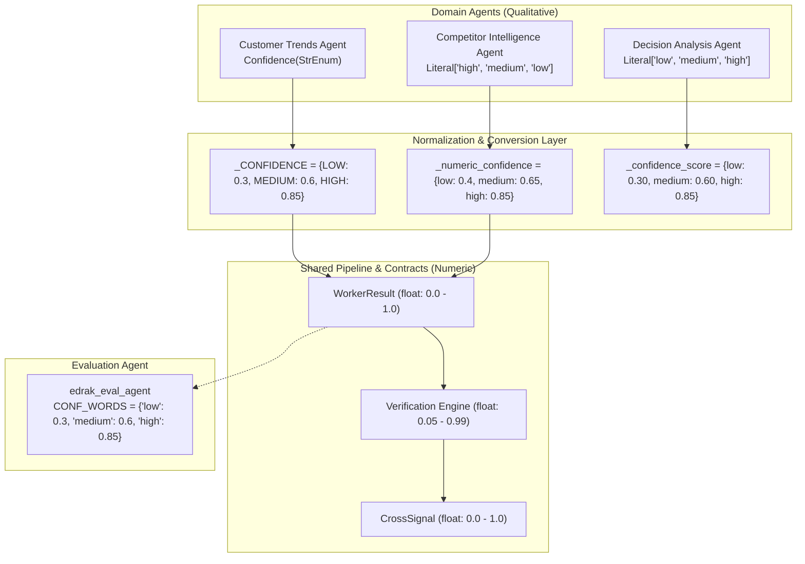

# EDRAK Confidence Scoring System: Qualitative & Quantitative Deep Dive

This document details how confidence scores—specifically qualitative ratings (**`"low"`**, **`"medium"`**, and **`"high"`**)—are structured, computed, validated, and converted across the EDRAK codebase.

---

## 1. Architecture Overview: Dual Representation

EDRAK uses a **hybrid confidence architecture**:

1. **Qualitative Levels (`"low"`, `"medium"`, `"high"`)**: Used within domain-specific agents (e.g., Customer Trends, Competitor Intelligence, Decision Analysis) and LLM-facing prompts where descriptive certainty levels prevent false precision.
2. **Numeric Scores (`0.0` to `1.0`)**: Used across global contracts ([WorkerResult](file:///d:/Courses/NTI%20-%20Agentic%20AI/Technical/Final%20project/Final/EDRAK/backend/src/edrak/contracts/result.py#L125), [CrossSignalOutput](file:///d:/Courses/NTI%20-%20Agentic%20AI/Technical/Final%20project/Final/EDRAK/backend/src/edrak/contracts/CrossSignal.py#L246), [Verification](file:///d:/Courses/NTI%20-%20Agentic%20AI/Technical/Final%20project/Final/EDRAK/backend/src/edrak/contracts/verification.py#L96)) for mathematical comparison, filtering, calibration, and cross-signal ranking.



---

## 2. Agent-by-Agent Implementations

### A. Customer Trends Agent (`customer_trends`)

The Customer Trends agent has the most formal enum-driven implementation of `"low"`, `"medium"`, and `"high"`.

#### 1. Enum Definition
*File:* [common.py](file:///d:/Courses/NTI%20-%20Agentic%20AI/Technical/Final%20project/Final/EDRAK/backend/src/edrak/agents/customer_trends/schemas/common.py#L57-L61)
```python
class Confidence(StrEnum):
    LOW = "low"
    MEDIUM = "medium"
    HIGH = "high"
```

#### 2. Deterministic Rule Function: `overall_confidence()`
*File:* [assembly.py](file:///d:/Courses/NTI%20-%20Agentic%20AI/Technical/Final%20project/Final/EDRAK/backend/src/edrak/agents/customer_trends/assembly.py#L123-L134)
```python
def overall_confidence(findings: Iterable[Finding], gaps: Iterable[Gap]) -> Confidence:
    """High when at least half the findings are high and no critical gap remains,
    medium when at least half are medium or better, else low (and low without findings)."""
    levels = [finding.confidence for finding in findings]
    if not levels:
        return Confidence.LOW
    high = sum(level is Confidence.HIGH for level in levels) / len(levels)
    medium_up = sum(level is not Confidence.LOW for level in levels) / len(levels)
    if high >= _HIGH_SHARE and not critical_gaps(gaps):
        return Confidence.HIGH
    return Confidence.MEDIUM if medium_up >= _HIGH_SHARE else Confidence.LOW
```

#### 3. Single-Source Degradation Rule
*File:* [findings.py](file:///d:/Courses/NTI%20-%20Agentic%20AI/Technical/Final%20project/Final/EDRAK/backend/src/edrak/agents/customer_trends/schemas/findings.py#L115-L127)
```python
@model_validator(mode="after")
def _apply_single_source_rule(self) -> Self:
    """Distinct ids only; fewer than two forces low confidence and a caveat."""
    self.evidence_ids = list(dict.fromkeys(self.evidence_ids))
    if len(self.evidence_ids) < 2:
        self.confidence = Confidence.LOW
        if SINGLE_SOURCE_CAVEAT not in self.caveats:
            self.caveats = [*self.caveats, SINGLE_SOURCE_CAVEAT]
    return self
```

#### 4. Evidence Volume Thresholds
*File:* [submit_findings.py](file:///d:/Courses/NTI%20-%20Agentic%20AI/Technical/Final%20project/Final/EDRAK/backend/src/edrak/agents/customer_trends/tools/submit_findings.py#L215-L238)
- A finding claiming `Confidence.HIGH` requires at least **10 distinct evidence IDs** across at least **2 separate platforms / source types**.
- If this criterion is not met, the validator downgrades the confidence to `Confidence.MEDIUM` and attaches a shortfall caveat.

---

### B. Decision Analysis Agent (`DecisionAnalysis`)

The Decision Analysis module generates strategic recommendations for business questions, rating recommendation strength qualitatively.

#### 1. Contract Definition
*File:* [DecisionAnalysis.py](file:///d:/Courses/NTI%20-%20Agentic%20AI/Technical/Final%20project/Final/EDRAK/backend/src/edrak/contracts/DecisionAnalysis.py#L105-L107)
```python
class RecommendationDetails(ContractModel):
    ...
    confidence: Literal["low", "medium", "high"] = Field(
        description="Confidence based on the strength and completeness of evidence."
    )
    impact: Literal["low", "medium", "high", "unknown"] = Field(
        default="unknown",
        description="How much the business outcome changes. Never derived from confidence."
    )
    feasibility: Literal["low", "medium", "high", "unknown"] = Field(
        default="unknown",
        description="How achievable this is. Never derived from confidence."
    )
```

> [!IMPORTANT]
> EDRAK enforces a strict boundary between `confidence`, `impact`, and `feasibility`:
> - **Confidence**: Strength of the supporting evidence.
> - **Impact**: Extent of expected business outcome change.
> - **Feasibility**: Internal organizational capability to execute.
> 
> *A high-impact decision can have low confidence, and a high-confidence finding can have low impact.*

#### 2. Normalization & Fallbacks
*File:* [nodes.py](file:///d:/Courses/NTI%20-%20Agentic%20AI/Technical/Final%20project/Final/EDRAK/backend/src/edrak/DecisionAnalysis/nodes.py#L318-L336)
```python
def _confidence_value(value: Any) -> str:
    """Normalize confidence to supported string values."""
    if hasattr(value, "value"):
        value = value.value
    confidence = str(value).lower().strip()
    return confidence if confidence in {"low", "medium", "high"} else "low"

def _confidence_score(confidence: str) -> float:
    """Convert qualitative confidence to a numeric assessment score."""
    return {
        "high": 0.85,
        "medium": 0.60,
        "low": 0.30,
    }[confidence]
```
If an LLM produces a recommendation without valid supporting Cross-Signal IDs, EDRAK automatically sets `confidence = "low"` ([nodes.py:L624](file:///d:/Courses/NTI%20-%20Agentic%20AI/Technical/Final%20project/Final/EDRAK/backend/src/edrak/DecisionAnalysis/nodes.py#L624)).

---

### C. Competitor Intelligence Agent (`competitor_intelligence`)

Used when comparing target companies against market competitors on key dimensions.

#### 1. Schema Definition
*File:* [state.py](file:///d:/Courses/NTI%20-%20Agentic%20AI/Technical/Final%20project/Final/EDRAK/backend/src/edrak/agents/competitor_intelligence/state.py#L121-L132)
```python
class CompetitorAssessment(BaseModel):
    competitor: str
    summary: str
    relative_to_target: Literal[
        "broader", "comparable", "narrower", "different_approach", "not_established"
    ]
    confidence: Literal["high", "medium", "low"]
    requirement_ids: List[str]
```

#### 2. Evidence Ceiling Rule
*File:* [nodes.py](file:///d:/Courses/NTI%20-%20Agentic%20AI/Technical/Final%20project/Final/EDRAK/backend/src/edrak/agents/competitor_intelligence/nodes.py#L2976-L3023)
- If cited requirements have no verified evidence, `relative_to_target` becomes `"not_established"` and `confidence` defaults to `"low"`.
- A comparison cannot have higher confidence than its underlying evidence:
  $$\text{Confidence}_{\text{final}} = \min(\text{Confidence}_{\text{LLM}}, \min(\text{Confidence}_{\text{evidence}}))$$

---

## 3. The Evaluation Agent Bridge (`edrak_eval_agent`)

In the evaluation subsystem ([edrak_eval_agent.py](file:///d:/Courses/NTI%20-%20Agentic%20AI/Technical/Final%20project/Final/EDRAK/evaluation/evaluation_Agent/edrak_eval_agent.py#L61-L224)), the evaluator explicitly maps qualitative word scores to numeric values so that all agents can be scored and benchmarked on a unified scale:

```python
CONF_WORDS = {
    "low": 0.3,
    "medium": 0.6,
    "high": 0.85,
}  # some agents report confidence as a word

def conf_num(v: Any) -> float | None:
    """Numeric confidence; words (low/medium/high) are mapped so every agent can be compared."""
    if is_num(v):
        return float(v)
    return CONF_WORDS.get(str(v).strip().lower())
```

---

## 4. Summary Conversion Matrix

| Component | Input Type | Low | Medium | High |
| :--- | :--- | :---: | :---: | :---: |
| **`customer_trends`** | `Confidence` enum | `0.30` | `0.60` | `0.85` |
| **`DecisionAnalysis`** | `Literal["low", "medium", "high"]` | `0.30` | `0.60` | `0.85` |
| **`competitor_intelligence`** | `Literal["high", "medium", "low"]` | `0.35` – `0.40` | `0.65` | `0.85` |
| **`edrak_eval_agent`** | Evaluator Normalizer | `0.30` | `0.60` | `0.85` |

---

## 5. Related Categorical Enums in the Pipeline

Be mindful not to confuse qualitative confidence with these adjacent categorical ratings:

1. **`EvidenceQuality`** ([verification.py](file:///d:/Courses/NTI%20-%20Agentic%20AI/Technical/Final%20project/Final/EDRAK/backend/src/edrak/contracts/verification.py#L27-L30)):
   - `HIGH = "high"`
   - `MEDIUM = "medium"`
   - `LOW = "low"`
   *(Reflects provenance strength: official primary docs vs. third-party blogs).*

2. **`Urgency`** ([CrossSignal.py](file:///d:/Courses/NTI%20-%20Agentic%20AI/Technical/Final%20project/Final/EDRAK/backend/src/edrak/contracts/CrossSignal.py#L176-L187)):
   - `IMMEDIATE = "immediate"`, `HIGH = "high"`, `MEDIUM = "medium"`, `LOW = "low"`, `UNKNOWN = "unknown"`.

3. **`PriorityBand`** ([DecisionAnalysis.py](file:///d:/Courses/NTI%20-%20Agentic%20AI/Technical/Final%20project/Final/EDRAK/backend/src/edrak/contracts/DecisionAnalysis.py#L27-L32)):
   - `CRITICAL`, `HIGH`, `MEDIUM`, `LOW`, `UNDETERMINED`.
