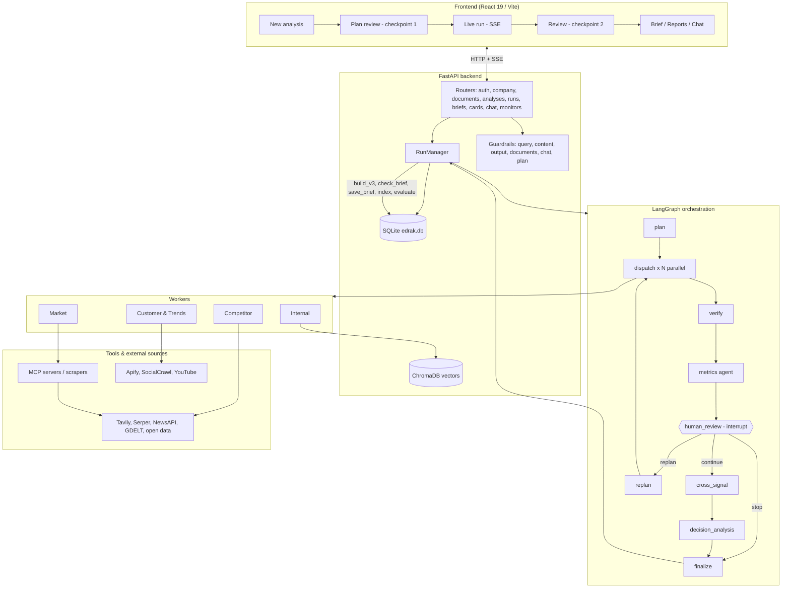
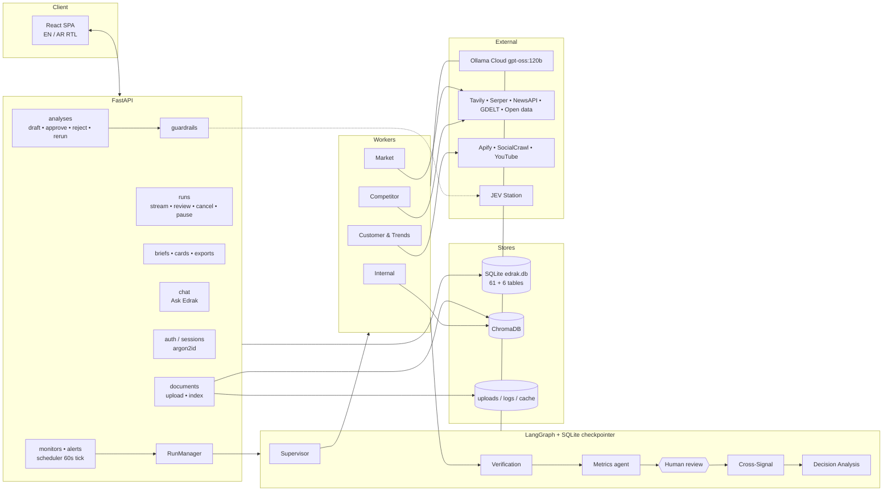
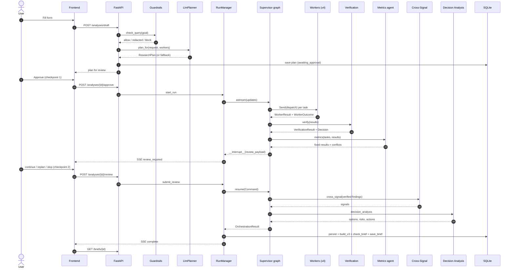
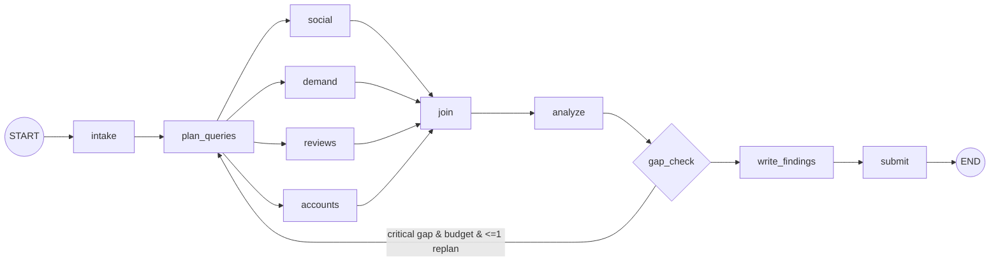
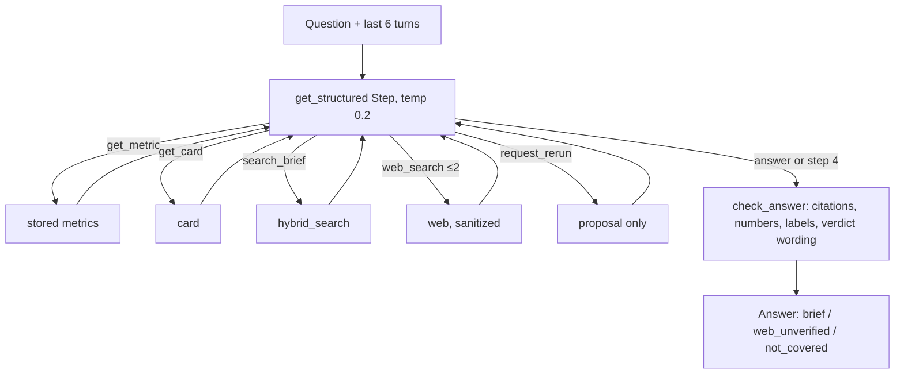

# EDRAK — Full Project Documentation

> **Edrak** is a multi-agent decision-intelligence platform. A strategy lead asks a business question; a bounded **Supervisor** plans the research, four specialist **workers** collect evidence in parallel, an independent **verification** stage grades every claim, a **metrics agent** extracts typed figures, a person reviews at a checkpoint, and **cross-signal** and **decision-analysis** agents turn verified findings into a four-card decision brief with cited evidence.

**How to read this document.** Everything below is derived from the repository source (`backend/src/edrak`, `tests/`, `scripts/`, `frontend/`, `mcp_servers/`) and the project notes in `documents/`. Where the project notes and the code disagree, **the code is described** and the difference is called out with the marker **⚠ Discrepancy**. Where something was not measured in this repository (latency, token counts, spend), the document says so instead of inventing numbers. Worked examples in Chapter 4.12, Chapter 11 and the appendices are **illustrative reconstructions** built from the code paths and the synthetic GitLab pilot data; they are *not* captured logs of a live run, and values in `⟨angle brackets⟩` are placeholders.

---

# Table of Contents

**1. Introduction and System Overview**
- 1.1 Edrak Project Overview
- 1.2 Agent-Based Architecture
- 1.3 Agent Responsibilities and Interactions
- 1.4 High-Level Architecture Diagram

**2. End-to-End Execution Lifecycle**
- 2.1 User Request and Input Processing
- 2.2 Company Context and Goal Integration
- 2.3 Task Planning and Agent Dispatching
- 2.4 Inter-Agent Communication and Data Flow
- 2.5 Final Report Generation and Delivery

**3. Shared Data Models and Contracts**
- 3.1 Input and Output Schemas
- 3.2 Data Validation and Structured Outputs
- 3.3 Shared State and Execution Context
- 3.4 Data Persistence and Storage
- 3.5 Error Propagation Between Components

**4. Agent-Level Technical Deep Dive**
- 4.1 Agent Purpose and Responsibilities
- 4.2 Code Structure and Entry Points
- 4.3 Initialization and Configuration
- 4.4 Input Processing and Context Construction
- 4.5 Planning and Decision-Making Logic
- 4.6 Prompt Engineering and LLM Integration
- 4.7 Tool Selection and Execution
- 4.8 Step-by-Step Execution Flow
- 4.9 Output Generation and Validation
- 4.10 Error Handling and Fallback Mechanisms
- 4.11 Testing and Evaluation
- 4.12 Worked Execution Trace

**5. Orchestrator and Agent Coordination**
- 5.1 Orchestrator Responsibilities and Implementation
- 5.2 Task Decomposition and Routing
- 5.3 Dependency Management and Execution Order
- 5.4 Parallel and Sequential Execution
- 5.5 State Management and Result Aggregation
- 5.6 Failure Recovery and Partial Execution

**6. Research Agents and Tool Integration**
- 6.1 Research Agent Architecture
- 6.2 Domain-Specific Research Logic
- 6.3 Tool Registry and Tool Catalog
- 6.4 External APIs, Search, and Web Scraping
- 6.5 Tool Arguments and Result Processing
- 6.6 Retries, Timeouts, and Rate Limits
- 6.7 Deterministic Data Collection vs. LLM Interpretation

**7. Evidence, Verification, and Evaluation**
- 7.1 Claim and Evidence Representation
- 7.2 Source Attribution and Provenance
- 7.3 Verification Agent Workflow
- 7.4 Evaluation Agent Workflow
- 7.5 Evaluation Criteria and Metrics
- 7.6 Conflicting Evidence and Unsupported Claims
- 7.7 Limitations of Verification and Evaluation

**8. Synthesis and Final Output Generation**
- 8.1 Collecting Results from Multiple Agents
- 8.2 Cross-Agent Reasoning and Information Integration
- 8.3 Handling Conflicts, Gaps, and Uncertainty
- 8.4 Report Structure and Output Formatting
- 8.5 Returning Results to the User Interface

**9. LLM Reliability, Guardrails, and Security**
- 9.1 Prompt Construction and Context Management
- 9.2 Input and Output Validation
- 9.3 Structured Output Parsing and Validation Failures
- 9.4 Prompt Injection and Untrusted External Content
- 9.5 Hallucination Risks and Unsupported Conclusions
- 9.6 Human-in-the-Loop Review and Approval

**10. Observability, Performance, and Cost**
- 10.1 Logging and Execution Tracing
- 10.2 Error Reporting and Debugging
- 10.3 Agent-Level and End-to-End Latency
- 10.4 Token Usage and LLM Costs
- 10.5 External API Costs and Resource Consumption
- 10.6 Performance Bottlenecks and Optimization

**11. End-to-End Case Study**
- 11.1 Use Case and Input Definition
- 11.2 Initial State and Task Plan
- 11.3 Agent-by-Agent Execution Trace
- 11.4 Tool Calls and Intermediate Results
- 11.5 Evidence Verification and Evaluation
- 11.6 Final Synthesis and Output
- 11.7 Failure Scenarios and Alternative Execution Paths

**12. Testing, Limitations, and Failure Analysis**
- 12.1 Unit and Integration Tests
- 12.2 Mocked vs. Real Integrations
- 12.3 Edge Cases and Failure Scenarios
- 12.4 Known Limitations and Reliability Issues
- 12.5 Implemented Features vs. Planned Improvements

**13. Technical Decisions and Trade-Offs**
- 13.1 Multi-Agent Architecture vs. Single-Agent Design
- 13.2 Model and Framework Selection
- 13.3 Tool and API Selection
- 13.4 Sequential vs. Parallel Execution
- 13.5 Reliability, Latency, and Cost Trade-Offs
- 13.6 Potential Architectural Improvements

**14. Technical Review and Team-Lead Questions**
- 14.1 Architecture and Design Questions
- 14.2 Agent Execution and Coordination Questions
- 14.3 LLM, Prompting, and Tool-Calling Questions
- 14.4 Verification, Evaluation, and Accuracy Questions
- 14.5 Debugging and Failure-Handling Questions
- 14.6 Performance and Cost Questions
- 14.7 Sample Answers with Code References

**15. Glossary and Code Reference Index**
- 15.1 Technical Terminology
- 15.2 Important Classes and Functions
- 15.3 Key Files and Modules
- 15.4 Configuration Variables and Environment Settings
- 15.5 Useful Commands for Running and Testing the System

**Appendices**
- A. System Architecture Diagram
- B. Agent Interaction and Sequence Diagrams
- C. Input and Output Schema Examples
- D. Sample Logs and Execution Traces
- E. Relevant Test Cases and Commands

---

# 1. Introduction and System Overview

## 1.1 Edrak Project Overview

**Purpose.** Edrak helps a strategy lead answer a business question — "How do we compare with competitor X on pricing?", "Should we enter market Y?", "Is there demand for offering Z?" — with a brief in which **every claim is cited, every number is traceable to a stored source, and the final decision stays with the person**. The platform recommends *directions*, never a single "winner"; verdict language and ranking are actively stripped from outputs (Chapter 9).

**Supported use cases** (`contracts/vocabulary.py → UseCase`):

| `use_case` value | Question it answers | Lead lens (from `metrics/templates.yaml`) |
|---|---|---|
| `competitive_intelligence` | Where does the company stand against named competitors? | competitor_intelligence |
| `market_entry_expansion` | Is a market worth entering and under what conditions? | market_intelligence |
| `product_launch` | Do customers want this offering now and at what price room? | customer_trends |

**Pilot company.** The pilot is **GitLab** (competitors: GitHub, Atlassian, Azure DevOps). Internal data under `data/internal/**` and `data/profiles/**` is *synthetic or adapted* and must be flagged as such: a `SourceType.SYNTHETIC_INTERNAL` evidence item requires `is_synthetic=True` (enforced by a validator in `contracts/evidence.py`).

**Product surface** (web app, English and Arabic with RTL): onboarding and company profile; *New analysis* (guided form); *Plan review* (checkpoint 1); *Live run*; the four-card *Brief* with PDF / Word / Markdown export; Reports with comparison; Monitors and Alerts (scheduled re-runs with change detection); Watchlist; Evidence explorer; Decision log and Action plans; Data sources (document upload); Notifications; *Ask Edrak* (chat grounded in a brief); Settings.

**Technology stack**

| Layer | Technology |
|---|---|
| Backend API | Python 3.11+, FastAPI + Uvicorn, Server-Sent Events (SSE), `aiosqlite` (SQLite at `data/edrak.db`), pydantic v2, structlog, tenacity |
| Agent runtime | LangGraph (all workers, orchestrator, verification, metrics, cross-signal, decision analysis), `langgraph-checkpoint-sqlite`, LangChain |
| LLM | Ollama Cloud, model `gpt-oss:120b`, via native `langchain_ollama.ChatOllama` at `https://ollama.com` |
| Retrieval | ChromaDB (cosine HNSW) + `sentence-transformers/all-MiniLM-L6-v2` embeddings (384 dims) |
| Tools | MCP servers (`mcp<2`, FastMCP) + direct scraper imports, Tavily, Serper, NewsAPI, GDELT, Apify, SocialCrawl, YouTube Data API, and open-data APIs |
| Export | Playwright (PDF), python-docx (Word), Markdown |
| Security | argon2id passwords, hashed session tokens, `HttpOnly` cookies |
| Frontend | React 19, TypeScript 5.9, Vite 7, React Router 7, Vitest; `i18n/en.ts` + `i18n/ar.ts` |
| Tests/lint | pytest, pytest-asyncio, ruff |

## 1.2 Agent-Based Architecture

Edrak follows the rules in `documents/AGENTS.md`:

1. **A bounded Supervisor** (control plane only) plans, dispatches, routes and records. It never reads finding content.
2. **Workers are LangGraph graphs** with a shared contract: a `Worker` Protocol with a `worker_type` property and `run(task: ResearchTask) -> WorkerResult`.
3. **Verification is a distinct stage**, not something a worker grades for itself.
4. **Synthesis is separate from orchestration** — cross-signal and decision analysis are their own graphs.
5. **Shared tools via MCP** where practical.
6. **Separate deterministic logic from LLM reasoning**: the model proposes; code checks (numbers appear in sources, ids resolve, no verdict language).
7. **Do not add frameworks or agents without need.** The notes explicitly list things *not* to add yet: Kubernetes, Terraform, Celery, Redis, complex auth, multiple databases.

**Agents in the system**

| Agent / stage | Package | Kind |
|---|---|---|
| Supervisor / Orchestrator | `edrak/orchestration` | LangGraph control plane |
| Internal Intelligence worker | `edrak/agents/internal_intelligence` | Linear LangGraph (RAG over workspace documents + handbook) |
| Competitor Intelligence worker | `edrak/agents/competitor_intelligence` | Staged research loop (search → synthesize → ground → check) |
| Market Intelligence worker | `edrak/agents/market_intelligence` | Task planner + task executor loop |
| Customer & Trends worker | `edrak/agents/customer_trends` | Parallel tool-using branches + deterministic checks |
| Verification | `edrak/verification` | Two-node graph (assess → decide) |
| Metrics agent | `edrak/agents/metrics` | `grid → harvest → hunt* → finish` |
| Cross-Signal | `edrak/CrossSignal` | `prepare → detect_signals → collect_signals → summarize → assemble` |
| Decision Analysis | `edrak/DecisionAnalysis` | `prepare_context → analyze → options → validate_and_assemble` |
| Briefing / Chat / Action plan / Evaluation | `edrak/briefing`, `edrak/chat`, `edrak/action_plan`, `edrak/evaluation` | Post-run services (some LLM-assisted, mostly deterministic) |

## 1.3 Agent Responsibilities and Interactions

| Agent | Responsibility | Consumes | Produces |
|---|---|---|---|
| Supervisor | Approved plan → one task per worker, parallel dispatch, replan routing, final status | `BusinessRequest`, `ResearchPlan` | `OrchestrationResult` |
| Internal | Facts from the company's own documents | `ResearchTask` | `WorkerResult` |
| Competitor | Pricing, features, positioning of named/discovered competitors | `ResearchTask` | `WorkerResult` |
| Market | Market size, growth, regulation, news and open data | `ResearchTask` | `WorkerResult` |
| Customer & Trends | Social, reviews, search interest, official-account posts | `ResearchTask` | `WorkerResult` (+ trend series in `metadata`) |
| Verification | Grade each finding (verified / insufficient), confidence, contradictions, targeted actions | `VerificationInput` | `VerificationResult` (+`VerificationDecision`) |
| Metrics | Typed figures from evidence, gap reasons, requirement outcomes | `ResearchTask[]`, `WorkerResult[]` | fixed `WorkerResult[]` + conflict sentences |
| Human review | Continue / replan (edit tasks) / stop | review payload | decision |
| Cross-Signal | Patterns across verified findings (no recommendations) | `CrossSignalInput` | `CrossSignalOutput` |
| Decision Analysis | Opportunities, risks, priorities, 2–3 non-ranked options, actions | `DecisionAnalysisInput` | `DecisionAnalysisResult` |

**Interaction rule.** Agents never call each other directly. They communicate only through typed contracts held in the orchestration state (Chapter 3) and, after the run, through the database (Chapter 3.4).

## 1.4 High-Level Architecture Diagram



---

# 2. End-to-End Execution Lifecycle

**Stage map (what really runs, in order):**

```
draft (API) ─► approve (checkpoint 1, API gate) ─► start_run
   plan ─► dispatch (workers, parallel) ─► verify ─► metrics ─► human_review (checkpoint 2, interrupt)
        ├─ continue ─► cross_signal ─► decision_analysis ─► finalize
        ├─ replan   ─► (replan | edited tasks) ─► dispatch ─► verify ─► metrics ─► human_review …
        └─ stop     ─► finalize (partial)
   then, in RunManager (outside the graph):
        build_v3 ─► check_brief ─► save_brief ─► index_brief (chat) ─► notifications
        ─► schedule_evaluation (background) ─► after_monitor_run (diff vs previous run)
```

> **⚠ Discrepancy.** The README describes plan approval as a LangGraph interrupt. In code, **checkpoint 1** is an API/DB gate *before the graph starts*: `POST /api/analyses/{id}/approve` marks the plan approved, then `RunManager.start_run` launches the graph. The **only** graph interrupt is `human_review` (**checkpoint 2**), in `orchestration/review.py`.

## 2.1 User Request and Input Processing

The user fills a guided form (`AnalysisForm`, `api/schemas.py`): `use_case`, `goal`, `competitors[]`, `market`, `offering`, `target_customers`, `focus[]` (pricing, features, positioning, sentiment), `time_window_days`, `sources{internal_files, competitor_web, news_open_data, reviews_social}`, `repeat_weekly`.

`POST /api/analyses/draft` → `analyses.draft()`:

1. **Guardrail first** — `check_query(form.goal, use_model=settings.GUARDRAIL_SCOPE_CHECK, context=...)`. A blocked query raises HTTP 422 with `{code, message}` and a `guardrail_events` row; a *redacted* query (PII) continues with the redacted text.
2. If the analysis already exists it must be in `draft | awaiting_approval | planning`, else HTTP 409 `wrong_state`.
3. `allowed_source_types(form)` maps toggles to concrete `SourceType`s (`TOGGLE_TO_SOURCE_TYPES`).
4. `build_request(...)` assembles the contract `BusinessRequest` from the form + stored company profile.
5. For `competitive_intelligence` / `product_launch` with no named competitor and the competitor worker enabled, `discover_for(company, markets, offering)` runs **competitor discovery** (limit 4), upserts the discovered entities (flagged `discovered_by="agent"` with a reason and confidence) and rebuilds the request.
6. `plan_for(request, workers_for(source_types))` creates the plan (LLM planner with deterministic per-worker fallback); `estimate_minutes = 6 + 2·len(workers)` is a UI estimate only.
7. The request status becomes `awaiting_approval`.

## 2.2 Company Context and Goal Integration

`build_request` (`api/analysis_service.py`) merges:

- **`CompanyProfile`** — name, products, notes (loaded from `company_profiles`; a GitLab profile JSON such as `data/profiles/gitlab_profile.json` can be uploaded and is auto-detected).
- **`BusinessContext`** — `use_case`, `targets`, `competitors` (`CompetitorRef` with website + `SocialAccount`s), `markets`, `offering`, `target_customers`, `focus_areas`, `constraints`, `time_window_days`, `allowed_source_types`.
- **Goal** — the redacted/validated question; on a rejected plan the *rejection feedback* is appended so the next draft addresses it.
- **Workspace knowledge** — uploaded documents (indexed per workspace) are retrieved later by the Internal worker; `workspace_id` rides in `BusinessRequest.extras`.

The `Settings`-level pilot defaults and the synthetic internal corpus (`data/internal/…`) are used when no workspace documents exist (the public GitLab handbook is a second, lower-weight corpus).

## 2.3 Task Planning and Agent Dispatching

**Planning (`orchestration/planner.py`).** `LlmPlanner.plan(request)` asks the model for a `PlannerPlan` of `WorkerAssignment`s (using `PLANNER_SYSTEM_PROMPT`) and converts it into a validated `ResearchPlan`. The planner uses `json_mode` (see Chapter 12.4). The API path tolerates planner failure by falling back to a deterministic **one-task-per-enabled-worker** plan (`test_human_review.py` forces `LlmPlanner.plan` to raise and still gets a plan).

**Approval (checkpoint 1).** The plan is shown in *Plan review*. Approve → `analyses_repo.approve_plan` (atomic, only once) + audit entry `plan.approved` + `RunManager.start_run`. Reject → plan rejected, request back to `draft` with `rejection_reason`. Rerun → clone the form, draft a fresh plan; the old run is untouched.

**Dispatch.** In the graph, `plan_node` **reuses an approved plan** carried in the run input (`if state.get("plan") is not None: return state`) — planning again would run different workers than those approved. `route_from_plan` emits one `Send("dispatch", {"task": t})` per task, so workers run **concurrently**. `ConcurrentWorkerDispatchError` is raised if two tasks target the same worker in one dispatch.

## 2.4 Inter-Agent Communication and Data Flow

```
BusinessRequest ──► ResearchPlan ──► ResearchTask (1 per worker)
ResearchTask ──► Worker.run ──► WorkerResult {evidence[], findings[], conflicts[], metadata, status}
WorkerResult.to_outcome() ──► WorkerOutcome (control fields only) ──► Supervisor
WorkerResult[] ──► VerificationInput ──► VerificationResult {findings: FindingVerdict[], decision}
ResearchTask[] + WorkerResult[] ──► Metrics agent ──► WorkerResult[] with metadata["metrics"] + conflicts
VerifiedFindings ──► CrossSignalInput ──► CrossSignalOutput {signals[]}
VerifiedFindings + signals ──► DecisionAnalysisInput ──► DecisionAnalysisResult
all of the above ──► OrchestrationResult ──► briefing.build_v3 / brief_builder.build_brief ──► brief document
```

Two separation rules protect the control plane:

- The Supervisor reads **only `WorkerOutcome`** (status, counts, error). Findings pass through untouched (`finalize_node` still stores the full `results` for downstream stages).
- `dispatch_worker` receives **only its own payload** (`{"task": …}`), never the global state, so one task cannot read another's data.

## 2.5 Final Report Generation and Delivery

After `finalize_node` produces the `OrchestrationResult` (status `completed` or `partial`), `RunManager._execute_run` continues outside the graph:

1. Persist results, evidence, findings, conflicts, verification verdicts/actions, information gaps, metrics.
2. `briefing.build.build_v3` (typed cards, KPI strip, coverage, gaps panel, sections, signals view) and `brief_builder.build_brief` (document v2 content).
3. `guardrails.output.check_brief` (uncited claims, unsupported numbers, verdict language, card numbers must be stored metrics).
4. `save_brief`, `index_brief` (so *Ask Edrak* can search it), notifications.
5. `schedule_evaluation` (background; writes `run_evaluations`).
6. `monitoring.scheduler.after_monitor_run` for monitor-launched runs: diff against the previous run → `change_events` and `alerts`.

Delivery to the user is over **SSE** (`GET /api/analyses/{id}/run/stream`) for live progress and **REST** (`GET /api/briefs/{id}`) for the brief; export endpoints produce PDF (Playwright), Word (python-docx) or Markdown.

---

# 3. Shared Data Models and Contracts

All contracts live in `backend/src/edrak/contracts/` and are exported through `edrak.contracts`. `scripts/export_contract_schemas.py` exports JSON Schemas and the frontend's `types/contracts.ts` is generated from them (`npm run gen:types`). A test (`test_contracts_location.py`, per `HANDOFF.md`) guards against a duplicate root-level `contracts/` package.

## 3.1 Input and Output Schemas

| Contract | Key fields / rules |
|---|---|
| `ContractModel` (base) | `extra="forbid"` — unknown keys are rejected. `NonBlankStr`, `new_id()`, `utcnow()` helpers. |
| `BusinessRequest` | `request_id`, `goal`, `company_profile: CompanyProfile`, `business_context: BusinessContext`, `trigger`, `created_at`, `extras` |
| `CompanyProfile` | `name`, `products[]`, `notes` |
| `BusinessContext` | `use_case`, `targets[]`, `competitors: CompetitorRef[]`, `markets[]`, `offering`, `target_customers`, `focus_areas[]`, `constraints[]`, `time_window_days`, allowed source types |
| `ResearchPlan` | `request_id`, `tasks: ResearchTask[]`. *Validator:* every task's request id matches; task ids unique. |
| `ResearchTask` | `task_id`, `parent_request_id`, `worker: WorkerType`, `goal`, `focus`, `company_profile`, `business_context`, `requirements: MetricRequirement[]`, `attempt` |
| `Evidence` | `evidence_id`, `source_type`, `source_url`, `source_title`, `publisher`, `excerpt`, `extracted_fact`, `page_text` (≤ 20 000 chars), `is_synthetic`, timestamps |
| `EvidenceRef` | `evidence_id`, `relation` ∈ {supports, contradicts, contextualizes} |
| `Finding` | `finding_id`, `statement`, `evidence_refs[]`, `confidence`, … *Validator:* one source cannot both support and contradict. |
| `WorkerResult` | `task_id`, `worker`, `status` ∈ {COMPLETED, PARTIAL, NO_EVIDENCE, FAILED}, `attempt`, `evidence[]`, `findings[]`, `conflicts[]`, `metadata`, `error` |
| `WorkerOutcome` | control-only projection of a result (what the Supervisor may read) |
| `OrchestrationResult` | `request_id`, `status` ∈ {completed, partial, failed}, `plan`, `results[]`, `outcomes[]`, `verification`, `cross_signal`, `decision_analysis`, `error` |
| `VerificationInput/Result/Decision` | `VerificationStatus` ∈ {VERIFIED, REPLAN_REQUIRED, CANNOT_COMPLETE, …}; `FindingVerdict`; `TargetedAction`; `ControlSummary` |
| `CrossSignalInput/Output`, `CrossSignal` | signals with `signal_type` ∈ {convergence, dependency, timing, gap, momentum} |
| `DecisionAnalysisInput/Result`, `DecisionOption` | opportunities, risks, priorities, actions, options |
| Metrics contracts (`metrics/contracts.py`) | `MetricObservation`, `MetricRequirement`, `MetricScope`, `MetricStatus`, `GapReason` |

**Worker vocabulary.** `WorkerType` ∈ `internal_intelligence`, `competitor_intelligence`, `market_intelligence`, `customer_trends`.

## 3.2 Data Validation and Structured Outputs

**Cross-field validators** (these make invalid states unrepresentable):

| Model | Invariant |
|---|---|
| `ResearchPlan` | tasks match `request_id`; `task_id`s unique |
| `Finding` | a single source cannot be both `supports` and `contradicts` |
| `WorkerResult` | evidence/finding/conflict ids unique; every `evidence_ref` and conflict resolves to evidence in the same result; `FAILED` **requires** an error; `NO_EVIDENCE` **cannot** carry findings; a conflict cannot refute the finding's own support |
| `OrchestrationResult` | task ids unique; results covered by the plan; a `completed` run cannot contain a failed worker |
| `VerificationDecision` | `RETRY`/`REPLAN` require ≥ 1 targeted action; `VERIFIED`/`CANNOT_COMPLETE` require none |
| `CrossSignal` | at least 2 supporting findings |
| `Evidence` | `SYNTHETIC_INTERNAL` ⇒ `is_synthetic=True`; `page_text` truncated at 20 000 chars |

**Structured LLM output rule** (`core/llm.py::get_structured`): default `method="json_schema"` **and** the schema must also be restated in the prompt with `schema_instruction(schema)`. Measured on `gpt-oss:120b` (from `documents/` and in code docstrings):

| Schema | `function_calling` | `json_schema` + restated schema |
|---|---|---|
| Customer-trends schemas (120 calls) | 11 / 120 | **119 / 120** |
| Competitor `ResearchRequirements` (5 calls) | 0 / 5 | **4 / 5** |
| Cross-signal (5 calls) | 0 / 5 | **5 / 5** |

`DEFAULT_NUM_PREDICT = 16384`. The harness `customer_trends/llm/ab_structured_output.py` reproduces the comparison but **spends 80 real model calls**.

## 3.3 Shared State and Execution Context

`orchestration/state.py::OrchestrationState` (a `TypedDict`):

| Key | Meaning | Reducer |
|---|---|---|
| `request`, `plan` | the approved request and plan | replace |
| `replan_tasks` | tasks to dispatch on a replan | replace |
| `results` | all `WorkerResult`s | `merge_by_task_id` (a retried task replaces its earlier result; `RESET` sentinel clears) |
| `outcomes` | control projections | `merge_by_task_id` |
| `verification`, `verification_result` | decision + per-finding verdicts | replace |
| `cross_signal`, `decision_analysis` | downstream outputs | replace |
| `replan_count` | automatic + human replans so far | replace |
| `status`, `error`, `orchestration_result` | final bookkeeping | replace |
| `attempts_exceeded` | legacy | replace |
| `review_decision`, `review_note`, `human_tasks` | checkpoint 2 | replace |

**Checkpointing.** The graph is compiled with a SQLite checkpointer at `ORCHESTRATION_CHECKPOINT_PATH`; `interrupt()` in `human_review_node` therefore **survives a process restart** — verified by `test_a_review_resumes_after_a_restart_and_stop_writes_a_partial_brief`. The Customer & Trends worker keeps its own checkpoint DB `checkpoints.db` (`thread_id = run_id`).

**Per-run execution context in the API.** `RunManager` (singleton, `api/run_manager.py`) keeps in-memory run handles (`_runs`), persists live activity every 1.0 s (`_flush`), and bridges worker `log_action` lines to live "cards" via `action_log.subscribe`.

## 3.4 Data Persistence and Storage

**Primary store: SQLite** (`data/edrak.db`; WAL; `foreign_keys=ON`; `busy_timeout=5000`). `db/connection.py` creates the file from `schema.sql` (61 tables, `SCHEMA_VERSION = 2`, "v0.2") and always applies `schema_v3.sql` (6 more tables) plus idempotent `ALTER TABLE`s. A file in the old v1 layout (an `analyses` table) is migrated by `db/migrate_v1.py`, which first copies it to `data/edrak.v1.bak.db`; legacy SHA-256 password hashes are accepted once and re-hashed to argon2id on the next sign-in.

| Domain | Tables |
|---|---|
| Identity & settings | `users`, `workspaces`, `sessions`, `workspace_counters`, `workspace_settings`, `user_preferences`, `notification_preferences` |
| Entities & company | `entities`, `entity_links`, `company_profiles`, `company_markets`, `company_links`, `connectors` |
| Documents | `documents`, `document_chunks`, `external_source_policies`, `external_source_allowlist` |
| Monitoring | `monitors`, `monitor_entities`, `monitor_triggers` |
| Request & plan | `business_requests`, `analysis_questions`, `analysis_documents`, `research_plans`, `research_tasks` |
| Runs | `runs`, `run_events`, `run_reviews` |
| Results | `worker_results`, `evidence`, `findings`, `finding_evidence`, `conflicts`, `verification_results`, `verification_actions`, `finding_verdicts`, `information_gaps`, `annotations` |
| Timeline | `entity_timeline_events`, `entity_timeline_event_evidence`, `entity_metric_points` |
| Briefs & decisions | `briefs`, `brief_entities`, `brief_exports`, `brief_reviews`, `decisions`, `decision_next_steps` |
| Change detection | `evidence_snapshots`, `evidence_snapshot_items`, `change_events`, `change_event_evidence`, `alerts`, `alert_evidence`, `digests`, `notifications` |
| Chat | `chat_threads`, `chat_messages`, `chat_message_evidence` |
| Audit & quality | `audit_log`, `guardrail_events`, `run_evaluations` |
| **v3** (`schema_v3.sql`) | `metrics`, `metric_conflicts`, `requirement_outcomes`, `brief_cards`, `action_plans`, `card_challenges` |

**Other stores**

| Store | Location | Content |
|---|---|---|
| ChromaDB | `VECTOR_STORE_PATH` | Chunks from workspace documents (workspace-scoped) and the handbook |
| LangGraph checkpoints | `ORCHESTRATION_CHECKPOINT_PATH`; customer-trends `checkpoints.db` | Resumable graph state |
| Uploads | `UPLOADS_PATH/<workspace_id>/<document_id>.<ext>` | Original uploaded files |
| Action logs | `artifacts/logs/<agent>.log` | Per-agent log lines |
| Run artifacts | `artifacts/runs/*.json`, `artifacts/reports/` | CLI run output (git-ignored except `.gitkeep`) |
| Provider cache | `<data_dir>/cache/<sha256>.json` | Customer-trends provider results (TTL 86 400 s; errors never cached) |

## 3.5 Error Propagation Between Components

| Layer | Rule |
|---|---|
| **Worker → Supervisor** | `run_task` **never raises**. A missing worker, an invalid `WorkerResult`, or any exception becomes a `FAILED` `WorkerResult` for *that task only*, so one broken worker cannot discard the others' findings. |
| **Supervisor → status** | `finalize_node` sets `PARTIAL` if any worker failed, an error exists, or decision analysis failed after cross-signal ran. |
| **Verification** | `verification_gate_node` redirects stdout to `artifacts/logs/verification.log`; on exception it returns `CANNOT_COMPLETE` (not `REPLAN_REQUIRED`, which must name actions) and lets the human decide. |
| **Metrics** | Failure of the metrics stage is contained: extraction returns `[]` ("a gap, never a guess"). |
| **Cross-signal** | Builder rejects payloads with insufficient findings; the node keeps the verified subset; no verified finding ⇒ no cross-signal. |
| **Decision analysis** | Falls back to a conservative question-level recommendation if the model fails. |
| **API** | `HTTPException` with machine codes (`wrong_state`, guardrail codes); `fail_orphaned_runs` at startup marks runs that were `running` when the process died. |
| **Customer-trends branch** | A failed/timed-out branch becomes a **critical gap** (`branch_<name>`) and an SSE `gap_found` event rather than an exception. |

---

# 4. Agent-Level Technical Deep Dive

This chapter covers each agent along the same twelve headings (4.1–4.12). Where a heading applies identically to every agent, it is stated once.

## 4.1 Agent Purpose and Responsibilities

| Agent | Purpose in one sentence |
|---|---|
| **Supervisor** | Run the approved plan across workers in parallel and route on verification and human review, without ever interpreting findings. |
| **Internal** | Answer from the company's own documents (plus the public handbook, down-weighted). |
| **Competitor** | Build grounded competitor findings (pricing, features, positioning) through staged web research. |
| **Market** | Gather market facts (size, growth, regulation, news) with quote-backed claims. |
| **Customer & Trends** | Measure what customers say and search for, across social, reviews, trends and official accounts. |
| **Verification** | Independently decide which findings are supported, and what to re-check. |
| **Metrics** | Turn evidence into typed, source-checked figures; report precisely why a figure is missing. |
| **Cross-Signal** | Find patterns that only appear across lenses; never recommend. |
| **Decision Analysis** | Frame 2–3 distinct, unranked options with what would change the answer. |

## 4.2 Code Structure and Entry Points

| Agent | Entry point | Graph builder / nodes |
|---|---|---|
| Orchestrator | `orchestration/graph.py::build_graph` | `nodes.py`, `routing.py`, `review.py`, `state.py`, `planner.py`, `prompts.py`, `registry.py::get_default_registry` |
| Internal | `agents/internal_intelligence/…` (`InternalWorker.run`) | `plan_queries → retrieve_evidence → analyze_synthesize → format_result` |
| Competitor | `agents/competitor_intelligence/…` (`__main__.py`, worker wrapper) | `nodes.py`, `state.py`, `discovery.py` |
| Market | `agents/market_intelligence/…` | `nodes.py`, `state.py`, `source_tiers.py` |
| Customer & Trends | `agents/customer_trends/runner.py::run_worker` (sync wrapper over async; thread pool) | `graph.py`, `nodes.py`, `gaps.py`, `tools/*`, `providers/*`, `llm/client.py` |
| Verification | `verification/graph.py::run` | `nodes.py`, `quality.py`, `source_tiers` |
| Metrics | `agents/metrics/__init__.py::run` | `nodes.py`, `metrics/registry.yaml`, `metrics/templates.yaml`, `metrics/reconcile.py` |
| Cross-Signal | `CrossSignal/graph.py::run_cross_signal` | `nodes.py`, `state.py`, `contracts/CrossSignal.py` |
| Decision Analysis | `DecisionAnalysis/service.py` (`make_decision_analysis_node`) | `graph.py`, `nodes.py`, `options.py` |

**Worker registry.** `get_default_registry()` builds a `WorkerRegistry` mapping `WorkerType → Worker`. Each worker is registered inside its own `try/except`: a worker whose import fails only logs a warning; at run time `registry.get` raises `WorkerNotRegisteredError`, which `run_task` converts into a `FAILED` result.

## 4.3 Initialization and Configuration

`core/config.py::Settings` (pydantic-settings, `.env` at repo root) is constructed at import time. Highlights:

| Setting | Default / note |
|---|---|
| `OLLAMA_BASE_URL` / `OLLAMA_MODEL` | `https://ollama.com` / `gpt-oss:120b` |
| `OLLAMA_TEMPERATURE` | `0.2` |
| `MAX_REPLANS` | `1` (automatic replans; human replans are capped separately at `MAX_HUMAN_REPLANS = 3`) |
| `MAX_TASK_ATTEMPTS` | `3` (used only by the unwired `decide_after_verification`) |
| `RETRIEVAL_MIN_SCORE` | `0.30` |
| `INTERNAL_RERANK_*` | cutoff 0.58, max 12, min 5 (Chapter 6.2) |
| Embeddings | MiniLM-L6-v2, 384 dims, ONNX or fast-local fallback; `EMBEDDING_ALLOW_FALLBACK=False` |
| Paths | `VECTOR_STORE_PATH`, `INTERNAL_DATA_PATH`, handbook paths, `ARTIFACTS_PATH`, `UPLOADS_PATH`, `ORCHESTRATION_CHECKPOINT_PATH`, `EDRAK_DB_PATH` |
| Limits | `MAX_UPLOAD_MB=25`, `SCRAPE_TEXT_CHARS=2000`, `SESSION_DAYS=30` |
| Feature flags | `GUARDRAIL_SCOPE_CHECK`, `JEV_GUARD_ENABLED`, `EVALUATION_JUDGE`, `EDRAK_DEBUG` |

**Per-agent credentials** (`core/llm.py::provider_key(base, agent)`): resolves `<BASE>_<AGENT>` → `<BASE>_<AGENT>_BACKUP` → shared `<BASE>`. `AGENTS = (orchestrator, competitor, market, internal, cross_signal, customer_trends)`. **An agent never reads another agent's key**, so one agent's quota exhaustion cannot starve another. The same resolver serves Tavily (`TAVILY_API_KEY[_MARKET|_COMPETITOR]`) and Serper (`SERPER_API_KEY[_MARKET|_CUSTOMER_TRENDS]`).

**Auth to Ollama Cloud.** `ChatOllama` has no `api_key` field, so the key is passed as `client_kwargs={"headers": {"Authorization": "Bearer …"}}`.

The Customer & Trends worker has its own `Settings` (`customer_trends/settings.py`): `ollama_timeout_s=120`, `branch_max_steps=8`, `branch_timeout_s=100`, `edrak_cache_ttl_s=86400`, `edrak_fake_llm`, `youtube_daily_quota=10000`, `youtube_search_daily_cap=100`, optional LangSmith tracing (`langsmith_tracing=False`). Collection providers are routed by `config/providers.yaml`; `EDRAK_PROVIDER_MODE=fixture` and `EDRAK_FAKE_LLM` run it offline.

## 4.4 Input Processing and Context Construction

Each worker adapts the shared `ResearchTask` into its own working brief:

| Worker | Adaptation |
|---|---|
| Internal | goal + focus + company name → search queries; `workspace_id` from `request.extras` scopes retrieval |
| Competitor | `identify_requirements` turns the goal into ≤ 5 requirements per competitor (`MAX_REQUIREMENTS_PER_COMPETITOR`); competitors come from `business_context` or discovery |
| Market | `business_context` is rendered to text; a planner makes a `task_list` of `{id, description, tool_hint, status}` |
| Customer & Trends | `schemas/task.py::brief_from_task` → `TaskBrief` (`entity` = company, `question` = goal, `competitors`, `accounts` ≤ 9 official accounts on X/Instagram/Facebook, `focus` inferred from words, `geo` from markets/text, `since = today − time_window_days`, `budget`) |
| Verification | `VerificationInput(request, agent_outputs=results)` |
| Cross-Signal | `build_cross_signal_input(verified_only, request)` — accepts VERIFIED or REPLAN_REQUIRED status and **requires ≥ 1 verified finding** |
| Decision Analysis | cross-signal signals + verified findings + metric references |

## 4.5 Planning and Decision-Making Logic

| Agent | Planning / decision logic |
|---|---|
| Supervisor | Deterministic routing: `route_from_plan` (fan-out), `route_after_review` (continue → cross_signal, or `finalize` when verification is `CANNOT_COMPLETE` and nothing is verified; replan → `replan` or direct dispatch of human-edited tasks; stop → finalize). |
| Replan | `_targeted_tasks` re-tasks **only workers whose findings had contradictions**, keeping the original `task_id` so `merge_by_task_id` replaces exactly those results; falls back to a full replan when no worker can be targeted. |
| Competitor | Staged loop (`STAGE_STRATEGY`: 1 *discovery*, 2 *official_sources*, 3 *targeted_missing_requirements*). Continues only if the last stage added ≥ `MIN_NEW_FINDINGS_TO_CONTINUE = 2` grounded findings, ≤ 3 stages, ≤ 24 queries total. |
| Market | Planner → executor loop over sub-tasks; one **gap-fill** pass for sub-tasks without a supported fact. |
| Customer & Trends | `plan_queries` (planner model) → four parallel branches → `analyze` → deterministic `gap_check` → at most **one** replan, only for a *critical* gap with budget left and ≥ `MIN_REPLAN_S = 30` s of collection time. |
| Verification | Deterministic checks first, LLM review only when needed (7.3). |
| Metrics | Typed registry + templates decide which figures a use case *requires* (a miss ⇒ blocking gap). |
| Decision Analysis | Question-level recommendations first, then 2–3 options with `would_change_if`. |

## 4.6 Prompt Engineering and LLM Integration

**Principles used across the codebase**

1. **The model points, code decides.** The metrics agent's model only *marks spans* (`Candidates`); code parses values, verifies spans exist in the source and counts stance.
2. **Schema restated in the prompt** via `schema_instruction(...)` even when using `json_schema`.
3. **Retrieved text is data, never instructions**: `guardrails.content.UNTRUSTED_RULE` is appended to system prompts that see web/document text; passages are wrapped with `<untrusted_source>` tags.
4. **No recommendation language** in cross-signal and decision-option prompts; digits forbidden in option text (figures only via `metric_refs`).
5. **Temperature by task:** verification review 0, metrics extraction 0, decision `analyze` 0, competitor 0, internal 0.1, cross-signal 0.2, chat 0.2, options 0.3, default 0.2.
6. **Feedback retry:** option generation and headline proposal retry once with *why* the previous attempt was rejected.

**Where the prompts live**

| Agent | Prompt location |
|---|---|
| Orchestrator | `orchestration/prompts.py` (`PLANNER_SYSTEM_PROMPT`, `REQUEST_BUILDER_SYSTEM_PROMPT`) |
| Customer & Trends | `customer_trends/prompts` (`BRANCH_PROMPTS`, `WRITE_FINDINGS`, `REPAIR_FINDINGS`, `WRITE_HEADLINE`) |
| Chat | `chat/agent.py::SYSTEM` |
| Cross-Signal | the node-embedded prompts; `CrossSignal/prompts.py` is an older prompt set not used by the nodes |
| Briefing | `briefing/propose.py` (headline/copy), `briefing/challenge.py` |

**Model access.** `get_chat_model(agent=..., temperature=...)` → `ChatOllama`; `get_structured(Schema, agent=..., temperature=...)` → structured runnable; `get_json_object(system, user, agent=...)` (used by the internal worker). Customer-trends has its own factory (`llm/client.py::get_chat_model(role)`, roles `planner|analyst|writer|branch`) with `invoke_with_retry` (3 attempts, random-exponential back-off, only for 429/5xx/transport errors) but resolves its key through the same `provider_key`.

## 4.7 Tool Selection and Execution

See Chapter 6.3 for the catalogs. Selection mechanisms:

| Agent | Tool selection |
|---|---|
| Competitor | Fixed: Tavily search + page extraction; discovery uses web search. |
| Market | `tool_hint` per sub-task; a fallback chain `tool_serper ↔ tool_web_search`, `tool_newsapi → tool_serper` (`TOOL_FALLBACK_CHAIN`, `MAX_TOOL_FALLBACK = 2`). |
| Customer & Trends | LLM-driven **bounded sub-agents** (`langchain.agents.create_agent` with `ModelCallLimitMiddleware(run_limit=8)`) over a branch-specific subset of the tool registry (`BRANCH_TOOLS`). The `accounts` branch and the Google-Trends call in `demand` are **deterministic** (no LLM choice). |
| Internal | No tools; direct Chroma retrieval. |
| Chat | `Step.action ∈ {get_metric, get_card, search_brief, web_search, request_rerun, answer}` as *structured steps*, not provider function-calling (which this model does not do reliably). Max 4 tool steps, ≤ 2 web calls. |

## 4.8 Step-by-Step Execution Flow

### Orchestrator (compiled graph, `orchestration/graph.py`)

```python
graph.set_entry_point("plan")
plan ──(route_from_plan)──► dispatch   | finalize (if no tasks)
dispatch ─► verify ─► metrics ─► human_review
human_review ──(route_after_review)──► dispatch | cross_signal | replan | finalize
cross_signal ─► decision_analysis ─► finalize ─► END
replan ──(route_from_plan)──► dispatch | finalize
exhausted ─► cross_signal            # node exists but nothing routes to it (see 12.4)
```

### Customer & Trends (`customer_trends/graph.py`)

```
START → intake → plan_queries → [social, demand, reviews, accounts] (parallel) → join → analyze → gap_check
gap_check → plan_queries      (critical gap, replan_count < 1, budget left, ≥ 30 s collection time)
gap_check → write_findings → submit → END
```

### Competitor

`identify_requirements → generate_queries → (search | finish) → synthesize → ground → check_requirements → (prepare_next_stage → generate_queries | final_report) → comparison`; `recursion_limit = 60`.

### Market

`task_planner → task_executor ⟲ → (fill_gaps once) → output_node`; `recursion_limit = 100`.

### Internal

`plan_queries → retrieve_evidence → analyze_synthesize → format_result`.

### Verification

`assess_findings → decide`.

### Metrics

`grid → harvest → hunt* → finish` with `MAX_HUNTS=3`, `WINDOW=600`, `MAX_WINDOWS=16`, `MAX_HUNT_CELLS=20`, `PAGES_PER_HUNT=3`, `PARALLEL=4`.

### Cross-Signal

`prepare → detect_signals → collect_signals → summarize → assemble` (three lenses: `strategic_patterns`, `timing_and_momentum`, `decision_implications`).

### Decision Analysis

`prepare_context → analyze → options → validate_and_assemble`.

## 4.9 Output Generation and Validation

| Agent | Output contract | Validation before leaving the agent |
|---|---|---|
| Workers | `WorkerResult` | Pydantic validators (3.2). `run_task` re-validates with `WorkerResult.model_validate(worker.run(task))`. |
| Internal | `WorkerResult` | Deterministic fallback extraction when the model fails; status `NO_EVIDENCE` / `PARTIAL` / `COMPLETED`; confidence clamped to 0.1–0.95. |
| Competitor | `WorkerResult` | `grounding_problem` — every number in a finding must appear in its source text and ≥ 45 % of its words must overlap; `check_requirements` is deterministic; `official_source_required` metrics need an official source. |
| Market | `WorkerResult` | Claims require a copied quote; heuristic confidence = 0.4 base, +0.25 if a digit, +0.1 for a long quote, +0.15 if a name, capped 0.9. |
| Customer & Trends | `CustomerTrendsResult` → `to_worker_result` | `check_finding`: evidence ids exist in this run; cited `metric_id`s exist; **every number in the claim must be in the finding's metrics**; no verdict phrases (`config/verdict_phrases.yaml`). Rejected findings go through **one repair pass**; survivors are renumbered `f1…`; an unearned `high` confidence is downgraded with a caveat. |
| Verification | `VerificationResult` | `VerificationDecision` validator. |
| Cross-Signal | `CrossSignalOutput` | ≥ 2 distinct supporting findings; duplicates merged; ids resolved. |
| Decision Analysis | `DecisionAnalysisResult` | `problems()` checks on options; `check_brief` strips `rank`/`recommended` later. |

## 4.10 Error Handling and Fallback Mechanisms

| Failure | Handling |
|---|---|
| Model returns `None`/invalid structure | Competitor `call_structured`: 1 retry, then `None` (caller falls back); customer-trends `structured_call` with tenacity; chat falls back to a "not covered" answer |
| Planner failure | Deterministic one-task-per-worker plan |
| Worker exception / missing worker | `FAILED` result for that task only |
| Verification exception | `CANNOT_COMPLETE`; human decides |
| Metrics extraction failure | No observations → gap with `GapReason` |
| Decision `analyze` failure | Conservative "Defer an irreversible decision…" fallback |
| Options invalid after 2 attempts | Distinct question-level directions |
| Embedding mismatch | Retriever fails loudly and **never deletes the index** |
| Branch timeout (customer trends) | `TimeoutError` → gap `branch_<name>` + `gap_found` event; remaining branches continue |
| Provider breaker | Customer-trends providers retry transient errors and open a circuit breaker after repeated failure (see 6.6) |
| Process restart mid-review | Checkpoint 2 state is restored from the SQLite checkpointer |
| Orphaned runs | `fail_orphaned_runs` at startup |

## 4.11 Testing and Evaluation

Covered in detail in Chapter 12 and Appendix E. Per-agent coverage:

| Agent | Tests |
|---|---|
| Orchestrator | `test_orchestration_targeted_replan.py` (9), `test_human_review.py` (3), `test_orchestration_cross_signal.py` (2), `test_cross_signal_gating.py` (6) |
| Verification | `test_verification.py` (7) — stubs the model call |
| Metrics | `test_metrics_agent.py` (14), `test_metrics_registry.py` (5) |
| Competitor | `test_competitor_worker.py` (7) |
| Market | `test_market_worker.py` (6), `test_market_schemas.py` (1) |
| Customer & Trends | `test_customer_accounts_and_trends.py` (5) |
| Internal / RAG | `backend/tests/test_internal_agent.py`, `test_internal_flow.py`, `test_rag.py`, `test_rag_text_utils.py` |
| Decision analysis | `test_decisionAnalysis.py` (2), `test_options_and_plan.py` (8) |
| Guardrails | `test_guardrails_v2.py` (5), `test_jev_guardrails.py` (13), `test_jevstation_client.py` (9), `scripts/run_evals.py` |

## 4.12 Worked Execution Trace

> **Illustrative.** Reconstructed from the code paths; ids, timings and values are placeholders.

**Scenario.** *Competitive intelligence* — "How does GitLab Duo compare with GitHub Copilot on pricing?" with sources `internal_files`, `competitor_web`, `news_open_data`, `reviews_social` enabled.

```
[api]            POST /api/analyses/draft            -> check_query: allow ; plan v1 (4 tasks) ; status=awaiting_approval
[api]            POST /api/analyses/<id>/approve     -> plan.approved (audit) ; RunManager.start_run
[orchestrator]   NODE: plan                          -> approved plan reused (no model call)
[orchestrator]   Send x4                             -> internal, competitor, market, customer_trends in parallel
[internal]       retrieve: user docs top_k=4 (min 0.25) + handbook top_k=3 (min 0.45) -> rerank -> ⟨n⟩ chunks
[competitor]     stage 1 discovery: ⟨q⟩ queries -> synthesize -> ground -> check_requirements (price_per_tier missing official source)
[competitor]     stage 2 official_sources: ⟨q⟩ queries -> grounded ⟨k⟩ findings
[market]         task_planner: ⟨n⟩ sub-tasks ; task_executor: tool_serper -> scrape -> claim+quote
[customer_trends] branches social/demand/reviews/accounts ; analyze ; gap_check ; write_findings ; submit
[orchestrator]   NODE: verify                        -> assess_findings (deterministic + LLM review) -> decide
[verification]   ⟨v⟩ verified / ⟨i⟩ insufficient ; decision=REPLAN_REQUIRED (contradiction on price)
[metrics]        grid -> harvest -> hunt (≤3) -> finish ; price_per_tier: found ; effective_price_usage: gap(not_published)
[orchestrator]   NODE: human_review                  -> interrupt(review_payload) ; SSE review_required
[user]           POST /api/analyses/<id>/review {"decision":"replan","tasks":[…edited competitor task…]}
[orchestrator]   dispatch (competitor only, attempt=2) -> verify -> metrics -> human_review (round 2: VERIFIED)
[user]           POST …/review {"decision":"continue"}
[orchestrator]   cross_signal -> decision_analysis -> finalize (status=completed|partial)
[run_manager]    build_v3 -> check_brief -> save_brief -> index_brief -> schedule_evaluation
```

---

# 5. Orchestrator and Agent Coordination

## 5.1 Orchestrator Responsibilities and Implementation

The orchestrator (`backend/src/edrak/orchestration/`) is a **control plane**: it **plans, dispatches, routes and records**. It is deliberately ignorant of finding content.

| File | Role |
|---|---|
| `graph.py` | Compiles the `StateGraph(OrchestrationState)` |
| `nodes.py` | `plan_node`, `run_task`, `make_dispatch_worker`, `verification_gate_node`, `metrics_node`, `cross_signal_node`, `replan_node`, `_targeted_tasks`, `exhausted_node`, `finalize_node` |
| `routing.py` | `route_from_plan`, `ConcurrentWorkerDispatchError`, legacy `decide_after_verification` |
| `review.py` | `review_payload`, `human_review_node`, `route_after_review`, `_auto_decision`, `MAX_HUMAN_REPLANS` |
| `state.py` | `OrchestrationState`, `merge_by_task_id`, `RESET` |
| `planner.py` / `prompts.py` | `LlmPlanner`, `PlannerPlan`, `WorkerAssignment`, planner and request-builder prompts |
| `registry.py` | `get_default_registry()` |

## 5.2 Task Decomposition and Routing

- **Decomposition** is *one task per enabled worker* (`LlmPlanner` customizes `goal` and `focus` per worker; the fallback plan uses the request goal). `ResearchTask.requirements` (the metrics each worker should find) is filled by `metrics.planning.requirements_for(worker, use_case, company, competitors, markets, offering)` in `metrics_node` if the planner did not supply them.
- **Routing** is by `WorkerType` through `WorkerRegistry`.

| Router | Returns |
|---|---|
| `route_from_plan(state)` | `[Send("dispatch", {"task": t}) …]` or `"finalize_failed"` when no tasks |
| `route_after_review(state)` | `"finalize"` (stop, or `CANNOT_COMPLETE` with nothing verified), `"replan"`, a `Send` list for human-edited tasks, or `"cross_signal"` |

## 5.3 Dependency Management and Execution Order

There are **no inter-worker dependencies**: the four workers are independent and may start together. Ordering is enforced at the *stage* level:

```
workers (parallel)  →  verify  →  metrics  →  human_review  →  cross_signal  →  decision_analysis  →  finalize
```

Metrics runs **after** verification deliberately, so checkpoint 2 can show conflicts and missing metrics. Cross-signal runs only on **verified** findings. Decision analysis consumes cross-signal output.

## 5.4 Parallel and Sequential Execution

- **Parallel:** worker dispatch via LangGraph `Send` (one `Send` per task). Inside workers: Customer & Trends' four branches run in parallel (LangGraph fan-in via `add_edge([…], "join")`), with `ACCOUNT_PARALLEL = 3` accounts at a time; the metrics agent hunts with `PARALLEL = 4`; document indexing runs ≤ 2 documents at a time (`_MAX_PARALLEL = 2`).
- **Sequential:** everything after dispatch; the competitor worker's stages; the market worker's sub-tasks; decision analysis steps.
- **Invariant:** one task per worker per dispatch (`ConcurrentWorkerDispatchError`), and `merge_by_task_id` makes result merging idempotent under retries.

## 5.5 State Management and Result Aggregation

- `results` and `outcomes` use the `merge_by_task_id` reducer: a retried task *replaces* its previous result; others stay. `RESET` clears the channel.
- A replan **keeps** earlier results (verified by `test_replan_keeps_previous_results_and_does_not_reset`) and **keeps the plan intact** so results stay valid (`test_replan_keeps_the_plan_intact_so_results_stay_valid`).
- `replan_node` amends the targeted task with the contradiction text (`test_replan_amends_the_task_with_the_contradiction`), counts contradictions per worker, increments `replan_count`, and falls back to a full replan when no worker can be identified.
- `finalize_node` assembles `OrchestrationResult` and sets status (3.5).

## 5.6 Failure Recovery and Partial Execution

| Situation | Behaviour |
|---|---|
| One worker fails | Other findings survive; run ends `partial`; health-check script flags the empty worker |
| Verification says `REPLAN_REQUIRED` | Checkpoint 2 recommends `replan` while `replans < MAX_REPLANS`; the person may accept or edit |
| Human replan | Up to `MAX_HUMAN_REPLANS = 3` rounds; `round` increments and is shown in the UI |
| Human `stop` | `finalize` → partial brief is still written (`test_…stop_writes_a_partial_brief`) |
| Restart at checkpoint 2 | State reloaded from checkpoint; UI sees `awaiting_review` and `round` unchanged |
| Cancel / pause / resume | `RunManager.cancel`, `pause`, `resume`; `notify-instead` route for monitors |
| Monitor runs | `extras["auto_review"]` lets `_auto_decision` auto-continue when no human is waiting |

> **⚠ Discrepancy.** `exhausted_node` and `routing.decide_after_verification` (which used `MAX_TASK_ATTEMPTS`) are **not wired** into the compiled graph; `route_after_review` is the live router. They are effectively dead code.

---

# 6. Research Agents and Tool Integration

## 6.1 Research Agent Architecture

All four workers satisfy the same Protocol and return a `WorkerResult`, but their internals differ by design:

| Worker | Shape | Why |
|---|---|---|
| Internal | Linear graph, no tool loop | Retrieval over a bounded corpus is predictable |
| Competitor | Staged loop with deterministic gates | Needs official sources and explicit requirement coverage |
| Market | Planner + executor loop | Heterogeneous facts and open-data APIs |
| Customer & Trends | Parallel LLM-driven branches + deterministic accounts/gap checks | Large, noisy social/review data; needs time and cost budgets |

## 6.2 Domain-Specific Research Logic

### Internal Intelligence
- **Retrieval** (`rag/retriever.py`): workspace-scoped (no `workspace_id` ⇒ returns nothing), cosine HNSW, over-fetches `3×top_k`, dedupes on `(source, heading, snippet)`, sanitizes chunks at read time.
  - User documents: `top_k=4`, `min_score=0.25`, `origin != public_handbook`.
  - Handbook: `top_k=3`, `min_score=0.45`.
- **Rerank score** = `0.6·base + 0.4·overlap + 0.15 (own-document boost) − 0.20 (handbook penalty)`; cutoff 0.58, max 12, min 5.
- **Status:** `NO_EVIDENCE` / `PARTIAL` / `COMPLETED`; confidence clamped 0.1–0.95. Degenerate constant confidence (0.75) is a known weakness (12.4).

### Competitor Intelligence
- Bounded by `MAX_RESEARCH_STAGES = 3`, `MAX_QUERIES_PER_REQUIREMENT = 2`, `MAX_QUERIES_TOTAL = 24`, `MAX_RESULTS_PER_QUERY = 3`, `MAX_REQUIREMENTS_PER_COMPETITOR = 5`.
- Per-LLM-call evidence budget `MAX_EVIDENCE_CHARS = 60000` (split into batches, never truncated); `SOURCE_CHARS = 3500`; dedupe similarity `0.85`.
- Finding categories: `product_feature, pricing_packaging, positioning, target_customer, strength, gap, market_signal, customer_sentiment, risk, opportunity, other`.
- Competitor **discovery** (`discovery.py`) runs when none are named (limit 4), returns name, website, links, reason and confidence.

### Market Intelligence
- `MAX_RETRIES = 2`, `MAX_TOOL_FALLBACK = 2`, `MAX_URLS_PER_TASK = 2`, `MAX_URL_CANDIDATES = 5`.
- `SEARCH_TOOLS = (tool_serper, tool_web_search, tool_newsapi)`. Page ranking uses `source_tiers.py` weights: regulator +0.50, law_firm +0.35, analyst +0.35, vendor +0.20, unknown 0, aggregator −0.25, reseller −0.35.
- Every claim must carry a **copied quote**; claims without support become `market_gaps`.

### Customer & Trends
- **Depth caps** per run: light 50, standard 200, deep 1000 items.
- **Default budget** (`Budget`): `max_tool_calls = 60`, `max_cost_usd = 2.0`, `max_seconds = 300`.
- **Use-case coverage rules** (`config/use_cases.yaml`): `min_evidence_total = 30`, `min_platforms = 2`, `min_platform_items = 20` for each use case. `gaps.find_gaps` adds critical gaps for branch errors, low volume, low platform spread, missing trend series, missing reviews and language mismatch.
- **Branches:** `social`, `demand` (Google-Trends-style search interest collected deterministically first), `reviews`, `accounts` (deterministic: posts + top replies of official accounts; `ACCOUNT_POSTS=15`, `ACCOUNT_REPLIES=20`).
- **Analysis tools** compute `volume_over_time`, `platform_mix`, `language_mix`, `engagement_stats`, `trend_growth:<keyword>`, `share_of_voice`, `account_engagement:<owner>`.

## 6.3 Tool Registry and Tool Catalog

**Customer & Trends registry** (`tools/registry.py`): collection tools — `web_search`, `fetch_page`, `social_search`, `social_comments`, `search_interest`, `reviews_fetch`, `news_coverage`, `account_posts`; processing tools — `analyze_text`, `compute_metrics`, `evidence_query`, `submit_findings`. Branch subsets are declared in `BRANCH_TOOLS`.

**MCP — `mcp_servers/web_server.py`** (FastMCP `edrak-web`):

| Tool | Source |
|---|---|
| `tool_newsapi`, `tool_gdelt`, `tool_hacker_news` | News and discourse |
| `tool_dbnomics`, `tool_fred`, `tool_imf`, `tool_worldbank`, `tool_eurostat`, `tool_alphavantage`, `tool_finnhub`, `tool_sec_edgar` | Economic/financial data |
| `tool_wikidata`, `tool_arxiv`, `tool_openalex` | Knowledge and research |
| `tool_serper`, `tool_web_search`, `tool_scrape_url` | Search and scraping |

**MCP — `mcp_servers/internal_data_server.py`:** `search_internal_knowledge`, `get_internal_document_by_id`, `index_internal_data`. `edrak/mcp/client.py::InternalDataToolClient` is the in-process client.

> In practice most workers import the scrapers **directly** (via `edrak.mcp.paths.ensure_repo_on_path`) rather than spawning the MCP servers; the MCP servers expose the same code for external clients.

**Chat tools:** `get_metric`, `get_card`, `search_brief`, `web_search`, `request_rerun`, `answer` (6 structured actions).

## 6.4 External APIs, Search, and Web Scraping

| Provider | Used by | Notes |
|---|---|---|
| Ollama Cloud | all LLM calls | `https://ollama.com`, `gpt-oss:120b` |
| Tavily | competitor, metrics (fallback) | `TAVILY_API_KEY[_MARKET|_COMPETITOR]` |
| Serper | market, metrics (first choice), customer-trends web | `SERPER_API_KEY[_MARKET|_CUSTOMER_TRENDS]` |
| NewsAPI, GDELT, Hacker News | market | `NEWS_API_KEY`; GDELT timeline queries (first 2 queries only) |
| FRED, Alpha Vantage, Finnhub, SEC EDGAR, World Bank, IMF, Eurostat, DBnomics | market/open data | `FRED_API_KEY`, `ALPHAVANTAGE_API_KEY`, `FINNHUB_API_KEY` |
| OpenAlex, arXiv, Wikidata | knowledge | `OPENALEX_MAILTO` |
| Apify | customer-trends social/reviews/trends | `APIFY_TOKEN`, `APIFY_FALLBACK_TOKENS`; per-call cost estimates feed the budget |
| SocialCrawl | customer-trends social | `SOCIALCRAWL_API_KEY`, `SOCIALCRAWL_FALLBACK_API_KEYS` |
| YouTube Data API | customer-trends | `YOUTUBE_API_KEY`; daily quota 10 000, search cap 100 |
| Google Trends | demand branch | `GOOGLE_TRENDS_API_KEY` (unset ⇒ keyless path) |
| JEV Station | guardrail semantic layer | `JEVSTATION_API_KEY`, `JEV_GUARD_ENABLED` |

Scraper etiquette (`mcp_servers/web/scrapers.py`): `REQUEST_DELAY_SECONDS = 2`, `TIMEOUT = 10`, `SCRAPER_USER_AGENT`, tier-aware ranking; Playwright is used for PDF export and rendering.

## 6.5 Tool Arguments and Result Processing

- **Customer & Trends** wraps each tool result in a provider envelope (`ProviderResult`) with `status`, `gaps`, `batch_id`; evidence is stored **in a per-run `EvidenceStore`**, and the LLM only sees `batch_id`s and small samples (`evidence_query` with `sample="top"`). Text from providers is passed through `sanitize()` before being stored (`tools/base.py`).
- **Market** converts search hits into URL candidates, ranks by tier weight, keeps `MAX_URLS_PER_TASK = 2` pages and prompts for `{claim, quote}`.
- **Competitor** truncates stored page text to `MAX_STORE_CHARS = 6000`; batches evidence for LLM calls.
- **Metrics** reads `Evidence.extracted_fact + excerpt + page_text` and checks spans with `span_in_source` / `appears_in` (`metrics/numbers.py`).

## 6.6 Retries, Timeouts, and Rate Limits

| Component | Behaviour |
|---|---|
| LLM (customer-trends) | `invoke_with_retry`: 3 attempts, `wait_random_exponential(multiplier=0.5, max=8)`, only on 429/500/502/503/504 or transport errors; `ollama_timeout_s=120` |
| LLM (core) | Structured calls retry per agent (competitor `retries=1`); `tenacity` is a project dependency |
| Collection branch | `branch_timeout_s = 100`, `branch_max_steps = 8`, `MIN_BRANCH_S` guard; accounts branch `min(1.5 × branch_timeout, time_left)` |
| Run-level budget | 60 tool calls / 2.0 USD / 300 s; `collection_seconds_left()` leaves a reserve for analysis and writing |
| GDELT | up to 3 attempts; on HTTP 429 waits 30 s, 60 s, 90 s; on request exceptions waits 15 s |
| Market scrapers | 2 s delay between requests; 10 s timeout |
| Provider cache | `edrak_cache_ttl_s = 86400`; errors never cached; cache key = SHA-256 of provider + capability + canonical params (run ids excluded) |
| API keys | Per-agent → backup → shared fallback; Apify and SocialCrawl have fallback tokens |
| YouTube | Local daily quota accounting |

## 6.7 Deterministic Data Collection vs. LLM Interpretation

| Deterministic (code) | LLM |
|---|---|
| Query execution, paging, caching, retries | Query *planning* (what to search) |
| Which accounts to read (`accounts` branch) | Which tool to call in a branch (bounded) |
| Number/span parsing and matching | Pointing at candidate spans |
| Metric statuses (verified/thin/conflict) | — |
| Gap rules (`find_gaps`, `coverage`) | Finding *wording* (then checked by code) |
| Cross-signal dedupe, domains, strength ranking | Signal detection per lens |
| Option checks (`problems()`) | Option drafting |
| Brief numbers (must be stored metrics) | Headline proposal (digits forbidden) |

---

# 7. Evidence, Verification, and Evaluation

## 7.1 Claim and Evidence Representation

- **`Evidence`** is the atomic, immutable unit: where it came from (`source_url`, `publisher`, `source_type`, `source_title`), what was extracted (`extracted_fact`), the supporting text (`excerpt`, `page_text` ≤ 20 000 chars), and flags (`is_synthetic`).
- **`Finding`** is a claim (`statement`) that cites evidence through `EvidenceRef(evidence_id, relation)`.
- **`WorkerResult.conflicts`** record sources that disagree.
- **Display numbers.** At brief build time each evidence item gets a stable `display_no` (`[E12]`); `numbers[(task_id, attempt, evidence_id)]` maps raw ids to display numbers used across cards, metrics, signals and chat.
- **`MetricObservation`** (typed figure): `metric_id` (from the closed registry), `entity`, `value_text`, parsed `value`, `unit`, `period`, `label`, `evidence_id`, `source_span`, `scope` (`official | internal | public_proxy | third_party`), `sample_size`, `derived`, `formula`, `status` (`verified | thin | conflict | unverified`).

## 7.2 Source Attribution and Provenance

- Every `Finding` must resolve its evidence inside the **same** `WorkerResult` (validator).
- Every metric stores `source_span` — the exact words in the source — and `evidence_id`.
- `source_scope(evidence, entity)` marks whether a figure came from the entity's *own* site/filing (**official**), an uploaded document (**internal**), a proxy, or press/analyst (**third_party**).
- Synthetic internal documents are tagged `is_synthetic` and are never presented as real.
- The brief renders `[E#]` citations; *Evidence explorer* and `GET /api/briefs/{id}/evidence` expose raw sources; `evidence_snapshots` capture per-run state for later diffs.

## 7.3 Verification Agent Workflow

Graph: `assess_findings → decide` (`verification/nodes.py`, `quality.py`).

**Step 1 — deterministic checks** (`quality.py`), per finding:
- **URL quality** via `source_tiers` (official vs aggregator, etc.).
- **Hard quantities** (`$`, `%`, years) in the claim must appear in the cited excerpt.
- **Word-overlap** between claim and excerpt → strength `yes | uncertain | no`.
- **Price conflicts** across sources.
- `MIN_CONFIDENCE = 0.45`.

**Step 2 — LLM review** (`_llm_review`, temperature 0, agent `orchestrator`, schema `_LLMReview{supported, contradictions, invented_details}`) is run **unless** the strength is "yes" and confidence is already adequate. The model can only *flag*; it cannot raise confidence by itself.

**Step 3 — confidence scoring** (`_confidence`): verified findings score ≈ 0.94 / 0.78 / 0.80 depending on evidence strength; insufficient findings ≈ 0.35 / 0.45; penalties are subtracted for contradictions or invented details.

**Step 4 — `decide`:** builds `ControlSummary` (conflicts, missing information, coverage gaps) and `TargetedAction`s (≤ `_MAX_ACTIONS_PER_WORKER = 5`). `coverage_gaps` parses goals of the form *"Analyze N topics: a; b; c"* and flags topics with no finding.

Decision statuses: `VERIFIED`, `REPLAN_REQUIRED` (≥ 1 targeted action), `CANNOT_COMPLETE`.

> **⚠ Discrepancy.** `documents/MARKET_AND_VERIFICATION.md` and `AGENT_VERIFICATION_REPORT.md` quote `MIN_CONFIDENCE = 0.60` and say LOW quality blocks verification. The code uses **0.45**, and quality only affects the confidence score.

## 7.4 Evaluation Agent Workflow

`evaluation/run.py` is *not* a graph; it is a background job scheduled by `RunManager` after a brief is saved (`schedule_evaluation`). It computes **deterministic metrics** over the stored run and, when `EVALUATION_JUDGE` is on, an **LLM judge** over a sample of `JUDGE_SAMPLE = 5` findings. Results are stored in `run_evaluations`; `quality_score` is the mean of all 0–1 metrics. Tests disable the judge automatically (`conftest.py` autouse fixture).

## 7.5 Evaluation Criteria and Metrics

| Metric | Type | Meaning |
|---|---|---|
| `citation_coverage` | det. | share of claims that cite evidence |
| `groundedness` | det. | share of claim text/numbers supported by cited sources |
| `evidence_quality_high` | det. | share of evidence in high-quality tiers |
| `source_diversity` | det. | spread of distinct hosts/publishers |
| `internal_relevance` | det. | use of company-specific evidence |
| `guardrail_issues` | det. | count of output-guardrail issues |
| `metric_grounding` | det. | metrics that are verified vs unverified |
| `required_coverage` | det. | required (template) metrics found |
| `conflicts_open` | det. | unresolved metric conflicts |
| `judge_faithfulness` | LLM | judge: is the claim faithful to its cited source |
| `judge_answer_relevance` | LLM | judge: does the finding answer the goal |

## 7.6 Conflicting Evidence and Unsupported Claims

- **Metric conflicts** (`metrics/reconcile.py`): the same `(metric_id, entity, period, label)` reported by **different sources** with values differing by > `CONFLICT_TOLERANCE = 1 %` becomes `status=conflict`. The brief shows the *range and both sources* and creates a **conflict signal** (`briefing.build.conflict_signals`); **no value is chosen**.
- **Single-source figures** from a third party are `thin`; official / internal / proxy / multi-source / derived-with-sample figures are `verified`; figures below a `min_sample` are `thin`.
- **Unsupported numbers:** a number not found in its saved source stays `unverified` and **never reaches a card**.
- **Unsupported claims:** `check_brief` flags uncited claims; chat removes unsupported numbers and replaces them with "(figure removed)".

## 7.7 Limitations of Verification and Evaluation

- Verification is **grounding verification, not truth verification**: it checks that cited text supports a claim, not that the source is right.
- Word-overlap and number-in-excerpt checks are heuristic; paraphrases may score "uncertain", triggering an LLM review that is itself fallible.
- The LLM judge samples **5** findings, so it is a smoke test, not coverage.
- Confidence values are rule-derived, not calibrated probabilities. Some workers emit constants (internal 0.75, customer-trends 0.30) that carry little information (see 12.4).
- Evaluation is post hoc: it scores a finished brief and does not block it.
- Synthetic internal data can look authoritative; only the `is_synthetic` flag and UI labelling separate it.

---

# 8. Synthesis and Final Output Generation

## 8.1 Collecting Results from Multiple Agents

At `human_review` the state holds `results[]` (merged by task id), the verification decision/result and, from the metrics agent, rewritten `WorkerResult`s whose `metadata["metrics"]` holds typed observations. After review, **only VERIFIED findings** feed cross-signal and decision analysis (`cross_signal_node` filters `FindingCheckStatus.VERIFIED`).

## 8.2 Cross-Agent Reasoning and Information Integration

`CrossSignal` finds patterns that only emerge **across** lenses:

- **Three lenses:** `strategic_patterns`, `timing_and_momentum`, `decision_implications`. Settings: `min_findings = 2`, `max_signals = 6`, `max_signals_per_lens = 4`, `max_summary_items = 10`, temperature 0.2.
- **Deterministic normalization after the model:** resolve `F1/F2` aliases to finding ids; require ≥ 2 **distinct** supporting findings; derive `domains_involved` and the weakest evidence quality in code; drop duplicates (`_is_duplicate_signal`, support-overlap / Jaccard thresholds 0.75 / 0.60 / 0.50 / 0.78); rank by strength = 0.45·confidence + 0.35·quality + 0.20·support.
- **Signal types:** `convergence`, `dependency`, `timing`, `gap`, `momentum`. The node named `summarize` is *deterministic* despite its name.
- **Must not recommend.** Recommendation is the next stage's job.

`DecisionAnalysis` then produces:

- Question-level recommendations (`analyze`, temperature 0; conservative fallback "Defer an irreversible decision…").
- **2–3 options** (`options.generate_options`, temperature 0.3). `problems()` rejects digits, ranking language, similarity ≥ 0.5, invalid signal ids and a missing `would_change_if`; up to 2 attempts with feedback; else distinct question-level directions. Figures are referenced only via `metric_refs`.
- Opportunities, risks, priorities and **actions with `requires_human_approval = True`**, and an executive summary.

## 8.3 Handling Conflicts, Gaps, and Uncertainty

| Case | Treatment in the brief |
|---|---|
| Metric conflict | A conflict signal with both sides, a range, and "no single value is used" |
| Missing required metric | `gaps_panel` entry with `GapReason` and `blocking=True` for template-required metrics |
| Thin figure | Shown with a caveat |
| Sparse lens (< `collapse_below_evidence`, default 2 items) | The lens is **collapsed** in sections (`collapsed_lenses`) |
| Unmet dimensions | `unmet_dimensions(found_ids, template.required, signals)` is passed to the headline prompt and the headline may not talk about them |
| Headline rejected twice | Falls back to the first signal title, then the goal |
| No verified findings | `route_after_review` goes to `finalize`; a partial brief is written |

## 8.4 Report Structure and Output Formatting

**Brief document v3** (`briefing/build.py::build_v3`) returns: `headline`, `kpis` (KPI strip from the use-case template), `coverage`, `gaps_panel`, `sections`, `cards` (keyed `card_key`), `metrics` (non-unverified), `conflicts`, `signals_view`, `unmet_dimensions`, and the `template` (use case, `kpi_strip`, `required`, `metrics_theme`, `signal_emphasis`, `decision_framing`).

Per-use-case ordering/weights come from `metrics/templates.yaml` (lens order and weights, e.g. `competitive_intelligence`: competitor 1.0, customer_trends 0.8, internal 0.7, market 0.5). Signals are ranked by lens emphasis then confidence; near-duplicate titles (overlap ≥ 0.7) dropped.

**Four cards** (summary, findings/metrics, signals, decision options) with versioning (`brief_cards`) and a **challenge** flow (`POST /api/briefs/{brief_id}/cards/{card_key}/challenge` → `card_challenges`; versions at `GET …/cards/{card_key}/versions`; router prefix assumed from `api/routers/cards.py`) that lets a person add evidence to a card — only that route can alter a card; chat never does.

**Exports:** PDF (Playwright), Word (python-docx), Markdown. **Action plans** (`action_plan/`): workstreams → actions with `depends_on`, `start_week`, `duration_weeks`; `validate.check` requires unique ids, no cycles, known dependencies, mitigated risks, KPIs linked to the metric registry; `schedule` pushes starts after dependencies.

## 8.5 Returning Results to the User Interface

- **Live:** SSE `EventStream` (`api/streaming.py`) emits `task_update`, `stage_change`, `verification`, `event`, `review_required`, `complete`, `paused`, `error`, with a 15 s ping. The front end (`services/sse.ts`) subscribes; `LiveRun.tsx` shows run cards.
- **Progress:** `25 + 67·(1 − 0.93^steps)`, capped at 92 until completion.
- **Final:** `GET /api/briefs/{id}` → `pages/Report.tsx` / `components/deck/BriefDeck.tsx` (`SummaryCard`, `FindingsCard`, `OptionsCard`, `EvidencePanel`), quality via `/briefs/{id}/quality`, annotations, review, decision logging, export.
- **i18n/RTL:** English and Arabic; metric names carry both languages in `registry.yaml` (`name: {en, ar}`).

---

# 9. LLM Reliability, Guardrails, and Security

## 9.1 Prompt Construction and Context Management

- Prompts are assembled per agent from templates plus bounded context. Typical caps: evidence text per passage 500–700 chars in prompts (`briefing/extract.py` uses 700; chat uses 400–600), `MAX_EVIDENCE` per extraction call, `SOURCE_CHARS = 3500` (competitor), `MAX_EVIDENCE_CHARS = 60000` per call (competitor), `DEFAULT_NUM_PREDICT = 16384` output tokens.
- Chat history is trimmed to the last 6 turns × 500 chars.
- Retrieved material is **wrapped** (`<untrusted_source>`) and preceded by `UNTRUSTED_RULE`.
- The metrics agent windows documents (`WINDOW = 600` chars, `MAX_WINDOWS = 16`) so the model sees small passages, not whole pages.

## 9.2 Input and Output Validation

**Input — `guardrails/query.py::check_query` pipeline** (stops at the first blocking layer):

1. Length 8–4000 chars.
2. **Injection** (English and Arabic regex; >3 hidden/zero-width chars).
3. **Harmful** content regex.
4. Optional **JEV semantic layer** (`JEV_GUARD_ENABLED`; `JEV_HIGH = 0.85` block, `JEV_REVIEW = 0.5` review).
5. **Model scope check** (`GUARDRAIL_SCOPE_CHECK`; lru-cached; **fails open**).
6. **PII redaction** (email, Luhn-valid card, national ID, IBAN, phone) → action `redacted`.

Other input guards: `guardrails/plan.py::check_free_text` (plan notes), `guardrails/documents.py::scan_chunk` (uploads), upload checks (extension allow-list, size ≤ `MAX_UPLOAD_MB`, empty file, sniff-vs-extension mismatch, SHA-256 dedupe), `resolve_storage` path containment.

**Output — `guardrails/output.py::check_brief`:** uncited claim; unsupported number; **verdict language** (from `customer_trends/config/verdict_phrases.yaml` plus ranking phrases); card numbers must be stored metrics; `rank`/`recommended` keys stripped from options. **Chat — `guardrails/chat.py::check_answer`:** allowed labels `brief | web_unverified | not_covered`; cited `[E#]`/metric uids must belong to the brief; any number not equal to a stored metric or present in cited text is replaced by "(figure removed)" (years 1900–2100 are allowed); a "brief" answer with no citation is relabelled "not covered"; verdict wording is softened.

Every outcome is written to `guardrail_events`.

## 9.3 Structured Output Parsing and Validation Failures

- Use `json_schema` + restated schema (3.2). Pydantic validation rejects bad structures.
- **Coercing validators** accept sloppy model output (e.g. `ParsedIntent` turns `null` lists into `[]`; `_coerce_str_list` in competitor schemas).
- **Fail-soft paths:** return `None`/`[]` and let deterministic fallbacks or gaps take over (4.10).
- **Repair pass** (customer trends): rejected findings are sent back once with the rejection reasons.
- **Feedback retries** (options, headline).

## 9.4 Prompt Injection and Untrusted External Content

`guardrails/content.py`:

- `sanitize(text) -> (clean_text, removed_count)` strips instruction-like lines; `is_high_risk(text)` flags severe text (market worker drops it entirely).
- `wrap(...)` + `UNTRUSTED_RULE` in system prompts.
- Retriever sanitizes at read time; customer-trends tools sanitize before storing; uploaded document chunks that carry instructions are **excluded from retrieval** but kept in `document_chunks` for the viewer; a document is **quarantined when > 30 % of it is excluded**.
- Evaluated by `backend/evals/guardrails/cases.json` via `scripts/run_evals.py` (queries, chunks, web text, chat, notes; exit code 1 on any failure; `--with-model` adds the model scope check).

> **⚠ Suspected bug (verified by reading the code).** `sanitize()` returns a **tuple**, but two call sites use it as a string: `agents/metrics/nodes.py:227` (`{sanitize(chunk)}` inside an f-string) and `briefing/extract.py:86` (`sanitize(_evidence_text(e))[:700]`, which slices the tuple, not the text). The prompt then contains the tuple's repr instead of the cleaned passage. Other call sites correctly use `[0]` or unpack. Fix: `sanitize(...)[0]`.

## 9.5 Hallucination Risks and Unsupported Conclusions

| Risk | Mitigation |
|---|---|
| Invented numbers | Number-in-source checks at four layers: worker grounding, verification, metrics `appears_in`, output guardrail |
| Uncited claims | `check_brief`; `Finding` requires evidence refs |
| Fabricated sources | Evidence ids must resolve in-run; URLs come from tools, not the model |
| Verdicts / rankings | Verdict phrase list; `rank`/`recommended` stripped; options must not rank |
| Over-confident ratings | Customer-trends downgrades unearned `high`; verification confidence is rule-based |
| Chat drift | Brief-first, web-second; web answers always "unverified"; step limit 4 |
| Synthetic data masquerading as real | `is_synthetic` enforced for `SYNTHETIC_INTERNAL` |

Residual risk: a source can be wrong; an LLM review can wrongly accept paraphrase (7.7).

## 9.6 Human-in-the-Loop Review and Approval

| Gate | Where | Who/what |
|---|---|---|
| **Checkpoint 1** — plan approval | API (`/approve`) | Person (or monitor with `auto_approve_plans`) |
| **Checkpoint 2** — post-verification review | Graph `interrupt` in `human_review` | Person: `continue`, `replan` (editable tasks), `stop` |
| Action approvals | `ActionPlan` actions have `requires_human_approval = True` | Person |
| Brief review & decisions | `brief_reviews`, `decisions` | Person |
| Card challenges | `card_challenges` | Person supplies evidence |

`review_payload` shows finding cards (with a strategic-impact heuristic), conflicts, missing metrics, proposed tasks and a `recommended` action. `MAX_HUMAN_REPLANS = 3`.

**Security hygiene:** argon2id hashing; session tokens stored as SHA-256 digests (`hash_token`), `HttpOnly` cookies, `COOKIE_SECURE` in production, `SESSION_DAYS = 30`; password min 8; audit log of significant actions; workspace-scoped queries and retrieval.

---

# 10. Observability, Performance, and Cost

## 10.1 Logging and Execution Tracing

- **`core/action_log.log_action(agent, message)`** writes to `artifacts/logs/<agent>.log` and fans out to run-listener callbacks; `RunManager` subscribes so worker log lines become live cards.
- **`run_events`** table with channels `supervisor_log`, `worker_feed`, `verification_feed`; **SSE** replays them.
- **Print-based node banners** (e.g. `[orchestrator] NODE: plan`, `[market_intelligence] …`) — heavy but useful in a console. The verification stage redirects its stdout into `verification.log`.
- **customer_trends** uses **structlog** (`logging.py`), `@traced("<node>")` decorators, an event bus (`deps.bus.emit({...})`) with `gap_found`, `finding_accepted`, `finding_rejected`, and optional LangSmith tracing (`langsmith_tracing`, off by default).
- **Audit and guardrail trails:** `audit_log`, `guardrail_events`.

## 10.2 Error Reporting and Debugging

- Failed workers carry `error` strings in `WorkerResult`; `WorkerOutcome` surfaces them to the supervisor and UI.
- **`scripts/pipeline_health_check.py [run.json] [--no-strict]`** — because exit code 0 is *weak evidence* (a worker can return nothing and still end `completed`), it checks: run status; all four workers present; **every worker produced ≥ 1 finding**; workers finished as `completed` (WARN otherwise); every evidence reference resolves; cross-signal completed; and prints gaps per worker. Exit 1 on any FAIL, so it can gate CI.
- `EDRAK_DEBUG` writes per-stage JSON from the competitor worker.
- Legacy CLI runs write `artifacts/runs/*.json`.

## 10.3 Agent-Level and End-to-End Latency

**No latency measurements are stored in this repository**, so none are quoted. What exists:

| Control | Value |
|---|---|
| UI estimate | `estimate_minutes = 6 + 2·len(workers)` (an *estimate* only) |
| Customer-trends time budget | 300 s default; branch ≤ 100 s; accounts ≤ 150 s; replan only with ≥ 30 s of collection time |
| Notes in `HANDOFF.md` | A "time-starved" collection window of about 210 s with 70–85 s per branch (reported, not measured here) |
| Market scraping | ≥ 2 s between requests; GDELT back-off up to 90 s |
| Progress model | `25 + 67·(1 − 0.93^steps)`, capped at 92 |

To measure latency, add timers around `dispatch_worker`, `verification_gate_node`, `metrics_node` and `human_review` — the `run_events` table already timestamps stage changes.

## 10.4 Token Usage and LLM Costs

**Token usage is not recorded anywhere in the codebase** (a search for `usage_metadata`, `total_tokens`, `prompt_tokens` and `eval_count` finds nothing). The model is a hosted `gpt-oss:120b` on Ollama Cloud; billing is outside the repo. The cost-relevant levers that *are* in code:

- `DEFAULT_NUM_PREDICT = 16384` caps output.
- `branch_max_steps = 8` model calls per branch (`ModelCallLimitMiddleware`).
- `MAX_QUERIES_TOTAL = 24`, `MAX_RESEARCH_STAGES = 3` (competitor).
- `MAX_HUNTS = 3`, `MAX_HUNT_CELLS = 20` (metrics).
- `JUDGE_SAMPLE = 5` LLM-judge calls per evaluation.
- Chat ≤ 4 steps per message.
- Guardrail scope check is `lru_cache`d.
- **Test-harness warning:** `ab_structured_output.py` spends 80 real calls; `test_jevstation_live.py` hits a live service.

## 10.5 External API Costs and Resource Consumption

- **Customer & Trends** is the only worker with an explicit **dollar budget**: `max_cost_usd = 2.0`, `max_tool_calls = 60` per run; each provider call estimates a cost, `BudgetTracker` raises `BudgetExceeded` ("tool call limit reached (…)" / "cost limit reached (…)"), and the result's `provider_calls` / `cost_usd` summarise spend. Depth caps (light 50 / standard 200 / deep 1000 items) bound volume. A disk cache (TTL 24 h) avoids repeat calls; Apify/SocialCrawl have fallback keys; YouTube quota is tracked locally.
- Other providers (Tavily, Serper, NewsAPI, etc.) have **no spend tracking** in code; limits are query counts per worker (above).
- **Local resources:** embeddings run locally (MiniLM, 384 dims); ChromaDB on disk; Playwright Chromium for PDF export; SQLite single-file DB.

## 10.6 Performance Bottlenecks and Optimization

| Bottleneck | Current mitigation | Possible next step |
|---|---|---|
| Customer-trends collection window is short; a lost branch is absorbed as a gap | Budget reserve, branch timeouts, one replan | Raise the budget or stream partial branch results |
| Serial competitor stages & market sub-tasks | Bounded loops | Parallelise sub-tasks / competitors |
| Sync workers inside a LangGraph `Send` fan-out | `run_worker` uses a thread pool for async workers | Native async dispatch |
| Print-heavy nodes | Verification stdout captured | Replace prints with structured logging |
| Scraper politeness delay (2 s) and GDELT back-off | Needed for rate limits | Per-host concurrency |
| Re-embedding on mismatch | Fails loudly, never deletes | Background re-index job |
| Duplicate searches across agents | Customer-trends disk cache only | Shared cache layer |

---

# 11. End-to-End Case Study

> **Reading note.** This case is an **illustrative reconstruction** built from the code and the synthetic GitLab corpus. It shows *what the system does at each step and which contract is exchanged*. Values in `⟨…⟩` are placeholders, not measured results, and no real-world claim about GitLab, GitHub or any competitor's actual prices or features is being made.

## 11.1 Use Case and Input Definition

**Use case:** `competitive_intelligence`. **Company:** GitLab (product: GitLab Duo). **Named competitor:** GitHub (Copilot). **Question:** *"How does GitLab Duo compare with GitHub Copilot on enterprise AI pricing and positioning?"*

Form (as sent to `/api/analyses/draft`):

```json
{
  "use_case": "competitive_intelligence",
  "goal": "How does GitLab Duo compare with GitHub Copilot on enterprise AI pricing and positioning?",
  "competitors": ["GitHub"],
  "market": "",
  "offering": "GitLab Duo",
  "focus": ["pricing", "positioning"],
  "time_window_days": 90,
  "sources": {"internal_files": true, "competitor_web": true, "news_open_data": true, "reviews_social": true}
}
```

## 11.2 Initial State and Task Plan

After guardrails (`action: allow`) and `build_request`, `plan_for` yields a plan with one task per enabled worker:

| task_id | worker | goal (abridged) | requirements (from `metrics.planning`) |
|---|---|---|---|
| `⟨t-int⟩` | internal_intelligence | Retrieve GitLab's own pricing/packaging and competitive positioning | `own_price`, `capacity` |
| `⟨t-comp⟩` | competitor_intelligence | Official pricing and positioning for GitHub Copilot | `price_per_tier`, `effective_price_usage`, `certifications` |
| `⟨t-mkt⟩` | market_intelligence | Market context for AI coding assistants | `market_size`, `adoption_rate` (as the template requires) |
| `⟨t-ct⟩` | customer_trends | What customers say about both products | `share_of_voice`, `sentiment_split`, `rating` |

The `competitive_intelligence` template **requires** `price_per_tier`, `paid_subscribers`, `share_of_voice`, `sentiment_split`, `own_price`; a miss becomes a *blocking gap*. The person approves (checkpoint 1) → `plan.approved` audit entry → run starts.

## 11.3 Agent-by-Agent Execution Trace

1. **Internal:** retrieves chunks from the synthetic corpus (`data/internal/pricing/gitlab_credits_and_packaging.md`, `data/internal/competitive/gitlab_duo_vs_github_copilot.md`, …), reranks, extracts facts with `is_synthetic=True`.
2. **Competitor:** stage 1 *discovery* → stage 2 *official_sources* (pricing page, docs) → grounding → requirement check; stops when a stage adds < 2 grounded findings or 3 stages are done.
3. **Market:** planner → tasks (market size, adoption) → Serper → scrape ≤ 2 pages per task → `{claim, quote}`; gap-fill once.
4. **Customer & Trends:** `intake → plan_queries` → four branches in parallel; `analyze` computes volume/platform/engagement and `share_of_voice`; `gap_check`; `write_findings` (with repair); `submit`.
5. **Verify:** grades every finding; may raise `REPLAN_REQUIRED` with targeted actions (e.g., competitor's price disagrees across sources).
6. **Metrics:** extracts typed observations (e.g., `price_per_tier` for GitHub, `⟨value⟩`), reconciles, and emits requirement outcomes (`found` / `retry` / `gap` + reason).
7. **Human review:** the person sees finding cards, conflicts, missing metrics and a recommended action.

## 11.4 Tool Calls and Intermediate Results

Illustrative tool sequence by worker (names are real; arguments/results are placeholders):

| Worker | Tool calls |
|---|---|
| Internal | `Chroma.query(workspace_id, "GitLab Duo pricing", top_k=4, min_score=0.25)`; `Chroma.query(handbook, top_k=3, min_score=0.45)` |
| Competitor | `tavily.search("GitHub Copilot pricing per user", max_results=3)` → page extraction → LLM `synthesize` (json_schema + schema instruction) |
| Market | `tool_serper("AI coding assistant market size")` → `tool_scrape_url(url)` ≤ 2 → LLM claim extraction |
| Customer & Trends | `search_interest` (deterministic), `social_search`, `reviews_fetch`, `account_posts` + `social_comments`; then `analyze_text`, `compute_metrics(share_of_voice)`, `evidence_query(sample="top")`, `submit_findings` |
| Metrics | `grid` of (metric × entity) cells; `harvest` windows (600 chars); `hunt` via Serper (fallback Tavily) up to 3 rounds × `PAGES_PER_HUNT = 3` |

Intermediate result example (a `Finding` with a cited `EvidenceRef`, shown as JSON in Appendix C).

## 11.5 Evidence Verification and Evaluation

- A finding "GitHub Copilot Enterprise costs `⟨$X⟩` per user per month" passes if `⟨$X⟩` **appears in the cited excerpt** and enough claim words overlap; otherwise the LLM reviewer checks and may mark `invented_details`.
- If two sources report different prices (> 1 % apart), `reconcile` sets `status=conflict`; the brief shows `⟨low⟩ to ⟨high⟩ across 2 sources`.
- After the brief is saved, evaluation computes `citation_coverage`, `groundedness`, `metric_grounding`, `required_coverage`, etc.; with the judge on, 5 sampled findings get `judge_faithfulness`/`judge_answer_relevance`.

## 11.6 Final Synthesis and Output

- **Cross-signal:** e.g. a *convergence* signal where official pricing (competitor) and customer sentiment (customer-trends) point the same way — only if ≥ 2 distinct **verified** findings support it.
- **Decision analysis:** 2–3 non-ranked options framed as *competitive responses* (the template's `decision_framing`: lead, match, differentiate, or hold and watch), each with `would_change_if` and `metric_refs` (no digits in text).
- **Brief:** headline (digit-free, names real companies, no unmet dimensions), KPI strip, four cards, evidence list `[E1…]`, gaps panel, and exports. `requires_human_approval=True` on every action.

## 11.7 Failure Scenarios and Alternative Execution Paths

| Scenario | Path |
|---|---|
| `LlmPlanner` fails | Deterministic plan; the user still reviews it at checkpoint 1 |
| Query blocked (e.g. injection) | HTTP 422 with code; nothing planned or searched |
| Competitor worker crashes | `FAILED` result for that task; verification and others proceed; run ends `partial` |
| Customer-trends branch times out | Critical gap `branch_<name>`; one replan if time allows (≥ 30 s); else finding-writing with what exists |
| Verification crashes | `CANNOT_COMPLETE`; if nothing verified → `finalize` (partial brief); otherwise the person decides |
| Contradiction | `REPLAN_REQUIRED` → targeted replan of only that worker (`attempt=2`) → second review round |
| User stops at review | `partial` brief still saved |
| Server restarts at review | Review state reloaded from checkpoint |
| Required metric missing | Blocking gap with reason, visible in the gaps panel |
| Monitor-launched run | Plan auto-approved if `auto_approve_plans`; review auto-continues; `after_monitor_run` diffs against the previous run and raises alerts |

---

# 12. Testing, Limitations, and Failure Analysis

## 12.1 Unit and Integration Tests

`pytest.ini`:

```
[pytest]
pythonpath = backend/src .
testpaths = tests
```

> **Important.** Because of `testpaths = tests`, a bare `pytest` runs **only `tests/`**. The five modules in `backend/tests/` (RAG, internal agent, contracts) must be run explicitly: `pytest backend/tests`.

**Inventory (counted by `def test_` occurrences; parametrised cases not expanded):**

| Module | # | Area |
|---|---|---|
| `tests/test_api_and_db.py` | 21 | API routes, DB, auth |
| `tests/test_brief_pipeline.py` | 21 | brief build, guardrail output, cards |
| `tests/test_metrics_agent.py` | 14 | metrics agent |
| `tests/test_jev_guardrails.py` | 13 | JEV guardrail layer |
| `tests/test_live_activity.py` | 13 | live run cards & streaming |
| `tests/test_workspace_knowledge.py` | 11 | documents, indexing, retrieval scoping |
| `tests/test_orchestration_targeted_replan.py` | 9 | targeted replan (arbiter) |
| `tests/test_chat_and_challenge.py` | 9 | chat guardrail, challenges |
| `tests/test_jevstation_client.py` | 9 | JEV client |
| `tests/test_pipeline_health_check.py` | 8 | health-check script |
| `tests/test_options_and_plan.py` | 8 | decision options, plan guard |
| `tests/test_competitor_worker.py` | 7 | competitor worker |
| `tests/test_verification.py` | 7 | verification |
| `tests/test_market_worker.py` | 6 | market worker |
| `tests/test_cross_signal_gating.py` | 6 | cross-signal gating |
| `tests/test_guardrails_v2.py` | 5 | guardrails |
| `tests/test_metrics_registry.py` | 5 | registry/templates |
| `tests/test_customer_accounts_and_trends.py` | 5 | customer-trends accounts & trends |
| `tests/test_human_review.py` | 3 | checkpoint 2 |
| `tests/test_contracts.py`, `test_orchestration_cross_signal.py`, `test_decisionAnalysis.py` | 2 each | contracts / orchestration / decision analysis |
| `tests/test_market_schemas.py`, `test_jevstation_live.py` | 1 each | market schemas; **live** JEV |
| `backend/tests/test_rag_text_utils.py` | 8 | RAG text utils |
| `backend/tests/test_contracts.py` | 5 | contracts |
| `backend/tests/test_internal_agent.py` | 3 | internal agent |
| `backend/tests/test_rag.py`, `test_internal_flow.py` | 1 each | RAG, internal flow |

≈ **206 test functions in 30 modules**. Frontend: Vitest (`lib/form.test.ts`, `i18n/i18n.test.ts`). Guardrail evaluation set: `scripts/run_evals.py`.

> **⚠ Discrepancy.** README says "19 test modules" and `HANDOFF.md` quotes older pass counts (e.g. 35). Treat both as stale; run the suite for the real number.

## 12.2 Mocked vs. Real Integrations

| Dependency | In tests |
|---|---|
| LLM | **Mocked/stubbed.** `conftest.py` autouse fixture sets `GUARDRAIL_SCOPE_CHECK=False` and `EVALUATION_JUDGE=False`; tests monkeypatch `LlmPlanner.plan`, `edrak.verification.graph.run`, `edrak.CrossSignal.graph.run_cross_signal`; `EDRAK_FAKE_LLM` for customer-trends |
| Workers | Fake workers (`FakeCompetitorWorker`) injected via `WorkerRegistry({...})` and `monkeypatch(rm, "get_default_registry", …)` |
| Database | Real SQLite in `tmp_path` (`EDRAK_DB_PATH`, `reset_ready_cache()`) |
| Vector store | `tmp_path/vectors` |
| Checkpointer | `tmp_path/checkpoints.db` |
| API | `fastapi.testclient.TestClient(app)` with a real app and a created account |
| External providers | **Fixture mode** (`EDRAK_PROVIDER_MODE=fixture`) uses `backend/evals/customer_trends/fixtures/providers/*` |
| **Real** services | `tests/test_jevstation_live.py` (live JEV); `ab_structured_output.py` (80 real model calls) — run deliberately only |

Competitor worker was historically exercised only through `__main__.py`; `tests/test_competitor_worker.py` now covers part of it with stubs.

## 12.3 Edge Cases and Failure Scenarios

Covered by tests (examples from the files read):

- Targeted replan re-dispatches only the contradicting worker; keeps the plan and prior results; amends the task with the contradiction; counts contradictions per worker; falls back to full replan when no worker can be targeted or the worker has no task; `MAX_REPLANS` is 1.
- Checkpoint 2: waits for a decision; "nothing moves on by itself" (0.3 s wait); second decision → HTTP 409; edited tasks are dispatched with `attempt == 2`; resume after restart; `stop` writes a partial brief.
- Guardrails: allow/block/redact cases, document chunk flagging/exclusion, web sanitization, chat number stripping, free-text notes.
- Health check: verifies empty workers, dangling evidence refs, missing cross-signal.

## 12.4 Known Limitations and Reliability Issues

Mix of items from `HANDOFF.md` (partly historical) and direct code reading. **Verified in code** is marked ✔; otherwise reported by the project notes.

| # | Issue | Status |
|---|---|---|
| 1 | `sanitize()` tuple used as string at `agents/metrics/nodes.py:227` and `briefing/extract.py:86` | ✔ |
| 2 | `exhausted_node` and `decide_after_verification` are unwired dead code | ✔ |
| 3 | Planner and request-builder use `json_mode` (stale comment says "function_calling"), contradicting the `json_schema` rule | ✔ |
| 4 | Market worker has **6** `json_mode` call sites (`market_intelligence/nodes.py` lines 527, 536, 652, 709, 817, 821) | ✔ |
| 5 | README says checkpoint 1 is a LangGraph interrupt; it is an API gate | ✔ |
| 6 | `MIN_CONFIDENCE` documented as 0.60; code is 0.45 | ✔ |
| 7 | `MAX_REPLANS` (1) governs automatic replans/recommendation; human replans cap is `MAX_HUMAN_REPLANS` (3) | ✔ |
| 8 | Leftover debug print `****************[decision_analysis] FINAL RESULT:` in `DecisionAnalysis/service.py` | reported |
| 9 | Print-heavy nodes produce stdout noise | ✔ |
| 10 | Customer-trends: intermittent zero-finding runs still reported as `completed` | reported |
| 11 | Customer-trends collection window is time-starved (~210 s total; 70–85 s per branch) | reported |
| 12 | A lost customer-trends branch is silently absorbed as a gap | ✔ (becomes a `branch_` gap) |
| 13 | All customer-trends evidence typed `other`; degenerate confidence constants (internal 0.75, CT 0.30) | reported |
| 14 | `GOOGLE_TRENDS_API_KEY` unset ⇒ keyless path | reported |
| 15 | Exit code 0 is weak evidence of health | ✔ (addressed by `pipeline_health_check.py`) |
| 16 | `pytest` default skips `backend/tests/` | ✔ |
| 17 | No token or latency accounting | ✔ |
| 18 | Scope guardrail check **fails open** when the model is unavailable | ✔ |
| 19 | Token/cost tracking only for customer-trends providers | ✔ |
| 20 | Single-node SQLite; in-memory `RunManager` run table (restart-safe only at checkpoints and via `fail_orphaned_runs`) | ✔ |

## 12.5 Implemented Features vs. Planned Improvements

**Implemented:** four parallel workers; independent verification; metrics registry + reconciliation; human review with edited replan; cross-signal; decision options; four-card brief; guardrails (query/content/output/documents/chat/plan/JEV); evaluation; monitors, alerts and change detection; Ask Edrak chat; action plans; PDF/Word/Markdown export; English/Arabic UI; MCP servers; per-agent API keys; checkpointed resume.

**Planned / suggested** (from the project notes, `AGENTS.md` "not yet" list, and gaps above): fix the two `sanitize` call sites; migrate the six market `json_mode` sites and the planner to `json_schema` + `schema_instruction`; remove or wire `exhausted_node`; structured logging instead of prints; token/latency telemetry; shared cross-agent search cache; calibrated confidence; larger customer-trends time budget; expand pytest `testpaths` to include `backend/tests`; real-integration smoke tests. Things explicitly **deferred**: Kubernetes, Terraform, Celery, Redis, complex auth, multiple databases.

---

# 13. Technical Decisions and Trade-Offs

## 13.1 Multi-Agent Architecture vs. Single-Agent Design

| | Multi-agent (chosen) | Single agent |
|---|---|---|
| Fault isolation | A failing worker yields a `FAILED` result for one task | One failure can end the run |
| Specialisation | Each worker has its own tools, prompts, budgets | One giant prompt/toolset |
| Independent verification | Verification is a separate stage and cannot be skipped by the producer | Self-grading |
| Parallelism | 4 workers via `Send` | Sequential |
| Cost | More model calls and more code | Cheaper but less auditable |
| Auditability | Typed contracts at every boundary | Opaque |

The rule "don't add agents without need" (`AGENTS.md`) keeps the count at nine, and Cross-Signal vs Decision Analysis are separate because *pattern finding must not recommend*.

## 13.2 Model and Framework Selection

- **LangGraph** for explicit state, `Send` fan-out, reducers, checkpointing and `interrupt()` — the human checkpoint needed durable pause/resume.
- **Ollama Cloud `gpt-oss:120b`** as *one* model for the whole platform (the former "strong" competitor model was collapsed into one). It lacks reliable provider function-calling, hence structured-step loops and `json_schema` + restated schema (measured 119/120 vs 11/120).
- **Native `ChatOllama`**, not the `/v1` OpenAI shim, to get native structured output.
- **pydantic v2 `extra="forbid"`** contracts so schema drift fails fast.
- **SQLite + aiosqlite** for zero-ops persistence; **ChromaDB** for local RAG; **MiniLM** for small, local embeddings.
- **React 19 + Vite** SPA with generated TypeScript types from the contract schemas.

## 13.3 Tool and API Selection

- **Serper** first for web search (ranking-friendly), **Tavily** for content-oriented extraction and as fallback; **NewsAPI/GDELT** for news; official statistics APIs for market figures; **Apify/SocialCrawl/YouTube** for social and reviews.
- **MCP** to make scrapers reusable by external agents, while workers import them directly to avoid process overhead.
- Source-tier priors prefer regulators and analysts, penalise aggregators and resellers.

## 13.4 Sequential vs. Parallel Execution

- Workers in **parallel** (independent, I/O-bound).
- Verification, metrics, cross-signal and decision analysis **sequential** (each depends on the previous output).
- Within workers: customer-trends parallel branches (the biggest wall-clock win), but competitor/market loops are sequential because each step conditions the next.
- A global ordering rule — metrics *after* verification — exists so the human sees conflicts at checkpoint 2.

## 13.5 Reliability, Latency, and Cost Trade-Offs

| Choice | Gains | Costs |
|---|---|---|
| Deterministic checks before LLM review | Cheaper, reproducible | Heuristic false "uncertain" |
| LLM "points", code "decides" | Fewer hallucinated numbers | More engineering, lower recall |
| Bounded loops (stages/queries/hunts) | Predictable spend | May stop before full coverage |
| Fail-open scope check | Availability | Weaker guardrail when the model is down |
| Human checkpoints | Trust and control | Latency and need for a person (mitigated by monitor auto-review) |
| Single shared model | Simpler | One quota point (mitigated by per-agent keys) |
| Time/cost budget in customer-trends | Bounded cost | Time-starved runs |

## 13.6 Potential Architectural Improvements

1. Replace the in-memory run table with a durable job queue (while respecting the "no Celery/Redis yet" policy — a SQLite-backed queue first).
2. Add per-stage latency/token/cost telemetry to `run_events`.
3. Parallelise competitor and market sub-tasks.
4. Move all structured calls to one `get_structured` helper and remove `json_mode`.
5. Shared provider cache across agents.
6. Calibrate confidence against labelled data using the `run_evaluations` history.
7. Promote evaluation from post-hoc score to optional gate for monitor runs.
8. Add an "evidence freshness" check using `evidence_snapshots`.

---

# 14. Technical Review and Team-Lead Questions

## 14.1 Architecture and Design Questions

1. **Why is the Supervisor not allowed to read findings?** To keep the control plane small and safe; findings flow only through typed contracts. `WorkerOutcome` carries status only.
2. **Why do workers share one contract?** So workers are swappable, testable with fakes (`WorkerRegistry`), and failures are uniform.
3. **Where are the human checkpoints?** Plan approval (API) and post-verification review (graph interrupt).
4. **Why SQLite?** Zero-ops pilot; single-node; the notes forbid multiple databases for now.
5. **How is multi-tenancy handled?** `workspace_id` on documents/retrieval/queries; sessions bound to workspaces.

## 14.2 Agent Execution and Coordination Questions

1. **How do parallel workers not corrupt state?** Each `dispatch_worker` returns a partial update; `results`/`outcomes` use `merge_by_task_id`.
2. **What happens on replan?** Only the contradicting workers get re-tasked, with the same `task_id` (so results are replaced, not duplicated); other results stay.
3. **How many replans?** Automatic recommendation up to `MAX_REPLANS=1`; human replans up to 3.
4. **Can a run be paused/cancelled?** Yes via `RunManager` and routes `/pause`, `/resume`, `/cancel`.

## 14.3 LLM, Prompting, and Tool-Calling Questions

1. **Why not function calling?** On this model it was 11/120 vs 119/120 for `json_schema` + restated schema.
2. **How do you stop prompt injection?** `sanitize`, `<untrusted_source>` wrapping, `UNTRUSTED_RULE`, chunk exclusion, quarantine > 30 %, plus the model never has write tools.
3. **What do the LLMs actually decide?** Plans, queries, candidate spans, finding wording, signal detection, option drafts — each followed by code checks.
4. **Which temperature where?** 0 for verification/extraction/analyze, 0.1 internal, 0.2 default/cross-signal/chat, 0.3 options.

## 14.4 Verification, Evaluation, and Accuracy Questions

1. **What does "verified" mean?** The cited text supports the claim (quantities appear, enough overlap or LLM-confirmed), no contradictions, no invented details, confidence ≥ 0.45.
2. **What about conflicting sources?** Metric status `conflict`, both values shown, no pick.
3. **Is confidence a probability?** No; it is rule-derived.
4. **How do you measure quality?** `run_evaluations` (deterministic metrics + sampled judge) and `pipeline_health_check.py`.

## 14.5 Debugging and Failure-Handling Questions

1. **A worker returned nothing — how to find out?** `scripts/pipeline_health_check.py` (FAIL "every worker produced a finding"); `artifacts/logs/<agent>.log`; `run_events`.
2. **A run is stuck?** Check `runs` state; `awaiting_review` waits for a human; startup runs `fail_orphaned_runs`.
3. **Embedding mismatch?** Retriever fails loudly and never deletes the index; re-index deliberately.

## 14.6 Performance and Cost Questions

1. **How long does a run take?** Not measured in the repo; UI estimate is `6 + 2·workers` minutes; customer-trends caps at 300 s.
2. **How much does it cost?** Token usage is not tracked; customer-trends enforces $2/60 calls; other providers have request caps only.
3. **What is the main bottleneck?** Customer-trends' collection window and sequential competitor/market loops.

## 14.7 Sample Answers with Code References

**Q: How does a contradiction lead to a targeted replan?**
**A:** Verification returns `REPLAN_REQUIRED` with `TargetedAction`s. At checkpoint 2 the person (or `_auto_decision`) chooses `replan`. `route_after_review` returns `"replan"` → `replan_node` calls `_targeted_tasks` (`orchestration/nodes.py`), which builds amended tasks for workers with contradictions, reusing the original `task_id`; `merge_by_task_id` (`orchestration/state.py`) then overwrites just those results. If it can't identify a worker, it returns `None` and a full replan runs. Tested by `tests/test_orchestration_targeted_replan.py`.

**Q: Why can't the brief contain a number that is not in a stored source?**
**A:** Four layers: workers' grounding checks (e.g. `grounding_problem` in the competitor worker; `check_finding` in customer trends), `reconcile.span_in_source`/`appears_in` for metrics (unverified numbers never reach a card), `check_brief` (card numbers must be stored metrics) and, in chat, `check_answer` (replaces unsupported numbers with "(figure removed)").

**Q: How do you guarantee options don't rank?**
**A:** `options.problems()` rejects digits, ranking language and near-duplicates; `check_brief` strips `rank`/`recommended`; verdict phrases are filtered with `verdict_phrases.yaml`; cross-signal prompts forbid recommendations.

**Q: What survives a restart?**
**A:** The LangGraph checkpoint (SQLite) restores `human_review` state; `RunManager._runs` is rebuilt from the DB; `test_a_review_resumes_after_a_restart_and_stop_writes_a_partial_brief` clears `_runs` and shows the review is still pending.

**Q: What would you fix first?**
**A:** (1) `sanitize()[0]` at `agents/metrics/nodes.py:227` and `briefing/extract.py:86`; (2) the six market `json_mode` calls and planner; (3) token/latency telemetry; (4) wire or delete `exhausted_node`.

---

# 15. Glossary and Code Reference Index

## 15.1 Technical Terminology

| Term | Meaning |
|---|---|
| **Brief** | The final four-card decision document with evidence |
| **Checkpoint 1 / 2** | Plan approval (API) / post-verification review (graph interrupt) |
| **Control plane** | The Supervisor: plans, dispatches, routes, records — never interprets findings |
| **Worker** | A specialist agent satisfying `Worker.run(task) -> WorkerResult` |
| **WorkerOutcome** | Control-only projection of a result |
| **Evidence / Finding / EvidenceRef** | Source item / claim / citation link (supports, contradicts, contextualizes) |
| **Verification** | Independent grading of each finding |
| **Targeted action** | A specific re-check asked of one worker |
| **Replan** | Re-dispatch of selected tasks; automatic cap `MAX_REPLANS`, human cap `MAX_HUMAN_REPLANS` |
| **Metric registry / template** | Closed list of typed metrics / per-use-case required & KPI lists |
| **Gap reason** (`GapReason`) | Why a metric is missing |
| **Cross-signal** | Pattern spanning ≥ 2 verified findings across lenses |
| **Option** | A non-ranked decision direction with `would_change_if` |
| **Guardrail** | Code check before/after an LLM or before storage |
| **JEV** | External semantic guard (`JEVSTATION_API_KEY`) |
| **Untrusted source** | Any retrieved text; wrapped and sanitized |
| **`display_no`** | The `[E#]` number of an evidence item in a brief |
| **Lens** | One worker's perspective in sections/signals |
| **RESET** | Sentinel clearing a reducer-managed channel |
| **Fixture mode** | `EDRAK_PROVIDER_MODE=fixture`; replay recorded provider data |
| **SSE** | Server-sent events for live runs |

## 15.2 Important Classes and Functions

| Symbol | File |
|---|---|
| `build_graph`, `plan_node`, `run_task`, `make_dispatch_worker`, `replan_node`, `_targeted_tasks`, `finalize_node` | `orchestration/graph.py`, `nodes.py` |
| `route_from_plan`, `ConcurrentWorkerDispatchError` | `orchestration/routing.py` |
| `human_review_node`, `route_after_review`, `review_payload`, `_auto_decision`, `MAX_HUMAN_REPLANS` | `orchestration/review.py` |
| `OrchestrationState`, `merge_by_task_id`, `RESET` | `orchestration/state.py` |
| `LlmPlanner`, `PlannerPlan`, `WorkerAssignment` | `orchestration/planner.py` |
| `get_default_registry`, `WorkerRegistry`, `Worker` | `orchestration/registry.py`, `contracts/worker.py` |
| `ContractModel`, `BusinessRequest`, `ResearchPlan`, `ResearchTask`, `WorkerResult`, `Evidence`, `Finding`, `OrchestrationResult` | `contracts/*` |
| `get_chat_model`, `get_structured`, `get_json_object`, `schema_instruction`, `provider_key` | `core/llm.py` |
| `Settings` | `core/config.py` |
| `log_action` | `core/action_log.py` |
| `assess_findings`, `decide`, `_llm_review`, `_confidence`, `coverage_gaps` | `verification/nodes.py`, `quality.py` |
| `run` (metrics), `extract_observations`, `reconcile`, `span_in_source`, `get_registry` | `agents/metrics`, `metrics/*` |
| `run_cross_signal`, `build_cross_signal_input`, `_is_duplicate_signal` | `CrossSignal/*`, `contracts/CrossSignal.py` |
| `generate_options`, `problems` | `DecisionAnalysis/options.py` |
| `build_v3`, `rank_signals`, `conflict_signals` | `briefing/build.py` |
| `check_query`, `sanitize`, `wrap`, `scan_chunk`, `check_brief`, `check_answer` | `guardrails/*` |
| `RunManager` | `api/run_manager.py` |
| `draft`, `approve_plan`, `reject_plan`, `rerun_analysis` | `api/routers/analyses.py` |
| `build_request`, `workers_for`, `TOGGLE_TO_SOURCE_TYPES`, `estimate_minutes` | `api/analysis_service.py` |
| `EventStream` | `api/streaming.py` |
| `run_agent`, `BriefContext`, `Step` | `chat/agent.py` |
| `launch`, `tick`, `run_forever`, `after_monitor_run`, `next_run` | `monitoring/scheduler.py` |
| `check`, `schedule`, `find_cycle` | `action_plan/validate.py` |
| `check_finding`, `submit_findings` | `agents/customer_trends/tools/submit_findings.py` |
| `find_gaps`, `coverage_of` | `agents/customer_trends/gaps.py` |
| `hash_password`, `verify_password`, `hash_token` | `core/security.py` |
| `init_db`, `get_db` | `db/connection.py` |
| `accept_upload`, `resolve_storage` | `knowledge/pipeline.py` |

## 15.3 Key Files and Modules

```
EDRAK/
├── README.md, HANDOFF.md, documents/AGENTS.md, MARKET_AND_VERIFICATION.md, AGENT_VERIFICATION_REPORT.md, BACKEND_INTEGRATION_README.md
├── pytest.ini, requirements.txt, .env.example
├── backend/
│   ├── src/edrak/
│   │   ├── main.py                 FastAPI app (lifespan: init_db, scheduler, orphan cleanup)
│   │   ├── api/                    routers/, run_manager.py, analysis_service.py, streaming.py, schemas.py
│   │   ├── orchestration/          graph.py, nodes.py, routing.py, review.py, state.py, planner.py
│   │   ├── contracts/              shared pydantic contracts
│   │   ├── agents/                 internal_intelligence, competitor_intelligence, market_intelligence, customer_trends, metrics
│   │   ├── verification/           graph.py, nodes.py, quality.py
│   │   ├── CrossSignal/            graph, nodes, state, prompts
│   │   ├── DecisionAnalysis/       graph, service, nodes, options
│   │   ├── briefing/ chat/ action_plan/ evaluation/ monitoring/ exports/ knowledge/
│   │   ├── guardrails/             query, content, output, documents, chat, plan, jev, patterns
│   │   ├── metrics/                registry.yaml, templates.yaml, contracts, reconcile, numbers, planning, format
│   │   ├── rag/                    retriever.py, embeddings.py
│   │   ├── db/                     connection.py, schema.sql, schema_v3.sql, migrate_v1.py, repositories/
│   │   ├── core/                   config.py, llm.py, security.py, action_log.py
│   │   └── mcp/                    client.py, paths.py
│   ├── evals/                      guardrails/cases.json, customer_trends/fixtures/providers
│   └── tests/                      rag, internal agent, contracts
├── mcp_servers/                    web_server.py, internal_data_server.py, web/scrapers.py
├── scripts/                        run_pipeline.py, run_market_worker.py, run_internal_agent.py, run_verification.py,
│                                   ingest_internal_data.py, seed_internal_data.py, present_pipeline.py,
│                                   export_contract_schemas.py, run_evals.py, pipeline_health_check.py, handbook/ETL scripts
├── tests/                          25 test modules + conftest.py
├── data/                           internal/*, profiles/gitlab_profile.json, gitlab-company-profile.md
├── artifacts/                      runs/, reports/, logs/ (git-ignored contents)
└── frontend/                       src/{pages, components, services, lib, i18n, types, state}, package.json
```

## 15.4 Configuration Variables and Environment Settings

(Names only — **never commit values**; keep them in `.env`, which is git-ignored.)

| Group | Variables |
|---|---|
| LLM | `OLLAMA_API_KEY`, `OLLAMA_API_KEY_<AGENT>`, `OLLAMA_API_KEY_<AGENT>_BACKUP`, `OLLAMA_BASE_URL`, `OLLAMA_MODEL`, `OLLAMA_TEMPERATURE` |
| Search | `TAVILY_API_KEY[_MARKET|_COMPETITOR]`, `SERPER_API_KEY[_MARKET|_CUSTOMER_TRENDS]`, `NEWS_API_KEY` |
| Open data | `FRED_API_KEY`, `ALPHAVANTAGE_API_KEY`, `FINNHUB_API_KEY`, `OPENALEX_MAILTO`, `SCRAPER_USER_AGENT` |
| Social | `APIFY_TOKEN`, `APIFY_FALLBACK_TOKENS`, `SOCIALCRAWL_API_KEY`, `SOCIALCRAWL_FALLBACK_API_KEYS`, `YOUTUBE_API_KEY`, `GOOGLE_TRENDS_API_KEY` |
| Guardrails | `GUARDRAIL_SCOPE_CHECK`, `JEV_GUARD_ENABLED`, `JEVSTATION_API_KEY`, thresholds `JEV_HIGH`, `JEV_REVIEW` |
| Evaluation | `EVALUATION_JUDGE` |
| Orchestration | `MAX_REPLANS`, `MAX_TASK_ATTEMPTS`, `ORCHESTRATION_CHECKPOINT_PATH` |
| Retrieval | `RETRIEVAL_MIN_SCORE`, `INTERNAL_RERANK_*`, embeddings settings, `EMBEDDING_ALLOW_FALLBACK`, `VECTOR_STORE_PATH`, `INTERNAL_DATA_PATH` |
| Storage | `EDRAK_DB_PATH`, `UPLOADS_PATH`, `ARTIFACTS_PATH`, `MAX_UPLOAD_MB`, `SCRAPE_TEXT_CHARS` |
| Server | `BACKEND_HOST`, `BACKEND_PORT`, `SESSION_DAYS`, `COOKIE_SECURE`, `EDRAK_ENV` |
| Customer-trends | `EDRAK_PROVIDER_MODE`, `EDRAK_FAKE_LLM`, `EDRAK_DATA_DIR`, `EDRAK_CACHE_TTL_S`, `EDRAK_LOG_LEVEL`, `EDRAK_FIXTURES_DIR`, `BRANCH_MAX_STEPS`, `BRANCH_TIMEOUT_S`, `LANGSMITH_TRACING` |
| Debug | `EDRAK_DEBUG` |

## 15.5 Useful Commands for Running and Testing the System

**Setup (from README)**

```bash
python -m venv .venv
pip install -r requirements.txt
playwright install chromium
cp .env.example .env          # then fill in keys
```

**Run the backend** (Windows PowerShell form from `BACKEND_INTEGRATION_README.md`):

```powershell
$env:PYTHONPATH="backend/src"
.venv\Scripts\python.exe -m uvicorn edrak.main:app --host 127.0.0.1 --port 8000 --reload
# Swagger UI: http://127.0.0.1:8000/docs   Health: GET /api/health
```

POSIX: `PYTHONPATH=backend/src uvicorn edrak.main:app --port 8000`.

**Run the frontend**

```bash
cd frontend && npm install && npm run dev      # http://localhost:5173 (proxies /api to 127.0.0.1:8000)
npm test        # Vitest
npm run build   # tsc --noEmit && vite build
npm run gen:types
```

**Tests and checks**

```bash
pytest                                  # tests/ only (pytest.ini testpaths)
pytest backend/tests                    # the extra backend tests
pytest tests/test_orchestration_targeted_replan.py -q
python scripts/run_evals.py             # guardrail evaluation set (deterministic)
python scripts/run_evals.py --with-model
python scripts/pipeline_health_check.py [artifacts/runs/run.json] [--no-strict]
```

**CLI pipeline and workers**

```bash
python scripts/run_pipeline.py --query "Compare GitLab Duo to GitHub Copilot on pricing" --plan-only
python scripts/run_pipeline.py --query "Should GitLab enter automotive compliance?" --target "Azure DevOps"
python scripts/run_market_worker.py ...
python scripts/run_internal_agent.py ...
python scripts/run_verification.py ...
python scripts/ingest_internal_data.py        # index data/internal into Chroma
python scripts/seed_internal_data.py
python scripts/export_contract_schemas.py
```

`run_pipeline.py` exit codes: `0` completed, `1` partial, `2` failed.

---

# Appendices

## Appendix A — System Architecture Diagram



## Appendix B — Agent Interaction and Sequence Diagrams

### B.1 Request-to-brief sequence



### B.2 Targeted replan

```mermaid
sequenceDiagram
    participant V as Verification
    participant HR as human_review
    participant R as replan_node
    participant D as dispatch
    participant ST as state (merge_by_task_id)
    V-->>HR: REPLAN_REQUIRED + TargetedActions
    HR-->>R: decision=replan (no edited tasks)
    R->>R: _targeted_tasks() -> amended tasks (same task_id)
    R-->>D: Send(dispatch) for contradicting workers only
    D->>ST: new WorkerResult (attempt=2)
    ST->>ST: replaces result with same task_id; others untouched
    D-->>V: verify again -> metrics -> human_review (round 2)
```

### B.3 Customer & Trends worker



### B.4 Chat step loop



## Appendix C — Input and Output Schema Examples

> Shapes follow the contracts; values are placeholders.

### C.1 `ResearchTask`

```json
{
  "task_id": "⟨task-comp-1⟩",
  "parent_request_id": "⟨req-1⟩",
  "worker": "competitor_intelligence",
  "goal": "Official pricing and positioning of GitHub Copilot for enterprises",
  "focus": "pricing, positioning",
  "attempt": 1,
  "company_profile": {"name": "GitLab", "products": ["GitLab Duo"], "notes": ""},
  "business_context": {
    "use_case": "competitive_intelligence",
    "targets": ["GitHub"],
    "competitors": [{"name": "GitHub", "website": "⟨https://…⟩"}],
    "markets": [],
    "focus_areas": ["pricing", "positioning"],
    "time_window_days": 90
  },
  "requirements": [
    {"metric_id": "price_per_tier", "entity": "GitHub"},
    {"metric_id": "effective_price_usage", "entity": "GitHub"}
  ]
}
```

### C.2 `WorkerResult` (abridged)

```json
{
  "task_id": "⟨task-comp-1⟩",
  "worker": "competitor_intelligence",
  "status": "completed",
  "attempt": 1,
  "evidence": [
    {
      "evidence_id": "ev-1",
      "source_type": "pricing_page",
      "source_url": "⟨https://…/pricing⟩",
      "source_title": "⟨Pricing page⟩",
      "extracted_fact": "⟨Plan X costs $⟨N⟩ per user per month⟩",
      "excerpt": "⟨exact quoted text⟩",
      "is_synthetic": false
    }
  ],
  "findings": [
    {
      "finding_id": "f-1",
      "statement": "⟨Plan X is listed at $⟨N⟩ per user per month⟩",
      "evidence_refs": [{"evidence_id": "ev-1", "relation": "supports"}],
      "confidence": 0.8
    }
  ],
  "conflicts": [],
  "metadata": {"metrics": []},
  "error": null
}
```

### C.3 `VerificationDecision`

```json
{
  "status": "replan_required",
  "summary": "Two sources disagree on the Starter price.",
  "targeted_actions": [
    {"worker": "competitor_intelligence", "reason": "Check the Starter price on the official site."}
  ]
}
```

### C.4 Checkpoint-2 review request and responses

```json
// POST /api/analyses/{id}/review
{"decision": "continue"}

{"decision": "replan",
 "note": "Official site only",
 "tasks": [{"task_id": "⟨task-comp-1⟩", "worker": "competitor_intelligence",
            "goal": "Find the official Starter price on the vendor's own site."}]}

{"decision": "stop"}
```

### C.5 `MetricObservation` (stored in `metadata["metrics"]`)

```json
{
  "metric_id": "price_per_tier",
  "entity": "GitHub",
  "value_text": "$⟨N⟩",
  "value": ⟨N⟩,
  "unit": "USD",
  "period": null,
  "label": "⟨plan name⟩",
  "evidence_id": "ev-1",
  "source_span": "⟨exact words containing the number⟩",
  "scope": "official",
  "sample_size": null,
  "derived": false,
  "status": "verified"
}
```

### C.6 Guardrail verdict on a query

```json
{"action": "redacted", "code": null, "text": "⟨goal with [REDACTED_EMAIL]⟩",
 "checks": [{"name": "length", "passed": true}, {"name": "injection", "passed": true},
            {"name": "pii", "passed": true, "detail": {"kinds": {"email": 1}}}]}
```

### C.7 SSE events (names real; payloads abridged)

```
event: stage_change      data: {"stage": "verification"}
event: task_update       data: {"task_id": "⟨…⟩", "worker": "market_intelligence", "status": "completed"}
event: review_required   data: {"round": 1, "recommended": "replan", "verification_status": "replan_required"}
event: complete          data: {"brief_id": "⟨…⟩"}
```

### C.8 Metric registry entry (`metrics/registry.yaml`)

```yaml
- id: price_per_tier
  name: {en: "Price per tier", ar: "السعر لكل باقة"}
  aliases: [pricing, plan price, price per seat, price per user]
  definition: "List price of each paid plan, per seat per month unless stated."
  unit_kind: currency
  period: point_in_time
  owner: competitor_intelligence
  preferred_sources: [official]
  query_hints: ["{entity} pricing", "{entity} plans price per user"]
  check: {official_source_required: true}
  visual: ladder
  comparator: company
```

## Appendix D — Sample Logs and Execution Traces

> **Reconstructed samples.** Message formats follow the strings and banners in the source (`[orchestrator] NODE: …`, `[SCRAPER] RETRY …`, etc.). Timestamps and counts are placeholders; these are *not* excerpts from a real run.

### D.1 Supervisor console

```
[orchestrator] NODE: plan
[internal_intelligence] NODE: dispatch
[competitor_intelligence] NODE: dispatch
[market_intelligence] NODE: dispatch
[customer_trends] NODE: dispatch
[verification] NODE: verify
[metrics] NODE: metrics agent
[orchestrator] NODE: human_review
[orchestrator] NODE: replan
[competitor_intelligence] NODE: dispatch
[verification] NODE: verify
[metrics] NODE: metrics agent
[orchestrator] NODE: human_review
[cross_signal] NODE: cross_signal
[orchestrator] NODE: finalize
```

### D.2 Scraper rate-limit handling (from `fetch_gdelt`)

```
[SCRAPER]  Fetching GDELT timelines for 2 queries...
[SCRAPER]  RETRY query '⟨q1⟩' (status 429, waiting 30s, attempt 1/3)
[SCRAPER]  RETRY query '⟨q1⟩' (status 429, waiting 60s, attempt 2/3)
[SCRAPER]  SKIP query '⟨q1⟩' (no response)
```

### D.3 Competitor structured-call warnings

```
WARNING: structured call returned None (attempt 1)
WARNING: structured call failed (attempt 2): ⟨exception⟩
```

### D.4 Customer-trends events

```
branch_timed_out  branch=social
{"type": "gap_found", "gap_id": "branch_social", "severity": "critical", ...}
{"type": "finding_rejected", "finding_id": "f2", "reasons": ["numbers in the claim are not in metrics: 45; copy each into metrics as written (45% is 45), or cite a compute_metrics result as metric_id"]}
{"type": "finding_accepted", "finding_id": "f1"}
```

Typical rejection reasons produced by `check_finding`:

```
evidence_ids is empty: cite the stored items that support the claim
evidence ids not found in this run: ⟨ids⟩; use ids returned by evidence_query
metric_id '⟨id⟩' does not exist in this run
the claim contains verdict language ('⟨phrase⟩'): state what the evidence shows and leave the decision to the reader
```

### D.5 Health check output (format from `pipeline_health_check.py`)

```
PASS  run status is completed                    completed
PASS  every worker is present in the results     4/4 present
FAIL  every worker produced a finding            internal_intelligence: 3 findings, competitor_intelligence: 4 findings, market_intelligence: 2 findings, customer_trends: 0 findings
WARN  every worker finished as completed         customer_trends=partial
PASS  every evidence reference resolves          ⟨n⟩/⟨n⟩ resolve
PASS  cross-signal completed                     ⟨k⟩ signals
```

### D.6 Chat guardrail example

```
Answer (before):  Copilot Business is $19 per user [E3] and has 4,000 customers.
Check:            "$19" in cited evidence -> kept ; "4,000" not in metrics or cited text -> removed
Answer (after):   Copilot Business is $19 per user [E3] and has (figure removed) customers.
Note:             A number that is not in the brief's stored metrics or cited sources was removed.
```

### D.7 Run-event channels (`run_events`)

```
channel=supervisor_log    "Plan approved by ⟨name⟩; dispatching 4 tasks"
channel=worker_feed       "[competitor] stage 2/3: official sources"
channel=verification_feed "⟨v⟩ verified, ⟨i⟩ insufficient; decision: replan_required"
```

## Appendix E — Relevant Test Cases and Commands

### E.1 Commands

```bash
# Whole default suite (tests/ only)
pytest

# Backend-only tests that pytest.ini does not collect by default
pytest backend/tests

# Key arbiters
pytest tests/test_orchestration_targeted_replan.py -q
pytest tests/test_human_review.py -q
pytest tests/test_verification.py tests/test_metrics_agent.py tests/test_metrics_registry.py -q
pytest tests/test_brief_pipeline.py tests/test_chat_and_challenge.py -q

# Guardrail evaluation set
python scripts/run_evals.py
python scripts/run_evals.py --with-model       # uses the model scope check

# Health of a produced run artifact
python scripts/pipeline_health_check.py artifacts/runs/⟨run⟩.json

# Frontend
cd frontend && npm test && npm run build
```

> Avoid in routine runs: `tests/test_jevstation_live.py` (live service) and `backend/.../ab_structured_output.py` (80 real model calls).

### E.2 Representative test cases

| Test (file) | What it proves |
|---|---|
| `test_replan_redispatches_only_the_contradicting_worker` (`test_orchestration_targeted_replan.py`) | Replan targets only workers with contradictions |
| `test_replan_keeps_the_plan_intact_so_results_stay_valid` | Plan not mutated by replan |
| `test_replan_keeps_previous_results_and_does_not_reset` | Earlier findings survive; `replan_count == 1` |
| `test_replan_amends_the_task_with_the_contradiction` | The contradiction text is added to the task |
| `test_replan_counts_contradictions_per_worker` | Per-worker accounting |
| `test_replan_falls_back_to_full_replan_when_no_worker_can_be_targeted` | `replan_tasks is None` ⇒ full replan |
| `test_max_replans_is_one` | Automatic replan cap |
| `test_the_run_waits_for_review_then_continues_to_a_brief` (`test_human_review.py`) | Checkpoint 2 blocks until a decision; second decision → 409 |
| `test_replan_sends_out_the_tasks_the_person_edited` | Human-edited task dispatched with `attempt == 2`; round 2 shown |
| `test_a_review_resumes_after_a_restart_and_stop_writes_a_partial_brief` | Checkpoint persistence; `stop` ⇒ `partial` brief |
| `tests/test_verification.py` | Verification logic with the model stubbed |
| `tests/test_metrics_agent.py`, `test_metrics_registry.py` | Span checks, statuses, registry/template integrity |
| `tests/test_brief_pipeline.py` | Brief build + `check_brief` |
| `tests/test_chat_and_challenge.py` | Chat answer guard + card challenge |
| `tests/test_cross_signal_gating.py` | Cross-signal needs ≥ 1 verified finding / ≥ 2 supports |
| `tests/test_workspace_knowledge.py` | Workspace-scoped retrieval, document handling |
| `tests/test_pipeline_health_check.py` | Health-check script behaviour |
| `scripts/run_evals.py` + `backend/evals/guardrails/cases.json` | Query/chunk/web/chat/note guardrail cases |

### E.3 Test fixture pattern (from `test_human_review.py`)

```python
@pytest.fixture
def app_client(tmp_path, monkeypatch):
    monkeypatch.setattr(settings, "EDRAK_DB_PATH", tmp_path / "edrak.db")
    monkeypatch.setattr(settings, "UPLOADS_PATH", tmp_path / "uploads")
    monkeypatch.setattr(settings, "VECTOR_STORE_PATH", tmp_path / "vectors")
    monkeypatch.setattr(settings, "ORCHESTRATION_CHECKPOINT_PATH", tmp_path / "checkpoints.db")
    connection.reset_ready_cache()
    monkeypatch.setattr(rm, "get_default_registry",
                        lambda: WorkerRegistry({WorkerType.COMPETITOR_INTELLIGENCE: worker}))
    monkeypatch.setattr(planner.LlmPlanner, "plan", lambda self, request: (_ for _ in ()).throw(RuntimeError("no model")))
    monkeypatch.setattr("edrak.verification.graph.run", fake_verification)
    monkeypatch.setattr("edrak.CrossSignal.graph.run_cross_signal", no_cross_signal)
    with TestClient(app) as client:
        client.post("/api/auth/create-account", json={"email": "...", "password": "long enough"})
        yield client, worker, rm
```

---

*End of document. This file was generated by reading the repository source; no code was executed to produce it, so counts of tests and any runtime behaviour described as "illustrative" should be confirmed by running the commands in Chapter 15.5 and Appendix E.*
