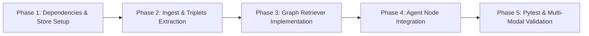

# EDRAK — Knowledge Graph & GraphRAG Integration Guide
## Architectural Feasibility, Design Patterns, and Implementation Runbook

> **Target Subsystem**: `backend/src/edrak/rag/`, `backend/src/edrak/connectors/`, & `backend/src/edrak/agents/internal_intelligence/`  
> **Applies to**: EDRAK Evidence-First Multi-Agent Architecture  
> **Status**: Design & Implementation Blueprint  

---

## 1. Executive Summary & Feasibility Assessment

### 1.1 Is It Applicable?
**Yes, highly applicable.** Integrating a **Knowledge Graph (KG)** or transitioning to **GraphRAG** addresses the fundamental operational limitations of vector-only similarity search in enterprise intelligence systems.

EDRAK already employs a **Tri-Modal Internal Intelligence** architecture (Vector RAG, Relational Text-to-SQL, and OpenAPI REST API) unified by the [`Evidence`](file:///d:/Courses/NTI%20-%20Agentic%20AI/Technical/Final%20project/Final/EDRAK/backend/src/edrak/contracts/evidence.py#L38-L70) contract. Adding or replacing the vector component with a Knowledge Graph natively fits into this contract with **zero downstream breaking changes** to the Verification Gate, Synthesis Agent, or Action Plan Generator.

---

### 1.2 Vector RAG vs. Knowledge Graph vs. Hybrid GraphRAG

```
┌─────────────────────────────────┬──────────────────────────────────┬──────────────────────────────────┐
│          Vector RAG             │        Pure Knowledge Graph      │       Hybrid GraphRAG (Ideal)    │
│          (ChromaDB)             │        (Neo4j / Kùzu)            │       (Graph + Vector Hybrid)    │
├─────────────────────────────────┼──────────────────────────────────┼──────────────────────────────────┤
│ • Best for fuzzy, semantic      │ • Best for multi-hop reasoning   │ • Combines semantic search with  │
│   text search across sentences. │   and deterministic relations.   │   deterministic entity paths.    │
│ • Blind to complex entity       │ • High precision on factual      │ • Answers both local facts and   │
│   relationships across docs.    │   relationships.                 │   broad thematic questions.      │
│ • Struggles with multi-hop      │ • Weak at broad, descriptive, or │ • Preserves rich narrative text  │
│   queries ("A -> B -> C").      │   nuanced conversational text.   │   alongside graph triplets.      │
│ • Ingestion is fast and cheap.  │ • Ingestion requires LLM triplet │ • Standard in high-assurance     │
│                                 │   extraction (higher cost).      │   enterprise intelligence.       │
└─────────────────────────────────┴──────────────────────────────────┴──────────────────────────────────┘
```

#### Why Pure Vector RAG Struggles:
1. **Multi-Hop Blind Spots**: Vector embeddings cannot connect indirect relationships across multiple documents (e.g., *"Which competitor acquired an entity that supplies our primary GPU vendor?"*).
2. **Entity & Relation Hallucination**: Vectors cluster by cosine similarity of text tokens, frequently conflating similar products or assuming incorrect relations between nearby words.
3. **Global Sensemaking Failure**: Vector similarity fails on corpus-wide aggregation (e.g., *"What are the primary strategic threats reported across all internal documents?"*), returning arbitrary nearest-neighbor samples.

#### Why Hybrid GraphRAG is Recommended for EDRAK:
Instead of deleting ChromaDB, implement **Hybrid GraphRAG**:
* Use **ChromaDB** for unstructured document chunk retrieval.
* Use a **Knowledge Graph (Neo4j or Kùzu)** for structured entity relationships, multi-hop traversals, and hierarchy mapping.
* Merge graph paths and text chunks into the universal [`Evidence`](file:///d:/Courses/NTI%20-%20Agentic%20AI/Technical/Final%20project/Final/EDRAK/backend/src/edrak/contracts/evidence.py#L38-L70) pool.

---

## 2. Target Architecture Flow

```
                               ┌────────────────────────────────────────────────────────┐
                               │      Internal Intelligence Worker (LangGraph)          │
                               └──────────────────────────┬─────────────────────────────┘
                                                          │
                  ┌────────────────────┬──────────────────┴─────────────────┬────────────────────┐
                  ▼                    ▼                                    ▼                    ▼
        ┌───────────────────┐┌───────────────────┐                ┌───────────────────┐┌───────────────────┐
        │  1. Vector Store  ││ 2. Knowledge Graph│                │ 3. Relational DB  ││  4. REST API      │
        │  (Unstructured)   ││ (Entities/Triples)│                │   (Text-to-SQL)   ││  (OpenAPI 3.x)    │
        └─────────┬─────────┘└─────────┬─────────┘                └─────────┬─────────┘└─────────┬─────────┘
                  │                    │                                    │                    │
               ChromaDB          Neo4j / Kùzu                            SQLAlchemy           httpx Client
          (Semantic Chunks)  (Subgraphs / Paths)                     (Tabular Metrics)   (Live Microservices)
                  │                    │                                    │                    │
                  └────────────────────┼────────────────────────────────────┴────────────────────┘
                                       ▼
                          ┌────────────────────────┐
                          │ Universal Evidence     │  • source_type: KNOWLEDGE_GRAPH
                          │ Contract (Typed Fact,  │  • excerpt: (Path / Triplet string)
                          │ Excerpt, Metadata)     │  • metadata: {"channel": "knowledge_graph"}
                          └────────────┬───────────┘
                                       ▼
                       Verification Gate & Cross-Signal Synthesis
```

---

## 3. Technology Selection: Neo4j vs. Kùzu

| Dimension | Neo4j (Community / Enterprise) | Kùzu (Embedded) |
| :--- | :--- | :--- |
| **Deployment Model** | Client-Server (Docker / Cloud / Desktop) | Embedded in-process (Like SQLite / DuckDB) |
| **Language** | Cypher (`MATCH (a)-[r]->(b)`) | Cypher dialect |
| **Setup Overhead** | Requires running container/service (`localhost:7687`) | `pip install kuzu` (Zero infrastructure) |
| **Best For** | Multi-user production deployments, enterprise visualization | Lightweight local testing, unit tests, standalone agents |

> **Recommendation**: Start with **Kùzu** for instant local development and CI testing, then connect to **Neo4j** if your deployment calls for a multi-user shared graph database.

---

## 4. Domain Ontology & Schema Design for EDRAK

For competitive and internal intelligence (e.g., NVIDIA, AI hardware, enterprise software), the graph schema defines explicit nodes and edges:

### 4.1 Node Labels
* `Company`: Organization or legal entity (e.g., `NVIDIA`, `AMD`, `Intel`).
* `Product`: Hardware, software, or service offering (e.g., `B200`, `GB200 NVL72`, `H100`).
* `Architecture`: Underlying technological architecture (e.g., `Blackwell`, `Hopper`, `CDNA3`).
* `MarketSegment`: Target vertical (e.g., `Hyperscale Cloud`, `Enterprise AI`, `Edge`).
* `FinancialMetric`: ASP, gross margin, ARR, unit shipments.
* `RiskFactor`: Supply bottleneck, regulatory restriction, export control.

### 4.2 Relationship Types
* `(:Company)-[:PRODUCES]->(:Product)`
* `(:Product)-[:BASED_ON]->(:Architecture)`
* `(:Product)-[:COMPETES_WITH]->(:Product)`
* `(:Product)-[:TARGETS]->(:MarketSegment)`
* `(:Product)-[:HAS_METRIC]->(:FinancialMetric)`
* `(:Product)-[:EXPOSED_TO]->(:RiskFactor)`
* `(:Company)-[:PARTNERS_WITH]->(:Company)`

---

## 5. Ingestion Pipeline: Documents to Graph Triples

Transforming raw documents into graph nodes and relationships uses an LLM-assisted entity-relation extraction pipeline.

### 5.1 Extraction Contract & LLM Prompt

```python
# backend/src/edrak/rag/graph_indexer.py
"""Graph Ingestion and Triplet Extraction Pipeline."""

from typing import Any, Dict, List
from pydantic import BaseModel, Field
from edrak.core.llm import get_json_object

class ExtractedEntity(BaseModel):
    id: str = Field(description="Unique entity identifier, normalized (e.g., 'B200')")
    label: str = Field(description="Node type: Company, Product, Architecture, MarketSegment, Metric, Risk")
    properties: Dict[str, Any] = Field(default_factory=dict)

class ExtractedRelation(BaseModel):
    source_id: str
    target_id: str
    relation_type: str = Field(description="COMPETES_WITH, BASED_ON, PRODUCES, TARGETS, PARTNERS_WITH")
    properties: Dict[str, Any] = Field(default_factory=dict)

class GraphExtractionResult(BaseModel):
    entities: List[ExtractedEntity]
    relations: List[ExtractedRelation]

GRAPH_EXTRACTION_SYSTEM_PROMPT = """
You are an expert enterprise knowledge graph engineer.
Extract structured entities and semantic relationships from the given enterprise document chunk.

Allowed Entity Labels:
- Company, Product, Architecture, MarketSegment, Metric, Risk

Allowed Relationship Types:
- PRODUCES, BASED_ON, COMPETES_WITH, TARGETS, HAS_METRIC, EXPOSED_TO, PARTNERS_WITH

Rules:
1. Normalize entity IDs (e.g., use 'NVIDIA' instead of 'Nvidia Corp', 'B200' instead of 'Blackwell B200 GPU').
2. Capture numeric facts (ASP, margins, memory bandwidth) in entity properties.
3. Return valid JSON matching the GraphExtractionResult schema.
"""

def extract_triplets_from_text(chunk_text: str) -> GraphExtractionResult:
    """Extracts typed entities and relationships from a text chunk."""
    raw = get_json_object(
        system_prompt=GRAPH_EXTRACTION_SYSTEM_PROMPT,
        user_prompt=f"Extract knowledge graph triples from this text:\n\n{chunk_text}",
        agent="internal",
        temperature=0.0,
    )
    return GraphExtractionResult.model_validate(raw)
```

---

## 6. Graph Retrieval Engine

Graph retrieval implements two core patterns:
1. **Neighborhood / Subgraph Traversal**: Given entities in a query, retrieve 1-hop and 2-hop connected subgraphs.
2. **Text-to-Cypher**: For explicit relational queries, generate and validate Cypher queries against schema guardrails.

### 6.1 Subgraph Retriever Implementation

```python
# backend/src/edrak/rag/graph_retriever.py
"""Knowledge Graph Retriever producing EDRAK typed Evidence."""

import logging
from typing import Any, Dict, List, Optional
import kuzu

from edrak.contracts.evidence import Evidence, SourceType
from edrak.core.config import settings

logger = logging.getLogger(__name__)

class KnowledgeGraphRetriever:
    """Retrieves relational subgraphs and transforms paths into EDRAK Evidence objects."""

    def __init__(self, db_path: Optional[str] = None):
        self.db_path = db_path or str(settings.BASE_DIR / "data" / "kuzu_graph")
        self.db = kuzu.Database(self.db_path)
        self.conn = kuzu.Connection(self.db)

    def retrieve_entity_neighborhood(
        self,
        entity_id: str,
        max_hops: int = 2,
        limit: int = 15,
    ) -> List[Evidence]:
        """Traverses the graph around entity_id and converts paths to Evidence."""
        query = f"""
        MATCH (a)-[r*1..{max_hops}]->(b)
        WHERE a.id = $entity_id
        RETURN a.id AS source, labels(a) AS source_type, 
               [rel IN r | type(rel)] AS relations, 
               b.id AS target, labels(b) AS target_type, 
               properties(b) AS target_props
        LIMIT $limit
        """
        try:
            result = self.conn.execute(query, {"entity_id": entity_id, "limit": limit})
        except Exception as e:
            logger.error("Failed executing graph traversal for entity %s: %s", entity_id, e)
            return []

        evidence_list: List[Evidence] = []
        while result.has_next():
            row = result.get_next()
            source = row[0]
            relations = " -> ".join(row[2])
            target = row[3]
            props = row[5]

            fact_str = f"Entity '{source}' connects via [{relations}] to '{target}'"
            excerpt_str = f"Graph Path: ({source}) -[{relations}]-> ({target}) with properties {props}"

            ev = Evidence(
                source_type=SourceType.INTERNAL_DOCUMENT,
                source_title=f"Knowledge Graph: {source} -> {target}",
                source_url=f"graph://{source}/{relations}/{target}",
                publisher="Enterprise Knowledge Graph",
                extracted_fact=fact_str,
                excerpt=excerpt_str,
                metadata={
                    "channel": "knowledge_graph",
                    "entity_id": entity_id,
                    "target_id": target,
                    "hops": len(row[2]),
                    "relevance_score": 0.92,
                },
            )
            evidence_list.append(ev)

        return evidence_list
```

---

## 7. Wiring Into EDRAK's Internal Intelligence Worker

### 7.1 Extend the Evidence Contract

In [`backend/src/edrak/contracts/evidence.py`](file:///d:/Courses/NTI%20-%20Agentic%20AI/Technical/Final%20project/Final/EDRAK/backend/src/edrak/contracts/evidence.py):

```python
class SourceType(str, Enum):
    # Existing types...
    INTERNAL_DOCUMENT = "internal_document"
    SYNTHETIC_INTERNAL = "synthetic_internal"
    KNOWLEDGE_GRAPH = "knowledge_graph"  # <--- Added
    OTHER = "other"
```

### 7.2 Update the Multi-Modal Retrieval Node

In [`backend/src/edrak/agents/internal_intelligence/nodes.py`](file:///d:/Courses/NTI%20-%20Agentic%20AI/Technical/Final%20project/Final/EDRAK/backend/src/edrak/agents/internal_intelligence/nodes.py#L91):

```python
# Inside retrieve_evidence_node(state: InternalAgentState):

    # 1. Vector RAG (ChromaDB)
    # ... existing vector retrieval ...

    # 2. Relational DB (SQL)
    # ... existing dynamic sql retrieval ...

    # 3. REST API (OpenAPI)
    # ... existing rest api retrieval ...

    # 4. Knowledge Graph Retrieval (GraphRAG)
    if getattr(settings, "ENABLE_KNOWLEDGE_GRAPH", False):
        try:
            from edrak.rag.graph_retriever import KnowledgeGraphRetriever
            kg_retriever = KnowledgeGraphRetriever()
            
            # Extract key entity mentions from queries or focus
            entity_candidates = extract_entities_from_queries(queries)
            for entity in entity_candidates:
                kg_evidence = kg_retriever.retrieve_entity_neighborhood(entity)
                candidates.extend(kg_evidence)
                
            logger.info("Knowledge Graph retrieval returned %d evidence items", len(kg_evidence))
        except Exception as e:
            logger.error("Error during Knowledge Graph retrieval: %s", e)
```

### 7.3 Priority Scoring in Evidence Reranking

In [`retrieve_evidence_node`](file:///d:/Courses/NTI%20-%20Agentic%20AI/Technical/Final%20project/Final/EDRAK/backend/src/edrak/agents/internal_intelligence/nodes.py#L158-L164), update `_score_candidate` to recognize the graph channel:

```python
    def _score_candidate(ev: Evidence) -> float:
        base_score = float(ev.metadata.get("relevance_score", 0.5))
        channel = ev.metadata.get("channel")
        
        # SQL, REST API, and Knowledge Graph paths are deterministic high-signal facts
        if channel in ("sql_database", "rest_api", "knowledge_graph"):
            return round(min(0.98, base_score + 0.12), 3)
```

---

## 8. Step-by-Step Implementation Roadmap



### Phase 1: Environment & Dependencies
1. Add `kuzu` (or `neo4j`) to `requirements.txt`:
   ```text
   kuzu>=0.4.0
   ```
2. Run installation:
   ```powershell
   .venv\Scripts\pip install kuzu
   ```

### Phase 2: Schema Initialization & Batch Ingestion
1. Define schema tables for nodes (`Company`, `Product`, etc.) and relationship tables in Kùzu.
2. Create script `scripts/build_knowledge_graph.py` to parse documents in `documents/` into Kùzu.

### Phase 3: Hybrid Retrieval Verification
1. Run a test script `scripts/test_graph_retrieval.py` testing entity neighborhood retrieval.
2. Confirm extracted outputs adhere to [`Evidence`](file:///d:/Courses/NTI%20-%20Agentic%20AI/Technical/Final%20project/Final/EDRAK/backend/src/edrak/contracts/evidence.py) model constraints.

### Phase 4: Integration with LangGraph Orchestrator
1. Enable `ENABLE_KNOWLEDGE_GRAPH = True` in `config.py`.
2. Run end-to-end multi-agent evaluation to verify that Verification Gate and Synthesis Nodes consume graph evidence alongside SQL and Vector evidence.

---

## 9. Summary & Recommendation

1. **Do not discard Vector RAG entirely.** Keep ChromaDB for broad narrative and semantic search.
2. **Adopt Hybrid GraphRAG.** Enrich ChromaDB search results with structured 1-hop and 2-hop entity paths from the Knowledge Graph.
3. **Use the Universal Evidence Contract.** Downstream agents (Synthesis, Verification, Executive Briefing) remain 100% stable because the Knowledge Graph serializes its outputs into standard EDRAK `Evidence` objects.

