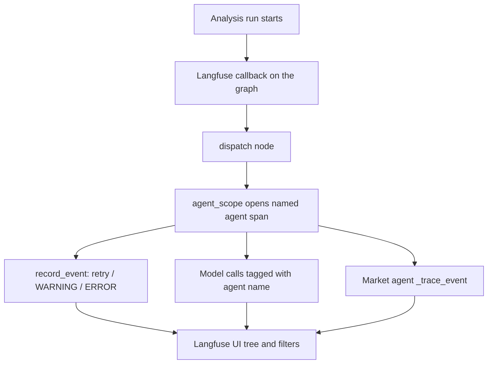

# Langfuse changes report

**Date:** 16–17 Nov 2026  
**Branches involved:** `feat/openrouter-provider`, `feat/optm-market` (market tracing merge)  
**Main commits:**
- `c17946b` — agent naming, event levels, retries across workers  
- `6b83657` — market intelligence Langfuse parity  

This report explains **what changed in Langfuse tracing**, **why**, and **where in the code**, in plain language first, then with the technical detail.

---

## In plain language (what you see in Langfuse now)

### Before
- A research run often looked like one big blob named **`dispatch`**.
- It was hard to tell which specialist (market, competitor, customers, verification, etc.) did what.
- Routine log lines and real problems were mixed; “warnings” were noisy.
- Retries (try again after a temporary glitch) were easy to miss.
- The market agent mostly wrote to local text logs only — those retries and failures did **not** show clearly in Langfuse.

### After
1. **Each specialist gets its own named section** in the Langfuse tree (for example `market_intelligence`, `verification`, `cross_signal`).
2. You can **filter a run by agent** using tags.
3. **Model calls are named after the agent**, not a generic “ChatOpenAI”.
4. **Events use clear severity:**
   - **DEFAULT** — retry / note (not a failure)
   - **WARNING** — only when a data provider is fully exhausted
   - **ERROR** — a real failure
5. **Ordinary chatty log lines stay out of Langfuse** (they still go to files / the live run screen). Only intentional events are sent.
6. The **market agent now reports retries, tool failures, and “all tools exhausted”** the same way as the other agents.

**What this is for:** debugging runs, seeing which agent struggled, and not confusing “tried again” with “broke”.

**What this is not:** it does not change research quality, options, or personalization by itself — it only improves **visibility**.

---

## High-level picture

---

## Change 1 — Name each agent clearly (`agent_scope` + labels)

### Plain language
Workers all go through one graph step called “dispatch”. Without help, Langfuse only showed that step. We now open a labeled “agent” box around each worker’s work so the tree says **who** ran.

### Code
**File:** [`backend/src/edrak/core/observability.py`](../backend/src/edrak/core/observability.py)

- `_CURRENT_AGENT` — remembers which agent owns the current work  
- `agent_label()` — maps short credential names (`market`) to full names (`market_intelligence`)  
- `agent_scope(agent)` — opens a Langfuse observation `as_type="agent"`, sets tags via `propagate_attributes`, and sets `_CURRENT_AGENT`

**Wired in:** [`backend/src/edrak/orchestration/nodes.py`](../backend/src/edrak/orchestration/nodes.py)

| Stage | Scope name |
|--------|------------|
| Each research worker | `task.worker.value` (e.g. `market_intelligence`) |
| Metrics | `metrics` |
| Verification | `verification` |
| Cross-signal | `cross_signal` |
| Decision analysis | `decision_analysis` |

On worker failure inside dispatch, an **ERROR** `record_event("failure", ...)` is also emitted.

---

## Change 2 — Intentional event levels (`record_event`)

### Plain language
Not every message is a problem. Retries are normal. “Provider exhausted” means we ran out of useful search/tool paths. Only true breakage is an error.

### Code
**File:** [`backend/src/edrak/core/observability.py`](../backend/src/edrak/core/observability.py) — `record_event(...)`

| Level | Meaning | Examples |
|--------|---------|----------|
| `DEFAULT` | Note / retry | LLM retry after 429; connection retry |
| `WARNING` | Provider exhausted | All search tools exhausted for a market task |
| `ERROR` | Real failure | Worker crashed; tool hard failure; structured call gave up |

Events are titled like `[market_intelligence] retry` and only attach if there is an active recording span.

**File:** [`backend/src/edrak/core/action_log.py`](../backend/src/edrak/core/action_log.py)

- Documented that **`log_action` does not auto-send to Langfuse**; only explicit `record_event` does.

---

## Change 3 — LLM retries and agent-named generations

### Plain language
When the model call fails temporarily (rate limit, timeout), the shared LLM client retries a few times and **writes each retry into Langfuse**. Each generation is labeled with the agent name so the tree stays readable.

### Code
**File:** [`backend/src/edrak/core/llm.py`](../backend/src/edrak/core/llm.py)

- `EdrakChat._config_for_agent` — prefers `current_agent()` from `agent_scope`, sets `run_name`, tags, and `langfuse_tags`
- `_record_retry` → `record_event("retry", level="DEFAULT", ...)`
- HTTP client retries disabled (`max_retries=0`); retries owned here so each attempt can be traced

**Customer trends (same idea):**  
[`backend/src/edrak/agents/customer_trends/llm/client.py`](../backend/src/edrak/agents/customer_trends/llm/client.py) — retries and invalid structured-output attempts call `record_event`.

**Customer trends tools:**  
[`backend/src/edrak/agents/customer_trends/tools/base.py`](../backend/src/edrak/agents/customer_trends/tools/base.py) — `_record_tool_issue`:

- `provider_exhausted` → WARNING  
- other failures → ERROR  
- budget stop → not recorded as failure  

**Verification:**  
[`backend/src/edrak/verification/nodes.py`](../backend/src/edrak/verification/nodes.py) — records failures via `record_event` where needed.

---

## Change 4 — Market agent Langfuse parity

### Plain language
The optimized market agent used to log retries and tool problems mostly to local logs. Those are now also sent to Langfuse with the same severity rules as the other agents.

### Code
**Commit:** `6b83657`  
**File:** [`backend/src/edrak/agents/market_intelligence/nodes.py`](../backend/src/edrak/agents/market_intelligence/nodes.py)

| Situation | Langfuse event | Level |
|-----------|----------------|-------|
| Structured LLM call fails, will retry | `retry` | DEFAULT |
| Structured LLM call fails for good | `failure` | ERROR |
| Search tool connection retry | `retry` | DEFAULT |
| Hard tool error | `failure` | ERROR |
| All search tools exhausted for a task | `provider_exhausted` | WARNING |

Helper: `_trace_event(...)` → `record_event(..., agent="market_intelligence")`.

> **Note:** This commit lives on the market / optm-market line (`6b83657`). If your current checkout is only `feat/openrouter-provider` without that merge, the market `_trace_event` code may not be on disk until that branch is merged in.

---

## Change 5 — Tests

**File:** [`tests/test_observability.py`](../tests/test_observability.py)

Updated/added coverage for:

- agent labels  
- event levels (WARNING vs ERROR vs DEFAULT)  
- that routine logging does not spam Langfuse  

---

## Related (same work window, not Langfuse UI)

These helped runs stay usable while tracing was improved, but are not Langfuse features themselves:

- API entry via `python -m edrak` with reload limited to `backend/src` and a short graceful shutdown so the site does not freeze on reload during long SSE runs (`main.py`, `__main__.py`, `scripts/run_api.ps1`).
- OpenRouter as the LLM provider (credentials and model config) — generations still appear in Langfuse through the same callback / agent tagging path.

---

## How to verify in Langfuse

1. Ensure `LANGFUSE_ENABLED=true` and keys/host point at your self-hosted instance.  
2. Restart the API.  
3. Run an analysis that includes market + at least one other worker.  
4. In Langfuse, open the trace and check:
   - Named **agent** spans (not only `dispatch`)  
   - Filter tags by agent name  
   - Retry events at DEFAULT; exhaustion at WARNING; hard failures at ERROR  
5. Force a market search failure (e.g. bad tool key) and confirm market events appear under `market_intelligence`.

---

## File checklist

| File | Role |
|------|------|
| `backend/src/edrak/core/observability.py` | Client, `agent_scope`, `record_event`, labels |
| `backend/src/edrak/core/llm.py` | Agent-named runs + retry events |
| `backend/src/edrak/core/action_log.py` | Langfuse only via `record_event` |
| `backend/src/edrak/orchestration/nodes.py` | Scopes around workers / metrics / verification / cross-signal / decision |
| `backend/src/edrak/agents/customer_trends/llm/client.py` | Retry / invalid-output events |
| `backend/src/edrak/agents/customer_trends/tools/base.py` | Tool WARNING / ERROR events |
| `backend/src/edrak/verification/nodes.py` | Verification failure events |
| `backend/src/edrak/agents/market_intelligence/nodes.py` | Market retries / failures / exhaustion |
| `tests/test_observability.py` | Automated checks |

---

## Bottom line

Langfuse went from “one opaque dispatch tree with noisy or missing signals” to **per-agent spans, filterable tags, agent-named model calls, and disciplined event levels**, with the **market agent brought in line** with the rest of the system.
