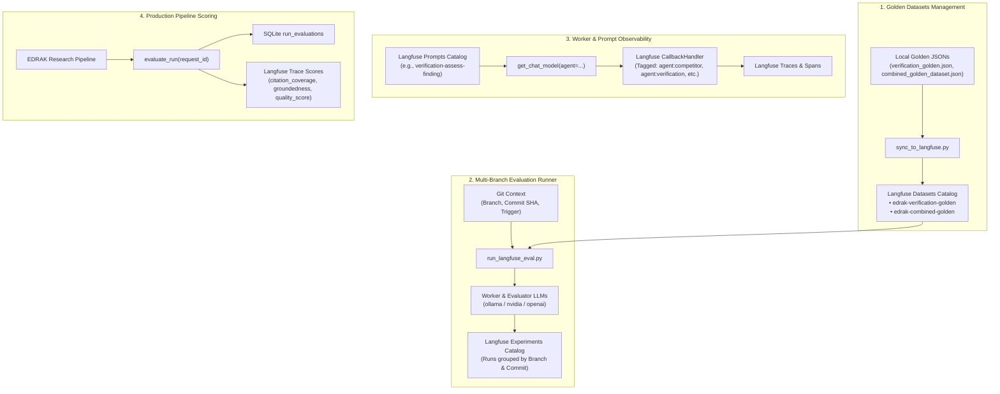

# EDRAK Langfuse Evaluation & Multi-Branch Observability Guide

**Date:** November 2026  
**Status:** Implemented & Verified  
**SDK Version:** `langfuse==5.1.0`  
**Host:** `http://localhost:3000` (or self-hosted / cloud instance)

---

## 1. Executive Summary

This document details the complete integration of **Evaluation & Dataset Observability** into Langfuse for the EDRAK platform. 

### What This Enables:
1. **Centralized Golden Dataset Management:** Manage, view, and update ground-truth datasets directly in the Langfuse UI (`edrak-verification-golden` and `edrak-combined-golden`).
2. **Worker & Judge LLM Observability:** Complete tracing of **every** worker LLM invocation (`competitor`, `market`, `internal`, `verification`, `customer_trends`, `orchestrator`), including prompt templates, compiled prompts, model parameters, temperature, latency, and token consumption.
3. **Cross-Branch Evaluation & Scheduling:** Compare evaluation benchmarks across multiple Git branches side-by-side in Langfuse with automated commit tagging, branch tracking, and run triggers (`manual`, `scheduled`, `ci`).
4. **Production Run Score Mirroring:** Real production runs automatically record and mirror evaluation metrics (`citation_coverage`, `groundedness`, `quality_score`, `internal_relevance`, etc.) directly into Langfuse trace scores.
5. **Offline & Resilient Execution:** Zero crashes or disruptions if Langfuse is unreachable or disabled; all pipelines gracefully fall back to local execution.

---

## 2. Architecture & Flow



---

## 3. Key Components Implemented

### 3.1 Dataset Synchronization (`backend/src/edrak/evaluation/langfuse_sync.py`)
- Reads local ground-truth files:
  - `Evaluation/verification_evaluation/verification_golden.json` (19 human-verified findings).
  - `Evaluation/golden/combined_golden_dataset.json` (22 multi-worker test cases).
- Synchronizes test items into Langfuse using `client.create_dataset()` and `client.create_dataset_item()`.
- Idempotent: Re-running updates items without duplicating datasets.
- **Convenience script:** `Evaluation/sync_to_langfuse.py`.

### 3.2 Worker & Judge LLM Tracing (`backend/src/edrak/core/llm.py` & `observability.py`)
- **Dual-Provider Compatibility:** Dynamic resolution between `ollama` (`OLLAMA_API_KEY`, `OLLAMA_BASE_URL`, `OLLAMA_MODEL`) and `nvidia` (`NVIDIA_API_KEY`, `NVIDIA_BASE_URL`, `NVIDIA_MODEL`).
- **Auto-Callback Attachment:** In `get_chat_model(agent=...)`, whenever observability is enabled, a `CallbackHandler` is automatically attached with `agent:{agent}` tags and `agent-{agent}` run names.
- **Prompt Linkage:** Prompts retrieved via `get_versioned_prompt()` register the active prompt in `contextvars`, linking subsequent model generations to the Langfuse Prompts catalog.

### 3.3 Evaluation Experiment Runner (`backend/src/edrak/evaluation/langfuse_runner.py`)
- Built on Langfuse v5's native `dataset.run_experiment()` and `client.run_experiment()`.
- **Git Context Detection:** Inspects current branch (`git rev-parse --abbrev-ref HEAD`) and commit (`git rev-parse --short HEAD`), with environment variable overrides (`GIT_BRANCH`, `GIT_COMMIT`).
- **Trigger Tagging:** Tags runs with `trigger: manual`, `trigger: scheduled`, or `trigger: ci`.
- **Evaluator Function:** Computes deterministic and heuristic scores returning `Evaluation(name=..., value=..., comment=...)`.
- **Convenience script:** `Evaluation/run_langfuse_eval.py`.

### 3.4 Production Score Mirroring (`backend/src/edrak/evaluation/run.py`)
- Extends `evaluate_run(request_id)`: After computing deterministic and LLM-judge metrics and committing them to SQLite, each metric is mirrored to Langfuse via `client.create_score(name=metric, value=value, trace_id=request_id)`.

---

## 4. How to Use: Step-by-Step Commands

### Step 1: Verify Environment & Langfuse Connection
Ensure your `.env` contains valid Langfuse credentials:
```env
LANGFUSE_ENABLED=true
LANGFUSE_PUBLIC_KEY=pk-lf-...
LANGFUSE_SECRET_KEY=sk-lf-...
LANGFUSE_HOST=http://localhost:3000
```

### Step 2: Sync Golden Datasets to Langfuse
Run the dataset sync command from the project root:

```powershell
# Sync verification golden dataset (19 test cases)
.venv\Scripts\python.exe Evaluation/sync_to_langfuse.py --dataset verification

# Sync combined multi-worker dataset (22 test cases across 4 workers)
.venv\Scripts\python.exe Evaluation/sync_to_langfuse.py --dataset combined

# Or sync both at once
.venv\Scripts\python.exe Evaluation/sync_to_langfuse.py --dataset all
```

### Step 3: Run Evaluation Experiments

#### A. Manual Evaluation on Current Branch
```powershell
.venv\Scripts\python.exe Evaluation/run_langfuse_eval.py --dataset verification
```

#### B. Evaluating a Specific Feature Branch
```powershell
.venv\Scripts\python.exe Evaluation/run_langfuse_eval.py --dataset verification --branch feature/improved-rag
```

#### C. Scheduled / CI Run
```powershell
.venv\Scripts\python.exe Evaluation/run_langfuse_eval.py --dataset verification --trigger scheduled
```

#### D. Worker Rubric Evaluation
```powershell
.venv\Scripts\python.exe Evaluation/run_langfuse_eval.py --dataset combined --worker competitor_intelligence
```

---

## 5. Viewing & Comparing in the Langfuse UI

### 1. Datasets Catalog (`/datasets`)
- Open `http://localhost:3000/project/<project_id>/datasets`.
- You will see:
  - `edrak-verification-golden`
  - `edrak-combined-golden`
- Click on any dataset to view:
  - Ground-truth inputs (claim statement, source excerpts, scope notes).
  - Expected outputs (verified vs insufficient, reasons, target evidence IDs).

### 2. Experiments & Cross-Branch Comparisons (`/datasets/<dataset_name>/runs`)
- Under the dataset, click the **Experiments / Runs** tab.
- Each experiment displays:
  - **Run Name:** e.g., `eval-verification-feat/GraphRAG_versio-540d788-manual-20261117-180426`.
  - **Git Branch:** Filter or group runs by `git_branch`.
  - **Commit SHA:** Directly maps the score back to code changes.
  - **Trigger:** Compare `manual` vs `scheduled` vs `ci`.
  - **Score Metrics:** `accuracy`, `verified_class_hit`, `insufficient_class_hit`.
- **Side-by-Side Comparison:** Select multiple runs (e.g., `main` vs `feat/GraphRAG_version`) to see item-by-item score deltas and regressions.

### 3. Worker LLM Calls & Prompts (`/traces`)
- Open the **Traces** tab.
- Filter by tag:
  - `agent:competitor`
  - `agent:market`
  - `agent:verification`
  - `agent:orchestrator`
- Click any trace to inspect:
  - **Exact Prompt:** System prompt and user message sent to the LLM.
  - **Model & Parameters:** E.g., `gpt-oss:120b`, temperature `0.0`.
  - **Token Counts & Latency:** Total tokens, completion tokens, execution time.

### 4. Production Trace Scores (`/scores`)
- Live user queries and pipeline runs will have attached scores visible under the **Scores** tab and inside the trace view:
  - `quality_score`
  - `citation_coverage`
  - `groundedness`
  - `evidence_quality_high`
  - `source_diversity`
  - `internal_relevance`

---

## 6. Automating Scheduled Evaluations (CI / Cron)

To run daily or weekly evaluation benchmarks automatically, you can add a simple GitHub Action or cron task:

```yaml
# Example: .github/workflows/langfuse_eval.yml
name: Scheduled Langfuse Evaluation
on:
  schedule:
    - cron: '0 2 * * *' # Every night at 02:00 UTC
  workflow_dispatch:

jobs:
  evaluate:
    runs-on: ubuntu-latest
    steps:
      - uses: actions/checkout@v4
      - name: Set up Python
        uses: actions/setup-python@v5
        with:
          python-version: '3.11'
      - name: Install dependencies
        run: pip install -e .
      - name: Run Langfuse Evaluation
        env:
          LANGFUSE_ENABLED: "true"
          LANGFUSE_PUBLIC_KEY: ${{ secrets.LANGFUSE_PUBLIC_KEY }}
          LANGFUSE_SECRET_KEY: ${{ secrets.LANGFUSE_SECRET_KEY }}
          LANGFUSE_HOST: ${{ secrets.LANGFUSE_HOST }}
          OLLAMA_API_KEY: ${{ secrets.OLLAMA_API_KEY }}
          GIT_BRANCH: ${{ github.ref_name }}
          GIT_COMMIT: ${{ github.sha }}
        run: |
          python Evaluation/run_langfuse_eval.py --dataset verification --trigger scheduled
```

---

## 7. Summary of Files Changed

| File Path | Description |
|---|---|
| [backend/src/edrak/core/llm.py](file:///d:/Courses/NTI%20-%20Agentic%20AI/Technical/Final%20project/Final/EDRAK/backend/src/edrak/core/llm.py) | Dual-provider support (Ollama & NVIDIA), auto-attached Langfuse CallbackHandler with agent tagging. |
| [backend/src/edrak/core/observability.py](file:///d:/Courses/NTI%20-%20Agentic%20AI/Technical/Final%20project/Final/EDRAK/backend/src/edrak/core/observability.py) | Prompt client contextvars, offline fallback, safe template formatting, flush utility. |
| [backend/src/edrak/evaluation/langfuse_sync.py](file:///d:/Courses/NTI%20-%20Agentic%20AI/Technical/Final%20project/Final/EDRAK/backend/src/edrak/evaluation/langfuse_sync.py) | Synchronizes `verification_golden.json` and `combined_golden_dataset.json` to Langfuse. |
| [backend/src/edrak/evaluation/langfuse_runner.py](file:///d:/Courses/NTI%20-%20Agentic%20AI/Technical/Final%20project/Final/EDRAK/backend/src/edrak/evaluation/langfuse_runner.py) | Multi-branch experiment runner with Git metadata, evaluators, and dataset tracking. |
| [backend/src/edrak/evaluation/run.py](file:///d:/Courses/NTI%20-%20Agentic%20AI/Technical/Final%20project/Final/EDRAK/backend/src/edrak/evaluation/run.py) | Mirrors computed production metrics directly to Langfuse trace scores. |
| [Evaluation/sync_to_langfuse.py](file:///d:/Courses/NTI%20-%20Agentic%20AI/Technical/Final%20project/Final/EDRAK/Evaluation/sync_to_langfuse.py) | Root CLI convenience script for dataset syncing. |
| [Evaluation/run_langfuse_eval.py](file:///d:/Courses/NTI%20-%20Agentic%20AI/Technical/Final%20project/Final/EDRAK/Evaluation/run_langfuse_eval.py) | Root CLI convenience script for running branch/scheduled evaluations. |
| [backend/tests/test_langfuse_eval.py](file:///d:/Courses/NTI%20-%20Agentic%20AI/Technical/Final%20project/Final/EDRAK/backend/tests/test_langfuse_eval.py) | Automated test suite validating prompt fallback, Git context, and evaluators. |
